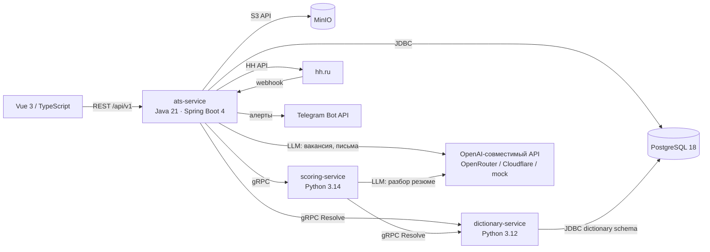

# Tracing ATS — объяснимый подбор «резюме ↔ вакансия»

## Аннотация

**Tracing ATS** — сервис объяснимого сопоставления резюме и вакансий. Он разбирает вакансию на атомарные требования, ищет в резюме дословные подтверждения, считает детерминированный балл и показывает не только рейтинг, но и причины: что закрыто, что частично, где пробел и что стоит уточнить у кандидата. Система работает в двух режимах — от резюме к вакансиям и от вакансии к пачке резюме; LLM извлекает факты и цитаты, но не выставляет оценку, а финальное решение остаётся за человеком.

## Содержание

1. [Быстрый запуск](#1-быстрый-запуск)
2. [Архитектура](#2-архитектура)
3. [Конфигурация `.env`](#3-конфигурация-env)
4. [Roadmap](#4-roadmap)
5. [Документация](#5-документация)

---

## 1. Быстрый запуск

### 1.1. Требования

| Компонент | Минимум |
|---|---|
| Docker Engine / Compose | 24+ / v2 |
| RAM / свободный диск | 8 ГБ / 10 ГБ |
| Свободные порты | `3000`, `5432`, `8080`, `8082`, `8084`, `9000`, `9001`, `9090` |
| Локальная разработка | Java 21, Gradle 9.8.2, Node 24, Python 3.14 + `uv`, Python 3.12 |

### 1.2. Запуск

```bash
cp .env.example .env
# Для демо без ключей:
export ATS_PROFILES=mock-llm
export SCORING_SERVICE_LLM_PROVIDER=mock

docker compose up -d --build
docker compose ps
```

Схему накатывает контейнер `migrations`; `ats-service` не создаёт таблицы сам.

### 1.3. Адреса

| Что | Адрес |
|---|---|
| UI | <http://localhost:3000> |
| REST API / Swagger | <http://localhost:8080/api/v1> / <http://localhost:8080/swagger-ui/index.html> |
| `ats-service` gRPC | `localhost:9090` |
| `scoring-service` gRPC | `localhost:8082` |
| `dictionary-service` gRPC | `localhost:8084` |
| PostgreSQL / MinIO | `localhost:5432` / <http://localhost:9000> |
| `mock-llm` / `mock-scoring` / `mock-hh` | `8089` / `8083` / `8090` |

### 1.4. Остановка

```bash
docker compose down
# Удалить также данные PostgreSQL и MinIO:
docker compose down -v
```

### 1.5. Демо и mock

```bash
docker compose up -d --build
./scripts/demo-skill-dictionary.sh
```

- `ATS_PROFILES=mock-llm` — `ats-service` ходит в `infra/mock-llm`.
- `SCORING_SERVICE_LLM_PROVIDER=mock` — скоринг без сети (по умолчанию).
- `docker compose --profile mock-scoring up` — заглушка скоринга.
- `docker compose --profile mock-hh up` — заглушка hh.ru.

### 1.6. hh и Telegram

hh и Telegram опциональны. Для мока: `docker compose --profile mock-hh up -d --build` и `./scripts/demo-hh-flow.sh`; переменные — в разделе 3, детали — [`infra/mock-hh/README.md`](infra/mock-hh/README.md) и [`docs/adr/0007-hh-webhook-integration.md`](docs/adr/0007-hh-webhook-integration.md). Без `ATS_TELEGRAM_*` алерты не отправляются.

---

## 2. Архитектура

### 2.1. Схема



### 2.2. Сервисы

| Компонент | Технологии | Ответственность |
|---|---|---|
| `frontend` | Vue 3, TypeScript, Vite, Tailwind | Вакансии, резюме, словарь, отчёты, письма |
| `ats-service` | Java 21, Spring Boot 4, JPA, Spring gRPC | REST, I/O, PII, оркестрация, hh, отчёты, аудит |
| `scoring-service` | Python 3.14, uv, gRPC, Pydantic | Разбор обезличенного резюме, математика и объяснения; stateless |
| `dictionary-service` | Python 3.12, gRPC, pymorphy3, PostgreSQL | Нормализация навыков, алиасы, очередь NEW, квалификации, связи |
| `text-extraction` | Java-библиотека | PDF, DOCX, TXT, MD → нормализованный текст |
| `migrations` | Liquibase | Схема `public` и `dictionary`, seed |
| `PostgreSQL` / `MinIO` | PostgreSQL 18 / S3-совместимое | Доменные данные, оригиналы резюме, артефакты |
| `infra/mock-llm`, `mock-scoring-service`, `mock-hh` | Python / Rust | Демо и CI без внешних ключей и hh |

### 2.3. Границы

- **Java** читает файлы, ходит в PostgreSQL, MinIO, hh и LLM для вакансии и писем, маскирует PII и оркестрирует сценарии.
- **`scoring-service`** получает только обезличенный текст и структурированные требования; не читает БД, файлы и не получает PII.
- **`dictionary-service`** не вызывает LLM и не считает `S^{ij}`; отдаёт канонические ключи, алиасы и классы связей.
- **`ats-service`** не дублирует арифметику скоринга.
- **Человек решает:** автоматических отказов и приглашений нет; письма кандидату — только черновики.

### 2.4. Потоки данных

**Резюме → вакансии:** загрузка → извлечение текста → маскировка PII → `ExtractResume` (LLM) → `resume_extraction` → `EvaluateResumeMatches` (без LLM) → `score_run` → рейтинг и отчёт.

**Вакансия → кандидаты:** создание вакансии → LLM-шаблон → правка HR → загрузка резюме → `ExtractResume` + `EvaluateResumeMatch` → `score_run(PRELIMINARY)` → скрининг → `score_run(FINAL)` → рейтинг, отчёт, письмо.

Сейчас `FINAL` переиспользует факты `PRELIMINARY`: в контракте нет `Refine`.

### 2.5. Скоринг v0

| Элемент | Реализация |
|---|---|
| `S` для навыков | Точный `skill_id`/ключ — `1.0`; связи: `SAME_GROUP`/`RELATED` `0.7`, `PARENT` `0.6`, `CHILD` `0.5`; иначе `0` |
| `S` для квалификаций | Бинарно по каноническому ключу |
| `S` для образования | `0.7 · направление + 0.3 · уровень` |
| `S` для опыта / текста | Сходство категории / доля значимых токенов в лучшей строке |
| `t` | Regex: результат `0.8`, обязанность `0.5`, остальное `0.3` |
| `τ` | `0.5 · (1 + tanh(years/required − 1)) · 2^(−recency/2)`; `recency` пока не извлекается |
| `c` | Навык `S·t·τ`, опыт `S·τ`, образование/текст `S`, квалификация `1.0` |
| `Score` | Взвешенное покрытие; `λ=0`, `F=0`, `𝓜=1`; в Python `0..1`, в API/БД `0..100` |

Формулы и открытые вопросы — [`docs/rfc/rfc-scoring-model.md`](docs/rfc/rfc-scoring-model.md). Критичность входит в `Wv`, отдельного cap нет.

### 2.6. Приватность

- PII маскируется до LLM: regex + опциональная локальная ONNX NER.
- PII хранится в AES-256-GCM `pii_vault`; `parsed_resume` и `masked_text` PII не содержат.
- `reveal` требует причину и пишет аудит; в отчёте `blind=true`.
- Prompt injection удаляется детерминированно; флаги не содержат исходного текста.
- По умолчанию `ATS_PII_NER_PROVIDER=fake`: имена не маскируются, только regex-PII. Для реальных данных нужна ONNX-модель.

---

## 3. Конфигурация `.env`

Полный пример для локального запуска и моделей. Значения по умолчанию можно переопределить в `.env`.

```dotenv
# ── Профили, порты, UI ───────────────────────────────────────────────
ATS_PROFILES=
FRONTEND_PORT=3000
ATS_SERVICE_PORT=8080
ATS_GRPC_PORT=9090
SCORING_SERVICE_PORT=8082
DICTIONARY_SERVICE_PORT=8084
MOCK_SCORING_PORT=8083
MOCK_LLM_PORT=8089
MOCK_HH_PORT=8090
POSTGRES_PORT=5432
MINIO_PORT=9000
MINIO_CONSOLE_PORT=9001
# ── PostgreSQL и S3 ──────────────────────────────────────────────────
POSTGRES_DB=ats
POSTGRES_USER=ats
POSTGRES_PASSWORD=ats
SPRING_DATASOURCE_URL=jdbc:postgresql://postgres:5432/ats
SPRING_DATASOURCE_USERNAME=ats
SPRING_DATASOURCE_PASSWORD=ats
ATS_STORAGE_TYPE=s3
ATS_S3_ENDPOINT=http://minio:9000
ATS_S3_ACCESS_KEY=minioadmin
ATS_S3_SECRET_KEY=minioadmin
ATS_S3_BUCKET=ats-resumes
ATS_S3_REGION=us-east-1

# ── Приватность и NER ────────────────────────────────────────────────
# Base64 32-байтного AES-256 ключа; для production задайте свой.
ATS_PII_ENCRYPTION_KEY=
ATS_PII_KEY_VERSION=v1
ATS_PII_NER_PROVIDER=fake
ATS_PII_NER_MODEL_PATH=/models/ner/model.onnx
ATS_PII_NER_TOKENIZER_PATH=/models/ner/tokenizer.json
ATS_PII_NER_CONFIG_PATH=/models/ner/config.json
ATS_PII_NER_THRESHOLD=0.85
ATS_PII_NER_FAIL_CLOSED=true

# ── LLM для ats-service: вакансия, словарь, письма ───────────────────
OPENROUTER_API_KEY=
VACANCY_LLM_BASE_URL=https://openrouter.ai/api/v1
VACANCY_LLM_API_KEY=
VACANCY_LLM_MODEL=dots-studio/dots-3-note-preview:free

# ── LLM для scoring-service: разбор резюме ───────────────────────────
SCORING_SERVICE_LLM_PROVIDER=mock
SCORING_SERVICE_LLM_BASE_URL=https://openrouter.ai/api/v1
SCORING_SERVICE_LLM_API_KEY=
SCORING_SERVICE_LLM_MODEL=
SCORING_SERVICE_LLM_TIMEOUT_SECONDS=30
SCORING_SERVICE_LLM_MAX_RETRIES=1
SCORING_SERVICE_LLM_MAX_OUTPUT_TOKENS=4096

# ── Fallback Cloudflare Workers AI ────────────────────────────────────
CLOUDFLARE_AI_ENABLED=false
CLOUDFLARE_AI_BASE_URL=
CLOUDFLARE_AI_API_TOKEN=
CLOUDFLARE_AI_MODEL=@cf/qwen/qwen3.8-27b
CLOUDFLARE_AI_REASONING_EFFORT=low

# ── Скоринг, словарь, screening ──────────────────────────────────────
SCORING_GRPC_TARGET=scoring-service:8082
ATS_SCORING_DEADLINE=600s
ATS_RESUME_MATCH_BATCH_SIZE=3
ATS_SCORING_WORKERS=4
ATS_SCORING_QUEUE_CAPACITY=1000
SCORING_SERVICE_TENURE_WEIGHT=0.1
SCORING_SERVICE_SKILL_FULL_COVERAGE=0.70
SCORING_SERVICE_IGNORE_INVALID_QUOTES=false
DICTIONARY_GRPC_TARGET=dictionary-service:8084
ATS_DICTIONARY_ENABLED=true
DICTIONARY_SERVICE_TOKEN=
DICTIONARY_SUGGESTION_THRESHOLD=0.6
DICTIONARY_MAX_BATCH=2000
SCORING_SERVICE_DICTIONARY_ENABLED=true
SCORING_SERVICE_DICTIONARY_TARGET=dictionary-service:8084
SCORING_SERVICE_DICTIONARY_DEADLINE_SECONDS=2
SCORING_SERVICE_DICTIONARY_AS_OF_VERSION=
ATS_SCREENING_WORKERS=2
ATS_SCREENING_SCORING_WAIT=2m
ATS_SCREENING_SCORING_POLL=500ms
ATS_SCREENING_THRESHOLD=50
ATS_SCREENING_TOP_N=10
ATS_SCREENING_BORDERLINE_MARGIN=5

# ── hh.ru ────────────────────────────────────────────────────────────
ATS_HH_ENABLED=false
ATS_HH_API_BASE_URL=https://api.hh.ru
ATS_HH_TOKEN=
ATS_HH_EMPLOYER_ID=
ATS_HH_WEBHOOK_TOKEN=
ATS_HH_WEBHOOK_PUBLIC_URL=
ATS_HH_SUBSCRIPTION_ID=
ATS_HH_USER_AGENT=tracing-ats/0.1 (ats@example.com)
ATS_HH_DEFAULT_AREA=1
ATS_HH_DEFAULT_EXPERIENCE=between1And3
ATS_HH_DEFAULT_EMPLOYMENT_FORM=FULL
ATS_HH_DEFAULT_SCHEDULE=fullDay
ATS_HH_DEFAULT_PROFESSIONAL_ROLE=96
ATS_HH_TIMEOUT=10s
ATS_HH_MAX_ATTEMPTS=3
ATS_HH_RETRY_DELAY=2s
MOCK_HH_PUBLIC_URL=http://localhost:8090

# ── Telegram ─────────────────────────────────────────────────────────
ATS_TELEGRAM_ENABLED=false
ATS_TELEGRAM_BOT_TOKEN=
ATS_TELEGRAM_CHAT_ID=
ATS_TELEGRAM_BASE_URL=https://api.telegram.org
ATS_TELEGRAM_TIMEOUT=10s
ATS_TELEGRAM_MAX_ATTEMPTS=3
ATS_TELEGRAM_RETRY_DELAY=30s
ATS_TELEGRAM_POLL_INTERVAL=5s
ATS_FRONTEND_BASE_URL=http://localhost:3000
```

Служебные mock-переменные и порты контейнеров — в [`.env.example`](.env.example).

Особенности: `ATS_SCREENING_*` пока не привязываются к политике (используются defaults); `DICTIONARY_SERVICE_TOKEN` загружается, но не проверяется. Для реальной модели задайте `SCORING_SERVICE_LLM_PROVIDER=openai`, base URL и модель.

---

## 4. Roadmap

- **Отраслевой стандарт объяснимой оценки:** публичная методология, аудит каждого решения, понятный отчёт для кандидата и нанимающего менеджера.
- **Полный цикл найма:** hh, Telegram, календарь интервью, заметки, оффер и обратная связь кандидату в одном контуре.
- **Обучение на решениях HR:** размеченные исходы, калибровка весов и порогов, профили под специализации и уровни без потери объяснимости.
- **Все профессии и языки:** словарь, квалификации и доменные признаки за пределами IT; мультиязычные резюме и вакансии.
- **Независимые подтверждения:** портфолио, публикации, сертификаты и открытые профили — только повышение покрытия, без штрафа за отсутствие.
- **Приватность как преимущество:** локальные модели, on-prem, шифрование PII и доказуемое отсутствие утечек.

---

## 5. Документация

- [`TASK.md`](TASK.md) — продуктовые требования; [`AGENTS.md`](AGENTS.md) — правила для AI-агента.
- [`docs/README.md`](docs/README.md) — индекс; [`docs/service-overview.md`](docs/service-overview.md) — архитектура и сценарии.
- [`docs/resume-pipeline.md`](docs/resume-pipeline.md) — пайплайн резюме; [`docs/data-model.md`](docs/data-model.md) — данные.
- [`docs/rfc/rfc-scoring-model.md`](docs/rfc/rfc-scoring-model.md) — формулы и открытые вопросы.
- [`docs/known-issues.md`](docs/known-issues.md) — известные расхождения; [`docs/deploy-vps.md`](docs/deploy-vps.md) — деплой.
- [`docs/adr/`](docs/adr/) — архитектурные решения.
