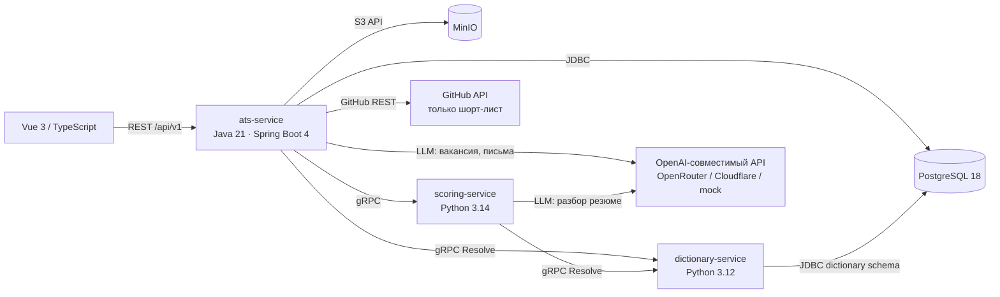

# Tracing ATS — объяснимое сопоставление резюме и вакансий

Сервис сопоставляет резюме кандидата с требованиями вакансии и объясняет результат по каждому требованию: что подтверждено, чего не хватает и что стоит уточнить у кандидата. Продуктовые требования и критерии приёмки — в [`TASK.md`](TASK.md); этот README описывает текущую реализацию, запуск и границы.

Система работает в двух направлениях:

- **резюме → вакансии** — основной сценарий `TASK.md`: загрузить резюме, получить рейтинг вакансий и отчёт по каждой паре;
- **вакансия → кандидаты** — обратный сценарий: собрать шаблон требований, загрузить пачку резюме, получить рейтинг кандидатов и отчёт для HR.

В обоих случаях результат — таблица «требование → подтверждение в резюме → статус → комментарий», а не одно число без объяснения.

---

## 1. Что уже работает

| Блок | Состояние |
|---|---|
| Загрузка PDF, DOCX, TXT, MD | Готово: определение типа по сигнатуре, лимиты, ошибки |
| Маскировка PII и vault | Готово: regex + опциональная ONNX NER, AES-256-GCM, reveal с аудитом |
| Вакансия и шаблон требований через LLM | Готово: `MUST`/`NICE`/`OPTIONAL`, цитаты, советы по расплывчатым формулировкам |
| Словарь навыков и квалификаций | Готово: `dictionary-service`, алиасы, очередь NEW, связи, админка |
| Разбор резюме через LLM | Готово: навыки, квалификации, образование, опыт, цитаты |
| Предварительный скоринг | Готово: детерминированная модель v0, вилка, матрица требований |
| Обратный подбор «вакансии под резюме» | Готово: `ExtractResume` + `EvaluateResumeMatches` |
| Шорт-лист и рейтинг | Готово: порог, top-N, borderline; политика в Java |
| Отчёт «требование → доказательство → пробел» | Готово: JSON, статусы, цитаты, пробелы |
| Сильные стороны, риски, вопросы, рекомендация | Готово: детерминированный `feedback-templates.v2` |
| GitHub-обогащение | Частично: факты собираются для шорт-листа и показываются в отчёте, но пока не меняют `Score` |
| Черновики писем кандидату | Готово: API и блок «Письмо» в окне решения; приглашение и отказ, без автоотправки |
| Авторизация, hh, PDF-отчёт, `ml-trainer`, профили весов | Не реализовано; см. раздел 12 |

---

## 2. Быстрый запуск

### Требования

- Docker Engine 24+ и Docker Compose v2.
- Не менее 8 ГБ RAM и 10 ГБ свободного диска.
- Для локальной разработки без Docker: Java 21, Node.js 24, Python 3.14 для `scoring-service`, Python 3.12 для `dictionary-service`, `uv`, Gradle 9.8.2.

### Запуск всего стека

```bash
cp .env.example .env
# Для демо без ключей:
export ATS_PROFILES=mock-llm
# scoring-service по умолчанию использует mock; для реальной модели:
# export SCORING_SERVICE_LLM_PROVIDER=openai
# export SCORING_SERVICE_LLM_MODEL=<model>
# export OPENROUTER_API_KEY=<key>

docker compose up -d --build
docker compose ps
```

Схему базы накатывает отдельный контейнер `migrations`; `ats-service` не создаёт таблицы сам.

### Адреса

| Что | Адрес |
|---|---|
| UI | <http://localhost:3000> |
| REST API | <http://localhost:8080/api/v1> |
| Swagger UI | <http://localhost:8080/swagger-ui/index.html> |
| OpenAPI JSON | <http://localhost:8080/v3/api-docs> |
| `ats-service` gRPC | `localhost:9090` |
| `scoring-service` gRPC | `localhost:8082` |
| `dictionary-service` gRPC | `localhost:8084` |
| MinIO API / консоль | <http://localhost:9000> / <http://localhost:9001> |

### Демо

```bash
./scripts/demo-skill-dictionary.sh
```

Сценарий создаёт вакансию, показывает очередь словаря, загружает синтетическое резюме и печатает рейтинг и отчёт. Описание — [`docs/demo-skill-dictionary.md`](docs/demo-skill-dictionary.md).

## Быстрый запуск демо hh.ru

```bash
export ATS_HH_ENABLED=true
export ATS_HH_API_BASE_URL=http://mock-hh:8090
export ATS_HH_TOKEN=mock-token
export ATS_HH_EMPLOYER_ID=999
export ATS_HH_WEBHOOK_TOKEN=mock-hh-token
export ATS_HH_WEBHOOK_PUBLIC_URL='http://ats-service:8080/api/v1/integrations/hh/webhook?token=mock-hh-token'
export SCORING_GRPC_TARGET=mock-scoring:8082
export ATS_PROFILES=mock-llm
docker compose --profile mock-hh --profile mock-scoring up -d --build
./scripts/demo-hh-flow.sh
```

Mock hh.ru написан на Rust + Axum (`infra/mock-hh`). Он эмулирует черновик, публикацию,
подписку, выдачу резюме и вебхук `NEW_NEGOTIATION_VACANCY`. У заглушки есть свой HTML-фронтенд:
`http://localhost:8090` — список вакансий и кнопка «Отправить отклик». Ссылка «Открыть на hh.ru»
в ATS ведёт именно туда. Подробности — в `infra/mock-hh/README.md` и
`docs/adr/0007-hh-webhook-integration.md`.

Для Telegram-алертов нужен токен бота и chat id:

```bash
export ATS_TELEGRAM_ENABLED=true
export ATS_TELEGRAM_BOT_TOKEN='<токен из @BotFather>'
export ATS_TELEGRAM_CHAT_ID='<id чата>'
./scripts/telegram-check.sh
```

Без токена и chat id алерты не отправляются: `ats-service` работает штатно, но
`notification_outbox` не пополняется.

---

### Остановка

```bash
docker compose down
# Удалить также данные PostgreSQL и MinIO:
docker compose down -v
```

### Профили и заглушки

- `ATS_PROFILES=mock-llm` — `ats-service` ходит в `infra/mock-llm` вместо внешней модели.
- `SCORING_SERVICE_LLM_PROVIDER=mock` — `scoring-service` не ходит в сеть; это значение по умолчанию.
- `docker compose --profile mock-scoring up` — поднимает `infra/mock-scoring-service` вместо реального скоринга; `SCORING_GRPC_TARGET=mock-scoring:8082`.

---

## 3. Архитектура



### Сервисы

| Сервис | Технологии | Ответственность |
|---|---|---|
| `frontend` | Vue 3, TypeScript, Vite, Tailwind | Вакансии, резюме, словарь, отчёты |
| `ats-service` | Java 21, Spring Boot 4, Gradle | REST, домен, PostgreSQL, MinIO, PII, оркестрация, GitHub, LLM для вакансии и писем |
| `scoring-service` | Python 3.14, gRPC, Pydantic | Разбор обезличенного резюме через LLM, детерминированное сопоставление и скоринг; stateless |
| `dictionary-service` | Python 3.12, gRPC, PostgreSQL | Нормализация навыков и квалификаций, алиасы, очередь NEW, связи |
| `text-extraction` | Java-библиотека | PDF, DOCX, TXT, MD → нормализованный текст |
| `migrations` | Liquibase | Схема `public` и `dictionary`, seed |
| `infra/mock-llm` | Python stdlib | OpenAI-совместимая заглушка для демо и тестов |
| `infra/mock-scoring-service` | Python 3.14 | Детерминированная gRPC-заглушка скоринга |

### Границы

- **Java** читает файлы, ходит в PostgreSQL, MinIO, GitHub и LLM для вакансии и писем, маскирует PII и оркестрирует сценарии.
- **`scoring-service`** получает только обезличенный текст и структурированные требования. Он не читает файлы, не ходит в БД, MinIO, GitHub и не получает PII. LLM он вызывает только для извлечения признаков резюме.
- **`dictionary-service`** не вызывает LLM и не знает про скоринг. Он отдаёт канонические идентификаторы, ключи и классы связей; числа `S^{ij}` считает `scoring-service`.
- **`ats-service`** не дублирует арифметику скоринга.

### Интеграция с hh.ru

```text
HR подтверждает шаблон
  → POST /vacancies/{id}/hh-publication
  → HH: черновик → публикация
  → vacancy_hh_publication: hh_vacancy_id → vacancy_id
  → HH: подписка NEW_NEGOTIATION_VACANCY

HH webhook (vacancy_id, resume_id, topic_id)
  → hh_webhook_event (идемпотентно)
  → привязка по hh_vacancy_id
  → GET /resumes/{resume_id}
  → только профессиональный текст
  → маскировка → parsed_resume → application (source=HH)
  → Score_pre по одной вакансии
  → notification_outbox → Telegram
```

- Сопоставление только по `hh_vacancy_id`. Название и URL не используются как ключ.
- Отдельный одиночный пайплайн: `ScreeningService` и top-N не вызываются, `screening_decision` остаётся пустым.
- `Score_final` не считается: внешних источников в этом сценарии нет.
- Несвязанная hh-вакансия → `UNMATCHED` + алерт, без автосоздания вакансии.
- Telegram-сообщение содержит вакансию, `Score_pre` без вилки и ссылку на анализ, без PII.
- Имя и контакты из hh-резюме не переносятся: для скоринга достаточно профессиональных фактов.

---

## 4. Потоки данных

### 4.1 Резюме → вакансии

```text
POST /api/v1/resumes (files, без vacancyId)
  → text-extraction
  → маскировка PII + sanitizer
  → vault + parsed_resume
  → ExtractResume (LLM один раз)
  → resume_extraction
  → EvaluateResumeMatches (чанки вакансий, без LLM)
  → score_run(direction=RESUME_TO_VACANCIES)
  → GET /resumes/{id}/ranking
  → GET /resumes/{id}/vacancies/{vacancyId}/report
  → POST /resumes/{id}/match — пересчёт по сохранённому ParsedResume без LLM
```

Ответ на загрузку — `202` с `resumeId` и статусом по каждому файлу. Прогресс обратного подбора виден через `GET /api/v1/screening-batches/{batchId}`.

### 4.2 Вакансия → кандидаты

```text
POST /api/v1/vacancies (text или file)
  → LLM: шаблон требований
  → HR: PUT /vacancies/{id}/template
  → POST /api/v1/resumes (files + vacancyId)
  → ExtractResume + EvaluateResumeMatch (предварительный скор)
  → POST /api/v1/vacancies/{id}/screen
  → политика шорт-листа в Java
  → GitHub только для SHORTLISTED + consent
  → FINAL: пока копия PRELIMINARY (нет Refine)
  → GET /vacancies/{id}/ranking
  → GET /applications/{id}/report
  → PUT /resumes/{resumeId}/vacancies/{vacancyId}/decision
  → POST /applications/{id}/candidate-messages
  → POST /applications/{id}/reveal
```

`Score_pre` и `Score_final` — разные фазы и разные записи `score_run`; в UI и API они не должны смешиваться. Сейчас `FINAL` переиспользует готовые факты `PRELIMINARY`, потому что в контракте `scoring-service` нет `Refine`.

---

## 5. Как считается Score (v0)

Формулы и открытые вопросы — в [`docs/rfc/rfc-scoring-model.md`](docs/rfc/rfc-scoring-model.md). Ниже — фактическое поведение кода.

### 5.1 Сходство `S`

| Тип требования | Что делает код |
|---|---|
| Навык | Точное совпадение `skill_id` или нормализованного ключа — `1.0`; класс связи словаря `SAME_GROUP`/`RELATED`/`PARENT`/`CHILD` — `0.5`; иначе `0.0` |
| Квалификация | Бинарно: совпадение канонического ключа — `1.0`, иначе `NOT_STATED` |
| Образование | `0.7 · сходство направления + 0.3 · соответствие уровня` |
| Опыт | Сходство категории опыта |
| Текстовое требование | Доля значимых токенов требования в лучшей строке резюме |

`DeterministicSimilarity` с `SequenceMatcher` используется для образования и категорий опыта, но **не** для навыков. Навыки сравниваются только через словарь и точный ключ.

### 5.2 Убедительность `t`

Для навыков `t` выводится из цитаты регулярными правилами:

- результат или метрика — `0.8`;
- обязанность без деталей — `0.5`;
- остальное — `0.3`;
- пустая цитата — `0.0`.

Ограничение: регулярное выражение результата реагирует на любую цифру, поэтому «Python — 3 года» может получить `0.8`. Это известный дефект эвристики.

### 5.3 Стаж и свежесть `τ`

```text
τ_tenure = 0.5 · (1 + tanh(years / required − 1))
τ_recency = 2 ^ (−recency / 2)
τ = clamp01(τ_tenure · τ_recency)
```

Если требуемый стаж `0`, фактор стажа равен `1`. Неизвестный стаж расширяет вилку, а не обнуляет требование. `recency` матчер поддерживает, но экстрактор резюме его пока не заполняет, поэтому в обычном пути `ExtractResume` + `EvaluateResumeMatch` давность всегда неизвестна.

### 5.4 Покрытие и итог

| Тип | Покрытие `c_i` |
|---|---|
| Навык | `S · t · τ` |
| Опыт | `S · τ` |
| Образование | `S` |
| Текст | `S` |
| Квалификация | `1.0` при совпадении |

`Wv^i` выводится из критичности: `OPTIONAL 0.25`, `NICE 0.5`, `REQUIRED 0.75`, `CRITICAL 1.0`, `UNSPECIFIED 0.5`. Критичность не вводит отдельный cap.

```text
Rv   = Σ Wv^i · R_i / Σ Wv^i
R'   = Σ Wv^i · c_i / Σ Wv^i
Score = 𝓜 · R' + 𝓕 · F
```

В текущей v0: `λ = 0`, `F = 0`, `𝓜 = 1`, поэтому `Score = R'`. Внешние источники в формулу не входят. Внутри Python шкала `0..1`; Java переводит её в `0..100` для API и БД.

Границы `Score_low`/`Score_high` получаются подстановкой граничных `τ` для навыков и опыта; для `NOT_STATED` верхняя граница равна `1.0`. Повторный расчёт всей модели с граничными значениями и численный метод пока не реализованы.

### 5.5 Статусы

| Статус | Смысл |
|---|---|
| `COVERED` / `FULL` | Требование подтверждено |
| `PARTIAL` | Подтверждено частично или недостаточно стажа |
| `GAP` / `ABSENT` | Есть близкий опыт, но требование не подтверждено |
| `NOT_STATED` | В резюме нет сведений; это не «навыка нет» |

`NOT_STATED` — важное отличие от `ABSENT`: отсутствие данных не трактуется как отсутствие навыка.

### 5.6 Что пока не реализовано в модели

- внешние `q_i^l` и `λ_l`;
- формула `F` и `𝓕 > 0`;
- общий стаж `τ_total`;
- извлечение `recency` из резюме;
- `Wv` из `weight`/`critical` (в контракте есть только `criticality`);
- cap для критичных требований (по решению команды его нет);
- повторный расчёт границ всей модели и численный метод;
- `Score_final` с внешними данными (`Refine`).

---

## 6. Извлечение требований и резюме

### Вакансия

`POST /api/v1/vacancies` принимает текст или файл. `ats-service` вызывает LLM с промптом `vacancy-template.v4` и строгой схемой `schema_version = 3`. Требования без цитаты-подстроки, дубликаты и записи без subject отбрасываются. `kind` хранится как `MUST`, `NICE` или `OPTIONAL`; `kind_source` показывает, откуда взялось значение: `LLM`, `HISTORY` или `HR`.

HR редактирует шаблон через `PUT /api/v1/vacancies/{id}/template`. Правка создаёт новую неизменяемую версию. Числового `weight` и `critical` в API и UI нет; `critical` в БД всегда `false`.

### Резюме

`scoring-service` вызывает LLM с промптом `resume-extraction.v4` и схемой `ParsedResume` `schema_version = 3`. Извлекаются:

- навыки (`name`, `years`, `quote`);
- квалификации (`label`, `quote`);
- образование (`institution`, `field`, `level`, `graduation_year`, `quote`);
- опыт (`company`, `position`, `category`, `begin_year`, `end_year`, `quote`, `metrics`).

Каждая цитата проверяется как подстрока обезличенного текста после схлопывания пробелов; признаки с невалидной цитатой отбрасываются и попадают в `dropped`. Неявные навыки разрешены только из описания задач и только с цитатой.

Провайдер по умолчанию — `mock`; реальный OpenAI-совместимый провайдер включается `SCORING_SERVICE_LLM_PROVIDER=openai`.

---

## 7. Приватность

- **Маскировка до LLM.** Имя, контакты, возраст, пол, фото и другие PII заменяются плейсхолдерами до передачи текста в Python и до любого внешнего LLM-вызова.
- **NER.** Regex-детекторы работают всегда; ONNX-модель для имён и локаций включается `ATS_PII_NER_PROVIDER=onnx`. По умолчанию в compose стоит `fake`, поэтому имена не маскируются. Для реальных данных нужна ONNX-модель и `ATS_PII_NER_PROVIDER=onnx`; модель в репозиторий не входит.
- **Образование не маскируется** по решению команды: вуз, специальность и годы остаются в тексте как факт резюме. В `reveal` поле `university` для новых резюме пусто.
- **Vault.** PII шифруется AES-256-GCM с AAD = `resume_id`; ключ обязателен при старте. `pii_vault` неизменяем.
- **Reveal.** PII раскрывается только отдельным запросом с причиной; действие пишется в `audit_event`. `blind=true` в отчёте означает, что PII в ответе нет.
- **Prompt injection.** Детерминированный sanitizer удаляет известные инструкции и сохраняет только хэши флагов, без исходного текста.
- **Логи.** Не логируются тексты резюме, цитаты, PII, промпты, ответы LLM и токены. Логируются идентификаторы, статусы, длительности и технические метаданные.

---

## 8. API

Публичный контракт — [`contracts/openapi.yaml`](contracts/openapi.yaml): 44 пути и 56 операций. Ниже — смысловые группы.

| Группа | Основные операции |
|---|---|
| Справочники | `GET/POST /specializations`, `GET /levels` |
| Вакансии | `GET/POST /vacancies`, `GET/DELETE /vacancies/{id}`, `PUT /vacancies/{id}/template` |
| Резюме | `GET/POST /resumes`, `GET/PUT/DELETE /resumes/{id}`, `GET /resumes/{id}/text`, `GET /resumes/{id}/extraction`, `POST /resumes/{id}/reveal-text` |
| Подбор под резюме | `GET /resumes/{id}/ranking`, `POST /resumes/{id}/match`, `GET /resumes/{id}/vacancies/{vacancyId}/report`, `PUT .../decision` |
| Скрининг | `POST /vacancies/{id}/screen`, `GET /screening-batches/{id}` |
| Рейтинг | `GET /vacancies/{id}/ranking?phase=PRELIMINARY|FINAL` |
| Отчёты | `GET /applications/{id}/report`, `GET/POST /applications/{id}/candidate-messages`, `POST /applications/{id}/reveal` |
| Словарь | `GET /admin/dictionary/version`, очередь NEW, навыки, алиасы, квалификации, связи, генерация |

Особенности:

- `GET /resumes/{id}/ranking` возвращает `PRELIMINARY`, если фаза не задана.
- `GET /resumes/{id}/vacancies/{vacancyId}/report` всегда читает `PRELIMINARY`.
- `GET /applications/{id}/report` и `GET /vacancies/{id}/ranking` по умолчанию используют `FINAL`.
- `POST /applications/{id}/candidate-messages` принимает `kind=INTERVIEW_INVITATION|REJECTION`; отказ требует непокрытых требований. Черновик не отправляется автоматически.
- `/users/signup`, `/users/login`, `/users/refresh` есть в OpenAPI, но не реализованы. Авторизации в сервисе нет.

Внутренние контракты:

- [`contracts/proto/scoring_service/v1/scoring.proto`](contracts/proto/scoring_service/v1/scoring.proto) — 4 RPC: `ScoreResume`, `EvaluateResumeMatch`, `EvaluateResumeMatches`, `ExtractResume`.
- [`contracts/proto/dictionary_service/v1/dictionary.proto`](contracts/proto/dictionary_service/v1/dictionary.proto) — `Resolve`, `ResolveQualifications`, `GetRelations`, `GetVersion`, админские RPC.
- [`contracts/vacancy-internal.proto`](contracts/vacancy-internal.proto) — `GetTemplate`, `DecideScreening`.

---

## 9. Данные

Схема накатывается Liquibase-миграциями `001–025` (файлы `005–008` отсутствуют) через контейнер `migrations`. Приложение работает с `ddl-auto=validate` и не создаёт таблицы само.

- **`public`** — вакансии, версии шаблонов, требования, резюме, PII-vault, разбор, отклики, запуски скоринга, результаты по требованиям, внешние факты, аудит, решения HR, письма кандидату, staging генерации словаря.
- **`dictionary`** — навыки, алиасы, нормализованные ключи, очередь NEW, квалификации, связи, снапшоты версий.

Ключевые правила:

- версии шаблонов, запуски скоринга, результаты требований, PII, разбор и аудит неизменяемы;
- `parsed_resume` и `masked_text` не содержат PII;
- `score_run` хранит версии модели, промпта, формулы и шаблона;
- `candidate_message` хранит только черновик без PII и не отправляется сам;
- `requirement_result` хранит `relevance`, `cR`, `tenure`, статус, цитату и пробел.

Подробная модель — [`docs/data-model.md`](docs/data-model.md).

---

## 10. Конфигурация

Ключевые переменные окружения. Полный список — в [`.env.example`](.env.example) и `ats-service/src/main/resources/application.yaml`.

### Публичный API (Java)

Контракт — `contracts/openapi.yaml`. Из него генерируются Spring-интерфейсы (`ats.api`) и DTO (`ats.gateway.model`).

| Метод и путь                                     | Назначение                                                                                        |
|--------------------------------------------------|---------------------------------------------------------------------------------------------------|
| `POST /api/v1/resumes`                           | Загрузка пачки PDF, DOCX, TXT, MD; ответ `202` со статусом по каждому файлу                       |
| `GET /api/v1/resumes/{id}`                       | Метаданные резюме без PII                                                                         |
| `POST /api/v1/vacancies/{id}/screen`             | Запустить предварительный скрининг пачки, ответ `202` и `batchId`                                 |
| `GET /api/v1/screening-batches/{id}`             | Статус асинхронного пакета: `PENDING`, `RUNNING`, `COMPLETED`, `FAILED`                            |
| `GET /api/v1/vacancies/{id}/ranking`             | Рейтинг с явной пометкой `PRELIMINARY` или `FINAL`                                                |
| `GET /api/v1/applications/{id}/report`           | Отчёт «требование → доказательство → пробел» без PII                                              |
| `POST /api/v1/applications/{id}/reveal`          | Раскрыть PII, тело содержит `reason`; пишется аудит                                               |
| `POST /api/v1/vacancies`                         | План: создать вакансию из текста и получить черновик шаблона                                      |
| `PUT /api/v1/vacancies/{id}/template`            | План: HR сохраняет правки требований и весов (новая версия)                                       |
| `POST /api/v1/vacancies/{id}/import/hh`          | План: импорт откликов с hh                                                                        |
| `GET /api/v1/applications/{id}/report.pdf`       | План: PDF для нанимающего менеджера                                                               |
| `GET /api/v1/applications/{id}/rejection-letter` | План: черновик письма для проверки HR                                                             |

### Внутренний API ML (gRPC, только из сети Java)

Рабочая версия gRPC-контракта — `contracts/proto/scoring_service/v1/scoring.proto`; она закоммичена, но до фиксации модели считается черновиком. Java вызывает Python через Spring gRPC client.

| RPC | Вход | Выход |
|---|---|---|
| `ExtractResume` | обезличенный текст резюме, `reference_date` | `ParsedResume`, `warnings`, `dropped`; вызывает LLM |
| `EvaluateResumeMatch` | `ParsedResume`, исходный текст, одна вакансия, `reference_date` | `GeneralResumeScore`, `FeatureMatch` по требованиям, `Gap`, объяснения; LLM не вызывает |
| `EvaluateResumeMatches` | `ParsedResume`, исходный текст, несколько вакансий, `reference_date` | результаты по каждой вакансии; ошибка одной не отменяет остальные; LLM не вызывает |
| `ScoreResume` | обезличенный текст, одна вакансия, `reference_date` | одношаговый legacy-вызов: `GeneralResumeScore` + `FeatureAssessment`; вызывает LLM |

Требования вакансии передаются как `FeatureRequirement`: структурированные `skill`/`education`/`experience` или `TextRequirement` для soft/other. Результат по каждому требованию — `FeatureMatch`, пробелы — `Gap` с причиной.

`EvaluateResumeMatch` и `EvaluateResumeMatches` используют одну и ту же математику; различие — в количестве вакансий. Передача внешних `q_i^l` и отдельные `Score_pre`/`Score_final` пока не зафиксированы в контракте: это следующий шаг после RFC по модели.

`EvaluateResumeMatch` и `EvaluateResumeMatches` дополнительно возвращают `strengths`, `risks`, `questions` и `recruiter_note`. Эти поля собираются детерминированно по каталогу `feedback-templates.v3`, без вызова LLM; правила и каталог — `docs/rfc/rfc-feedback-generation.md`. Java сохраняет объяснения в `score_run.parsed`, а REST-отчёт и HTML-страница отчёта отдают их вместе с требованиями, подтверждениями и пробелами.

### Контракт обучения весов (Python, офлайн)

Кроме онлайн-ML, у Python есть офлайн-обучение. Его контракт — два артефакта в MinIO, описанные `contracts/training-artifact.schema.json`:

| Артефакт | Кто пишет | Кто читает | Содержимое |
|---|---|---|---|
| `dataset.jsonl` | Java | `ml-trainer` | обезличенные пары «резюме — вакансия», оценки рекрутёров, версии формулы и справочника |
| `weight-profile.json` | `ml-trainer` | Java | `level`, `lambda_ext`, `w_m`, `w_n`, `w_f`, `dataset_hash`, `metrics`, `trained_at` |

Админские эндпоинты Java:

| Метод и путь | Назначение |
|---|---|
| `SPRING_DATASOURCE_URL/USERNAME/PASSWORD` | PostgreSQL |
| `ATS_SERVICE_PORT`, `ATS_GRPC_PORT` | Порты `ats-service` |
| `ATS_STORAGE_TYPE`, `ATS_S3_*` | MinIO/S3 или `memory` |
| `ATS_PII_ENCRYPTION_KEY` | Base64-ключ AES-256-GCM, обязателен |
| `ATS_PII_NER_PROVIDER` | `fake` или `onnx` |
| `ATS_PII_NER_MODEL_PATH`, `..._TOKENIZER_PATH`, `..._CONFIG_PATH` | Файлы ONNX-модели |
| `SCORING_GRPC_TARGET`, `ATS_SCORING_DEADLINE` | Вызов `scoring-service` |
| `ATS_RESUME_MATCH_BATCH_SIZE` | Сколько вакансий в одном `EvaluateResumeMatches` |
| `ATS_DICTIONARY_ENABLED`, `DICTIONARY_GRPC_TARGET` | Словарь из Java |
| `SCORING_SERVICE_DICTIONARY_ENABLED`, `..._TARGET`, `..._DEADLINE_SECONDS` | Словарь из Python |
| `OPENROUTER_API_KEY`, `VACANCY_LLM_*` | LLM для вакансии и писем |
| `SCORING_SERVICE_LLM_*` | LLM для разбора резюме |
| `CLOUDFLARE_AI_*` | Явный fallback Cloudflare Workers AI |
| `MOCK_LLM_URL` | Адрес mock-LLM |
| `ATS_GITHUB_ENABLED`, `ATS_GITHUB_TOKEN` | GitHub, по умолчанию выключен |

Особенности:

- `ATS_SCREENING_THRESHOLD`, `ATS_SCREENING_TOP_N`, `ATS_SCREENING_BORDERLINE_MARGIN` заявлены, но из-за пути `ats.dictionary.screening` в `application.yaml` не привязываются к `ScreeningPolicyProperties`; используются значения по умолчанию `50/10/5`. Это известный дефект, см. [`docs/known-issues.md`](docs/known-issues.md).
- `DICTIONARY_SERVICE_TOKEN` загружается, но не проверяется.
- `scoring_weights` (`w_m`, `w_n`, `w_f`) остаётся в БД как совместимый артефакт, но `scoring-service` эти поля не читает.

---

## 11. Примеры использования

### Пример 1. Вакансия → кандидаты

Вход: синтетическая вакансия backend-middle и синтетическое резюме без реальных PII.

```bash
# 1. Создать вакансию
curl -s -X POST http://localhost:8080/api/v1/vacancies \
  -F 'specialization=backend' \
  -F 'level=middle' \
  -F 'title=Backend Engineer' \
  -F 'text=Требуется Python от 3 лет, PostgreSQL, Docker. Kafka будет плюсом.'

# 2. Загрузить резюме в вакансию
curl -s -X POST http://localhost:8080/api/v1/resumes \
  -F 'files=@synthetic-resume.pdf' \
  -F 'vacancyId=<vacancyId>'

# 3. Запустить скрининг
curl -s -X POST http://localhost:8080/api/v1/vacancies/<vacancyId>/screen

# 4. Посмотреть рейтинг и отчёт
curl -s 'http://localhost:8080/api/v1/vacancies/<vacancyId>/ranking?phase=FINAL'
curl -s 'http://localhost:8080/api/v1/applications/<applicationId>/report?phase=FINAL'
```

Ожидаемый результат: рейтинг кандидатов, для каждого — `score`, `scoreLow`, `scoreHigh`, матрица требований со статусами `COVERED`/`PARTIAL`/`GAP`/`NOT_STATED`/`ABSENT`, цитаты-подтверждения, пробелы, сильные стороны, риски и вопросы.

### Пример 2. Резюме → вакансии

Вход: одно синтетическое резюме и несколько вакансий.

```bash
curl -s -X POST http://localhost:8080/api/v1/resumes \
  -F 'files=@synthetic-resume.pdf'

curl -s -X POST http://localhost:8080/api/v1/resumes/<resumeId>/match
curl -s http://localhost:8080/api/v1/resumes/<resumeId>/ranking
curl -s http://localhost:8080/api/v1/resumes/<resumeId>/vacancies/<vacancyId>/report
```

Ожидаемый результат: вакансии упорядочены по `score`, для каждой пары доступен отчёт «требование → доказательство → пробел». Повторный `POST /match` не вызывает LLM: используется сохранённый `ParsedResume`.

---

## 12. Ограничения и roadmap

### Текущие ограничения

- Нет авторизации и ролей; все REST- и админские endpoints открыты.
- `/users/*` есть только в контракте.
- GitHub-факты не влияют на `Score`; `FINAL` пока копирует `PRELIMINARY`.
- Нет `Refine`, внешних `q_i^l`, `λ`, формулы `F` и общего `τ_total`.
- Нет cap для критичных требований; `capApplied` в отчёте всегда `false`.
- NER по умолчанию `fake`; ONNX-модель не входит в репозиторий.
- Нет импорта с hh, PDF-отчёта, `ml-trainer`, профилей весов и активации обученных артефактов.
- Нет OCR: PDF без текстового слоя даёт `TEXT_EMPTY`.
- Блок «Письмо» показывается в окне решения по отклику и не показывается в отчёте по паре «резюме × вакансия».
- Основной блок отчёта не показывает `phase`, `scoreLow`, `scoreHigh`, `capApplied` и внешние факты в полном объёме; блок письма подписывает фазу.

### Roadmap

1. **Надёжность текущего MVP:** реальная NER-модель в демо, исправление привязки screening-настроек, CI для `dictionary-service`, тесты на GitHub и недостающие сквозные сценарии.
2. **TASK-полнота:** показ всех статусов и вилки в UI, нормальная работа с нестандартными и пустыми документами.
3. **Внешние источники:** передача нормализованных GitHub-фактов в скоринг, `Refine`, `Score_final`, антинакрутка.
4. **Продуктовые расширения:** hh, PDF-отчёт, авторизация, профили весов, `ml-trainer`, калибровка, OCR, анализ интервью.

---

## 13. Тесты и CI

| Модуль | Команды |
|---|---|
| `ats-service` | `./gradlew test`, `./gradlew spotlessCheck` |
| `text-extraction` | `gradle test`, `gradle spotlessCheck` (wrapper нет, нужен Gradle 9.8.2) |
| `scoring-service` | `uv sync --locked`, `uv run sh protoc.sh`, `uv run pytest -q`, `uv run ruff check .`, `uv run ruff format --check .` |
| `dictionary-service` | `python -m pytest`, `ruff check .`, `ruff format --check .` |
| `frontend` | `npm ci`, `npm test`, `npm run build` |
| `mock-scoring-service` | `uv sync --locked`, `uv run sh protoc.sh`, `uv run pytest -q` |
| Compose | `docker compose config --quiet` |

CI jobs: Java (`text-extraction`, `ats-service`), Python (`scoring-service`), `mock-scoring`, frontend и migrations. Отдельного job для `dictionary-service` пока нет.

---

## 14. Структура репозитория

```text
tracing-ats/
├── README.md
├── AGENTS.md
├── TASK.md                    # продуктовые требования, не менять
├── contracts/                 # OpenAPI и protobuf-контракты
├── ats-service/               # Java 21 / Spring Boot 4
├── text-extraction/           # Java-библиотека извлечения текста
├── scoring-service/           # Python 3.14, gRPC
├── dictionary-service/        # Python 3.12, gRPC
├── frontend/                  # Vue 3 + TypeScript
├── migrations/                # Liquibase, схема public + dictionary
├── infra/
│   ├── mock-llm/                # заглушка LLM для CI и демо
│   ├── mock-scoring-service/
│   └── mock-hh/                 # заглушка hh.ru на Rust + Axum
├── scripts/
│   ├── demo-skill-dictionary.sh
│   ├── demo-hh-flow.sh
│   ├── demo-resume.txt
│   ├── download-ner.sh
│   └── telegram-check.sh
├── models/                    # сюда кладётся ONNX-модель, в git не входит
├── docs/
├── .github/workflows/
└── compose.yaml
```

---

## 15. Документация

- [`TASK.md`](TASK.md) — продуктовые требования и критерии приёмки.
- [`AGENTS.md`](AGENTS.md) — правила работы AI-агента с репозиторием.
- [`docs/README.md`](docs/README.md) — индекс документов и их статусы.
- [`docs/service-overview.md`](docs/service-overview.md) — текущая архитектура и сквозные сценарии.
- [`docs/resume-pipeline.md`](docs/resume-pipeline.md) — детальный пайплайн резюме.
- [`docs/data-model.md`](docs/data-model.md) — модель данных `public` и `dictionary`.
- [`docs/known-issues.md`](docs/known-issues.md) — известные расхождения и технический долг.
- [`docs/rfc/rfc-scoring-model.md`](docs/rfc/rfc-scoring-model.md) — формулы, открытые вопросы и статус v0.
- [`docs/rfc/rfc-feature-extraction.md`](docs/rfc/rfc-feature-extraction.md) — извлечение признаков и цитат.
- [`docs/rfc/rfc-feedback-generation.md`](docs/rfc/rfc-feedback-generation.md) — детерминированные объяснения.
- [`docs/rfc/rfc-text-extraction.md`](docs/rfc/rfc-text-extraction.md) — извлечение текста.
- [`docs/technical_specification/tz-skill-dictionary-service.md`](docs/technical_specification/tz-skill-dictionary-service.md) — словарь навыков и квалификаций.
- [`docs/adr/`](docs/adr/) — принятые архитектурные решения.
- [`docs/reports/`](docs/reports/) — исторические отчёты о выполненных работах; не текущая спецификация.
