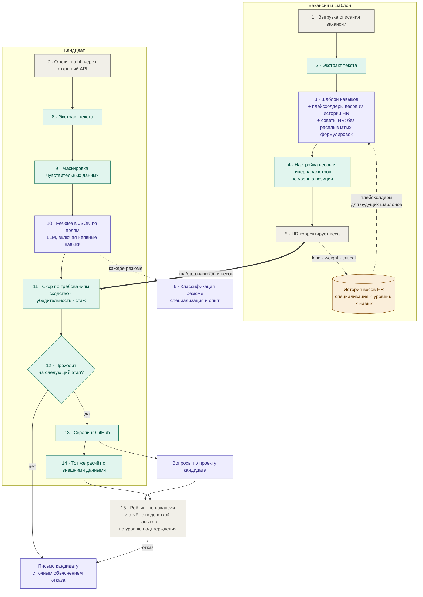
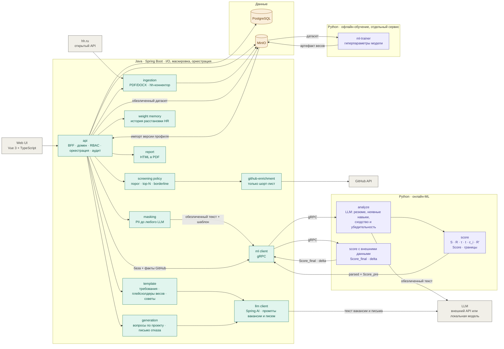
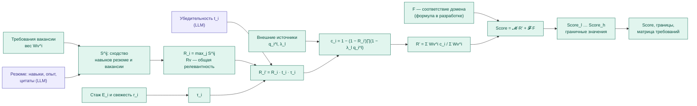
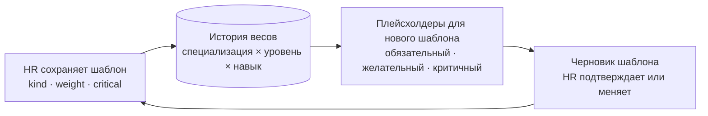
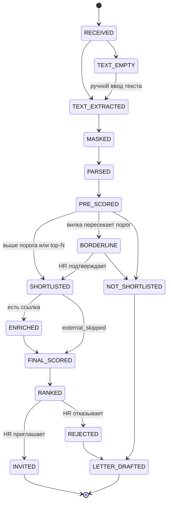
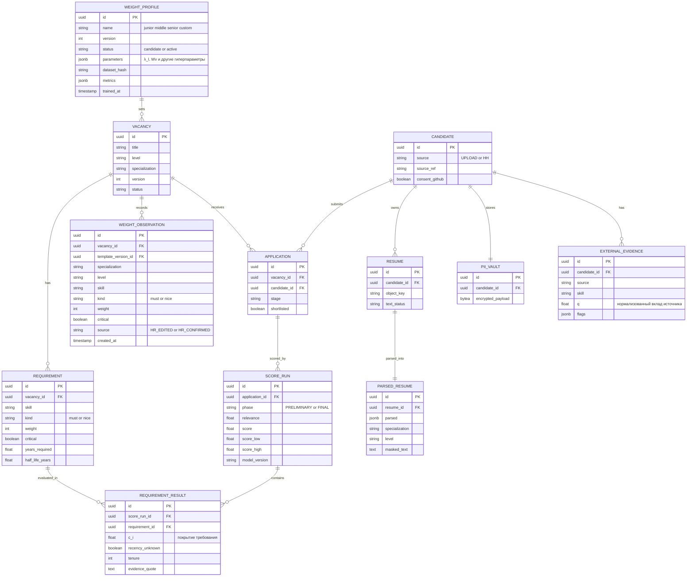

# Tracing ATS — объяснимый подбор: резюме ↔ вакансия


**Источники:** математическая модель скоринга (`scoring_model.pdf`). Всё, что помечено «гипотеза», нужно калибровать на данных.

---

## Содержание

1. [Идея](#1-идея)
2. [Весь процесс на одной схеме](#2-весь-процесс-на-одной-схеме)
3. [Этапы подробно](#3-этапы-подробно)
4. [Архитектура и сервисы](#4-архитектура-и-сервисы)
5. [Двухфазный скоринг](#5-двухфазный-скоринг)
6. [Модель скоринга](#6-модель-скоринга)
7. [Веса: профили по уровню позиции и обратная связь](#7-веса-профили-по-уровню-позиции-и-обратная-связь)
8. [Жизненный цикл кандидата](#8-жизненный-цикл-кандидата)
9. [Данные](#9-данные)
10. [Контракты API и JSON](#10-контракты-api-и-json)
11. [Внешние источники и защита от накрутки](#11-внешние-источники-и-защита-от-накрутки)
12. [Приватность и этика](#12-приватность-и-этика)
13. [Границы MVP](#13-границы-mvp)
14. [Структура репозитория](#14-структура-репозитория)
15. [Качество и проверка](#15-качество-и-проверка)
16. [Риски](#16-риски)
17. [Бэклог и открытые вопросы](#17-бэклог-и-открытые-вопросы)
18. [Глоссарий](#18-глоссарий)

---

## 1. Идея

### Проблема

Классический ATS ищет ключевые слова и не отличает «знаю Kafka» от «год писал продюсеров на Kafka». Запрос к LLM «оцени резюме от 0 до 100» даёт нестабильные числа, которые невозможно объяснить.

### Решение

Сервис разбивает вакансию на атомарные требования и для каждого навыка оценивает три вещи:

| Вопрос | Обозначение | Диапазон |
|---|---|---|
| Насколько навык из резюме похож на требуемый? | `S` | 0–1 |
| Насколько убедительно он подтверждён? | `t` | 0–1 |
| Насколько свеж и продолжителен опыт? | `τ` | 0–1 |

Из этих оценок получается покрытие требования `c_i`, затем — взвешенная релевантность `R'` и итоговый балл `Score` с интервалом. LLM размечает смысл и цитаты, а все числа считает детерминированный код. Отдельно может учитываться соответствие домена `F`; его формула пока не зафиксирована (см. `docs/rfc/rfc-scoring-model.md`).

### Три правила, на которых всё держится

1. **LLM даёт смысл и цитаты, код даёт числа.** Модель определяет сходство и убедительность и приводит цитату. Всю арифметику считает детерминированный код, поэтому результат воспроизводим.
2. **Внешние источники только повышают уверенность.** Нет GitHub — нет штрафа: без внешних данных `λ = 0`, и балл считается только по резюме. Многие сильные специалисты пишут код в закрытых репозиториях.
3. **Решение принимает человек.** Система готовит доказательства, вопросы и черновик письма, но не нанимает и не отказывает сама.

### Что получает рекрутёр и кандидат

| Рекрутёр | Кандидат |
|---|---|
| Шаблон навыков и весов по вакансии за минуты | Понимание, какие требования закрыты |
| Предварительный отбор всей пачки по тексту резюме | Конкретные пробелы вместо «вам отказано» |
| Рейтинг по вакансии, балл с вилкой и объяснением | Письмо с точными причинами отказа |
| Подсветка навыков по уровню подтверждения | Возможность подтвердить навыки через GitHub |
| Вопросы по проектам кандидата для интервью | |
| Слепой режим и PDF-отчёт для нанимающего менеджера | |

---

## 2. Весь процесс на одной схеме

Фиолетовый цвет — шаги, где работает LLM. Бирюзовый — детерминированный код. Серый — человек, вход или выдача.



Две ветки, которые легко потерять:

- **Пунктир 5 → история → 3** — обратная связь. Когда HR сохраняет шаблон, её расстановка (`kind`, `weight`, `critical`) записывается в историю по паре «специализация × уровень × навык». В следующем шаблоне для той же пары навык получает плейсхолдер из истории, если он есть в требованиях. Отклики и статистика резюме в весах не участвуют.
- **Ветка отказа** — кандидат, не прошедший отбор на шаге 12, сразу получает письмо с причинами. GitHub у него не запрашивается.

---

## 3. Этапы подробно

| №  | Этап                 | Что происходит                                                                                                                                                                                                                                                             | Кто           | Результат                        |
|----|----------------------|----------------------------------------------------------------------------------------------------------------------------------------------------------------------------------------------------------------------------------------------------------------------------|---------------|----------------------------------|
| 1  | Выгрузка вакансии    | Описание берём из hh или принимаем как файл или текст                                                                                                                                                                                                                      | человек, код  | сырой текст вакансии             |
| 2  | Экстракт текста      | Markdown, PDF, DOCX приводим к чистому тексту                                                                                                                                                                                                                              | код           | текст вакансии                   |
| 3  | Шаблон навыков       | LLM выделяет атомарные требования: навык(обязательный, желательный, необязательный). Если навык уже встречался в истории HR для этой специализации и уровня, поля предзаполняются плейсхолдером. Отдельно отмечает расплывчатые формулировки и предлагает, как их уточнить | LLM, код      | черновик шаблона и советы HR     |
| 4  | Настройка весов      | По уровню позиции выбирается стартовый профиль весов и гиперпараметров (раздел 7). Для начальных позиций профиль может сильнее опираться на подтверждённую практику, для старших — на стаж. Конкретные значения калибруются | код           | шаблон с весами                  |
| 5  | Коррекция HR         | HR правит требования, веса, критичные пометки. При сохранении расстановка пишется в историю весов по специализации и уровню                                                                                                                                                | человек       | утверждённый шаблон, версия      |
| 6  | Классификация резюме | Каждое резюме получает специализацию и уровень для отчёта и группировки. В весах будущих шаблонов эта статистика не участвует                                                                                                                                              | LLM           | `specialization`, `level`        |
| 7  | Отклик на hh         | Кандидат откликается, резюме попадает в систему через открытый API                                                                                                                                                                                                         | кандидат, код | резюме с источником `HH`         |
| 8  | Экстракт текста      | PDF через PDFBox, DOCX через POI, текст из hh напрямую                                                                                                                                                                                                                     | код           | текст резюме                     |
| 9  | Маскировка           | Имя, контакты, пол, возраст, фото, вуз заменяются плейсхолдерами **до** любого вызова внешней LLM                                                                                                                                                                          | код           | обезличенный текст, PII отдельно |
| 10 | Резюме в JSON        | LLM раскладывает текст по полям: места работы, даты, навыки. Выводит неявные навыки из описания опыта («настроил деплой в кластер» → Kubernetes)                                                                                                                           | LLM           | `parsed` JSON с цитатами         |
| 11 | Предварительный скор | Для каждого требования: сходство `S^{ij}` и релевантность `R_i`, убедительность `t_i`, стаж и свежесть `τ_i`; затем покрытие `c_i`, взвешенная релевантность `R'` и `Score` с границами                                                                                       | код           | балл, границы, матрица требований |
| 12 | Отбор                | Порог, top-N и пограничная зона. Решение — политика в Java, не в обученной модели                                                                                                                                                                                          | код, HR       | шорт-лист, остальные в отказ     |
| 13 | Скрапинг GitHub      | Только для шорт-листа и только по ссылке кандидата. Авторство, объём, устойчивость, инженерная культура                                                                                                                                                         | код           | факты GitHub, флаги накрутки     |
| 14 | Итоговый скор        | Тот же расчёт с нормализованными внешними фактами: `Score_final`, `delta`                                                                                                                                                                                                 | код           | итоговый балл                    |
| 15 | Рейтинг и отчёт      | Кандидат встаёт в рейтинг по вакансии. Отчёт: подсветка навыков по уровню подтверждения, вопросы по проекту, письмо отказа                                                                                                                                                 | код, LLM      | отчёт, PDF, рейтинг              |

### Уровни подтверждения навыка (для подсветки)

| Уровень            | Условие                                                             | Подсветка в отчёте |
|--------------------|---------------------------------------------------------------------|--------------------|
| Подтверждён внешне | есть внешний вклад `q_i^l` по этому навыку (GitHub и др.)          | зелёный            |
| Подтверждён делом  | в резюме конкретное действие с результатом или метрикой (`t = 0.8`) | светло-зелёный     |
| Заявлен            | упомянут в обязанностях без деталей (`t = 0.5`)                     | жёлтый             |
| Только в списке    | строка в списке навыков без контекста (`t = 0.3`)                   | серый              |
| Не найден          | нет доказательств                                                   | красный пробел     |

Шкала `t_i` — текущая стартовая классификация; её расширение и точные значения обсуждаются в RFC.

---

## 4. Архитектура и сервисы

Два контура. Java — I/O, маскировка, оркестрация и LLM для вакансии. Python — онлайн-ML: принимает обезличенный текст, сам ходит в LLM и считает математическую модель. Обучение гиперпараметров — отдельный офлайн-сервис.



### Сервисы

| Сервис | Технологии | Ответственность |
|---|---|---|
| **web** | Vue 3, TypeScript, Vite | Вакансии, редактор шаблона и весов, загрузка резюме, рейтинг, отчёт, слепой режим |
| **api** | Java 21, Spring Boot 4, Gradle, Spring Security, JPA, PostgreSQL | Домен, роли, оркестрация, хранение результатов, аудит раскрытий. Публичный REST генерируется из `contracts/openapi.yaml` |
| **ingestion** | PDFBox, Spring AI PDF, hh open API | Извлечение текста из PDF, DOCX, TXT; импорт откликов hh. Файлы и токены не покидают Java |
| **masking** | модуль Java | Замена PII плейсхолдерами до отправки текста в Python и до любого вызова LLM |
| **template** | модуль Java + Spring AI | Требования из текста вакансии, плейсхолдеры весов из истории HR, советы по формулировкам |
| **llm client** | модуль Java, Spring AI | Вызовы LLM для вакансии, вопросов и письма. Промпты с версиями, таймауты, валидация ответа |
| **generation** | модуль Java | Вопросы по проекту, черновик письма отказа |
| **ml client** | модуль Java, Spring gRPC | Единственная точка вызова Python-ML: предварительный скор и тот же расчёт с внешними данными |
| **weight memory** | модуль Java | История расстановки HR по специализации × уровню × навыку |
| **screening policy** | модуль Java | Порог, top-N, пограничная зона, ручной override с причиной |
| **github-enrichment** | модуль Java, GitHub REST или GraphQL | Сбор фактов только для шорт-листа, нормализация в `facts` |
| **report** | модуль Java, HTML в PDF | Отчёт для нанимающего менеджера |
| **scoring-service** | Python 3.14, uv, gRPC, Pydantic | Онлайн-ML: принимает обезличенный текст и шаблон, сам вызывает LLM для разбора резюме и категорий, затем считает `S^{ij}`, `R_i`, `Rv`, `τ`, `t`, `c_i`, `R'`, `Score` и границы; `F` — после фиксации в RFC. Внешние факты приходят нормализованными; сам их не собирает. Stateless |
| **ml-trainer** | Python 3.14, отдельный офлайн-сервис | Обучение гиперпараметров и весов модели; точный набор параметров определяется RFC. Читает обезличенный датасет, пишет артефакт. В рантайме не участвует |
| **PostgreSQL** | PostgreSQL 16 | Система записи: вакансии, резюме, запуски скоринга, профили весов, рейтинг, аудит |
| **MinIO** | S3-совместимое | Оригиналы резюме, извлечённый текст, PDF-отчёты, датасеты и артефакты обучения |
| **LLM** | внешний API или локальная модель | Только категории, цитаты и текст. Чисел не выставляет, PII не видит |

### Правила границ

- **Java — I/O, маскировка и оркестрация.** Только он читает файлы, ходит в hh, GitHub, MinIO и PostgreSQL, маскирует PII, строит шаблон вакансии и генерирует тексты.
- **Java вызывает LLM для вакансии и генерации.** Требования, советы HR, вопросы по проекту и письмо отказа — зона Java.
- **Python-сервис вызывает LLM для резюме.** `scoring-service` получает только обезличенный текст и шаблон, сам разбирает резюме, классифицирует доказательства и считает математическую модель. Ни файлов, ни БД, ни MinIO, ни hh, ни GitHub, ни PII.
- **Внешние факты нормализует Java.** GitHub, hh и другие источники остаются в Java; `scoring-service` получает готовые `q_i^l` и применяет модель.
- **Python-обучение — отдельный офлайн-сервис.** `ml-trainer` получает обезличенный датасет и возвращает артефакт с гиперпараметрами. Доступа к PostgreSQL, PII, hh, GitHub и LLM у него нет; из MinIO — только тренировочный бакет.
- **LLM не считает.** Обе стороны получают от модели только категории сходства/убедительности и цитаты; арифметика остаётся в `scoring-service`.
- **Обучение не активируется само.** Java импортирует артефакт как версию `WEIGHT_PROFILE` со статусом `candidate`; активирует человек. Активные вакансии и сохранённые запуски не пересчитываются.
- **Маскировка до любого LLM.** Java маскирует PII до передачи текста в Python, поэтому и Java, и Python отправляют модели только обезличенный текст.
- **Кого обогащать GitHub, решает Java**, а не обученная модель.
- **Контракты.** Публичный REST — OpenAPI (`contracts/openapi.yaml`), обучение — JSON Schema (`contracts/training-artifact.schema.json`). gRPC-контракт пока черновик (`contracts/scoring_service/v1/scoring.proto`); он не коммитится и не считается стабильным до фиксации модели.

---

## 5. Двухфазный скоринг

Идея: сначала дешёвый проход по тексту для **всех** откликов, потом дорогие внешние источники только для отобранных. Так мы экономим лимиты GitHub и не собираем лишние данные.


Важные детали:

- Предварительный и итоговый балл считает одна и та же модель. Меняются только входные данные: в предварительном вызове внешних фактов нет (`λ = 0`), в итоговом есть.
- Предварительный вызов идёт без внешних данных, поэтому `c_i = R_i'`.
- Повторный расчёт с внешними фактами **не вызывает LLM**: факты уже нормализованы Java. Это дешевле и воспроизводимо.
- Если GitHub недоступен или нет согласия, `Score_final = Score_pre` и ставится флаг `external_skipped`. Это честное состояние, не ошибка.
- В рейтинге всегда подписано, какой балл показан: предварительный или итоговый. Смешивать их в одной колонке нельзя.
- Пограничных кандидатов (`BORDERLINE`) не отсекаем по одному числу: если вилка пересекает порог, GitHub может изменить решение.

---

## 6. Модель скоринга

Модель устроена как конвейер: сначала сходство навыков, потом убедительность и стаж, затем покрытие требований и итоговый балл. Подробные формулы и открытые вопросы — в `docs/rfc/rfc-scoring-model.md`.



### Переменные

| Переменная | Смысл | Кто считает |
|---|---|---|
| `S^{ij}` | Насколько навык из резюме похож на требование: 1 — точное совпадение, 0 — ничего общего | LLM или детерминированный алгоритм; выбор источника — открытый вопрос RFC |
| `R_i` | Лучшее сходство по требованию: `max_j S^{ij}` | код |
| `Rv` | Общая релевантность набора навыков: взвешенное среднее `R_i` | код |
| `Wv^i` | Вес требования. Получается из `weight` и `critical`; критичность повышает вес, отдельного cap нет | система/HR; точная формула — RFC |
| `τ_i` | Темпоральный коэффициент: стаж против требуемого и давность последнего использования | код |
| `t_i` | Убедительность заявления: список, обязанность или действие с результатом | LLM (категория), код переводит в число |
| `F` | Соответствие домена: опыт в той сфере, куда нанимаем. Не «уровень + стаж» | формула пока не разработана |
| `q_i^l`, `λ_l` | Вклад внешнего источника и его влияние | `q` нормализует Java, `λ` — параметр модели |
| `c_i` | Покрытие требования после сходства, убедительности, стажа и внешних данных | код |
| `R'` | Уточнённая релевантность резюме: взвешенное среднее `c_i` | код |
| `Score` | Итоговая оценка: смесь `R'` и `F` | код |
| `𝓜`, `𝓕` | Коэффициенты смешивания покрытия и домена; `𝓜 + 𝓕 = 1` | конфигурация; значения — RFC |
| `Score_l`, `Score_h` | Нижняя и верхняя границы при неизвестных данных | код |

`t_i` сейчас использует три категории: 0.3 — просто перечислен, 0.5 — обязанность без деталей, 0.8 — действие с результатом. Это стартовая шкала; расширение — в RFC.

### Внешние источники

Общего «балла GitHub» нет. Java собирает факты по конкретному навыку и нормализует их в `q_i^l`; `scoring-service` только применяет модель. Если внешних данных нет, `λ = 0`, и покрытие считается только по резюме: `c_i = R_i'`. Поэтому отсутствие GitHub ничего не вычитает.

Признаки накрутки снижают внешний вклад и поднимают флаг. Это повод для вопроса на интервью, а не автоматический отказ.

### Пример

Вакансия: Python, Kafka, Docker. В резюме Python подтверждён проектом с метрикой, Kafka не указана, но есть RabbitMQ, Docker упомянут в обязанностях.

- Python получает высокое сходство, высокую убедительность и свежий опыт.
- Kafka получает частичное сходство через RabbitMQ; покрытие ниже.
- Docker получает среднюю убедительность: навык назван, но без результата.

Итог — не сумма баллов, а взвешенное среднее покрытий. Если по части опыта нет данных, модель считает нижнюю и верхнюю границы и показывает интервал. Конкретные числа зависят от гиперпараметров и калибровки; в README они не фиксируются.

### Что делает LLM, а что код

| LLM (смысл и цитаты) | Код (арифметика) |
|---|---|
| Требования из текста вакансии, советы по формулировкам | Сборка `S^{ij}` из категорий, релевантность `R_i`, `Rv` |
| Резюме в JSON, неявные навыки | `τ_i`, `c_i`, `R'`, `Score`, границы |
| Категория сходства, убедительность `t_i`, цитата | Перевод категорий в числа, проверка цитат |
| Специализация и уровень резюме | Внешние `q_i^l` и `λ_l` |
| Вопросы по проектам, письмо отказа | Антинакрутка, флаги неизвестности |

Цитата, которой нет в исходном тексте, отбрасывается, а требование не получает повышения покрытия. Это защита от галлюцинаций.

Вся арифметика живёт в `scoring-service/app/scoring/`: Java передаёт туда обезличенный текст резюме и шаблон, Python сам вызывает LLM для разбора и категорий `m`/`t`, а затем возвращает балл, вилку и матрицу требований.

---

## 7. Веса: профили по уровню позиции и обратная связь

### Профили весов (шаг 4)

Профиль уровня задаёт стартовые гиперпараметры модели: насколько сильно внешние источники могут повысить покрытие (`λ_l`), как `weight` и `critical` превращаются в `Wv^i`, насколько строго учитываются стаж и свежесть. Для junior профиль может сильнее опираться на подтверждённую практику, для senior — на стаж, но конкретные значения — параметры конфигурации, а не часть этого README.

Профиль — шаблон, а не решение: HR правит веса, а утверждённые значения фиксируются в версии вакансии. Даже при малом `λ` отсутствие GitHub ничего не вычитает.

### Обратная связь (шаг 5)

Плейсхолдеры весов берутся из расстановки HR, а не из поданных откликов. Каждое сохранение шаблона фиксирует, что HR поставила для конкретного навыка, и в следующий раз система предлагает это же значение.



- Наблюдение пишется при сохранении шаблона (шаг 5) по каждому требованию: специализация, уровень, нормализованный навык, `kind`, `weight`, `critical`, источник (`HR_EDITED` — HR изменила, `HR_CONFIRMED` — оставила как есть).
- Ключ памяти — **специализация × уровень × навык**. Значения junior и senior не смешиваются: «Python обязательный для junior-аналитика» и «Python желательный для senior-аналитика» — разные записи.
- В новом шаблоне плейсхолдер подставляется только если навык уже есть в извлечённых требованиях. Отсутствующие навыки из истории не добавляются.
- После каждого изменения вычисляется средний вес.
- Если истории нет, работает текущее поведение: `kind` предлагает LLM, профиль уровня задаёт гиперпараметры модели.
- HR всегда может переопределить плейсхолдер. Предложение не меняет активную вакансию и сохранённые запуски.
- Память весов **не использует** отклики, шорт-лист, отказы и статистику резюме. Она влияет только на `kind`, `weight` и `critical` конкретного требования. Профиль гиперпараметров от истории HR не зависит: он задаётся уровнем позиции или обученным артефактом.

---

## 8. Жизненный цикл кандидата



`TEXT_EMPTY` возникает у сканов без текстового слоя: PDFBox не распознаёт картинки. OCR в MVP не входит, вместо него ручной ввод текста.

---

## 9. Данные



Принципы хранения:

- **Запуски скоринга неизменяемы** и хранят версии модели, промптов, формулы, гиперпараметров и справочника. Это нужно для аудита и калибровки.
- **Версии профилей гиперпараметров неизменяемы.** Артефакт обучения хранится с `dataset_hash` и метриками; активация создаёт новую версию, старые запуски не пересчитываются.
- **PII лежит отдельно и зашифрованной** (`PII_VAULT`). В `PARSED_RESUME` только обезличенные данные.
- **Раскрытие данных в слепом режиме** пишется в журнал аудита с причиной.

---

## 10. Контракты API и JSON

Источник истины — OpenAPI для публичного REST и JSON Schema для датасета и артефакта обучения. gRPC-контракт пока черновик и не считается стабильным. Ниже черновик для ориентира.

### Публичный API (Java)

Контракт — `contracts/openapi.yaml`. Из него генерируются Spring-интерфейсы (`ats.api`) и DTO (`ats.gateway.model`).

| Метод и путь                                     | Назначение                                                                                        |
|--------------------------------------------------|---------------------------------------------------------------------------------------------------|
| `POST /api/v1/vacancies`                         | Создать вакансию из текста, получить черновик шаблона                                             |
| `PUT /api/v1/vacancies/{id}/template`            | HR сохраняет правки требований и весов (новая версия). Расстановка пишется в `WEIGHT_OBSERVATION` |
| `POST /api/v1/vacancies/{id}/screen`             | Запустить предварительный скоринг пачки, ответ `202`                                              |
| `GET /api/v1/vacancies/{id}/ranking`             | Рейтинг с пометкой предварительный или итоговый балл                                              |
| `POST /api/v1/resumes`                           | Загрузка PDF, DOCX, TXT                                                                           |
| `POST /api/v1/vacancies/{id}/import/hh`          | Импорт откликов с hh                                                                              |
| `GET /api/v1/applications/{id}/report`           | Отчёт по кандидату                                                                                |
| `GET /api/v1/applications/{id}/report.pdf`       | PDF для нанимающего менеджера                                                                     |
| `POST /api/v1/applications/{id}/reveal`          | Раскрыть PII, тело содержит `reason`                                                              |
| `GET /api/v1/applications/{id}/rejection-letter` | Черновик письма для проверки HR                                                                   |

### Внутренний API ML (gRPC, только из сети Java)

Черновик gRPC-контракта — `contracts/scoring_service/v1/scoring.proto`; он не коммитится и не считается стабильным, пока модель не зафиксирована. Java вызывает Python через Spring gRPC client.

Смысл вызова один: передать обезличенный текст/структурированное резюме и шаблон, получить `Score`, границы и матрицу требований. Предварительный и итоговый вызовы используют одну модель; различие — во входных данных.

| Вызов | Вход | Выход |
|---|---|---|
| Предварительный | обезличенный текст резюме + шаблон | `Score`, `Score_l`/`Score_h`, `Rv`, `refine`, матрица требований |
| Итоговый | те же данные + нормализованные внешние `q_i^l` | `Score_final`, `delta`, матрица и подсветка навыков |

Имена RPC и поля появятся после стабилизации контракта. Предварительный вызов сам вызывает LLM для разбора резюме; итоговый использует готовые факты и LLM не вызывает.

### Контракт обучения гиперпараметров (Python, офлайн)

Кроме онлайн-ML, у Python есть офлайн-обучение. Его контракт — два артефакта в MinIO, описанные `contracts/training-artifact.schema.json`:

| Артефакт | Кто пишет | Кто читает | Содержимое |
|---|---|---|---|
| `dataset.jsonl` | Java | `ml-trainer` | обезличенные пары «резюме — вакансия», оценки рекрутёров, версии формулы и справочника |
| `weight-profile.json` | `ml-trainer` | Java | `level`, гиперпараметры модели (`λ_l`, `Wv` и др.), `dataset_hash`, `metrics`, `trained_at`; точный набор полей — после фиксации RFC |

Админские эндпоинты Java:

| Метод и путь | Назначение |
|---|---|
| `POST /api/v1/training/exports` | Выгрузить обезличенный датасет в MinIO |
| `POST /api/v1/weight-profiles/import` | Импортировать артефакт как версию профиля со статусом `candidate` |
| `GET /api/v1/weight-profiles` | Список версий профилей и метрик |
| `POST /api/v1/weight-profiles/{id}/activate` | Активировать версию; старые запуски не пересчитываются |

### Шаблон вакансии

```json
{
  "vacancy_id": "7f3c…",
  "level": "middle",
  "specialization": "analyst",
  "weight_profile": "middle",
  "requirements": [
    {
      "id": "req-1",
      "skill": "Python",
      "kind": "must",
      "critical": true,
      "weight": 3,
      "weight_source": "HR_HISTORY",
      "prior_observations": 3,
      "years_required": 3,
      "half_life_years": 5,
      "related_skills": [],
      "clarity_warning": null
    },
    {
      "id": "req-2",
      "skill": "Kafka",
      "kind": "must",
      "critical": false,
      "weight": 2,
      "years_required": 0,
      "half_life_years": 3,
      "related_skills": [{ "skill": "RabbitMQ", "similarity": 0.6 }],
      "clarity_warning": null
    },
    {
      "id": "req-3",
      "skill": null,
      "raw_text": "опыт работы с высоконагруженными системами",
      "kind": "nice",
      "weight": 1,
      "clarity_warning": "Расплывчато: укажите нагрузку (rps, объём данных) и роль кандидата"
    }
  ]
}
```

### Резюме в JSON (после маскировки)

```json
{
  "specialization": "backend",
  "level_estimate": "middle",
  "total_years": 4.5,
  "jobs": [
    {
      "company": "Company A",
      "role": "Backend developer",
      "from": "2021-03",
      "to": null,
      "skills_explicit": ["Java", "Kafka"],
      "skills_implicit": [
        { "skill": "Kubernetes", "quote": "настроил деплой в кластер" }
      ],
      "claims": [
        { "quote": "разработал сервис на FastAPI, 5k rps", "t": 0.8 }
      ]
    }
  ]
}
```

### Результат скоринга

```json
{
  "phase": "PRELIMINARY",
  "score": 0.69,
  "score_low": 0.62,
  "score_high": 0.82,
  "relevance": 0.71,
  "tenure": 5,
  "refine": true,
  "requirements": [
    {
      "requirement_id": "req-1",
      "coverage": 0.72,
      "recency_unknown": false,
      "tenure": 3,
      "evidence": { "source": "resume", "quote": "разработал сервис на FastAPI, 5k rps" }
    }
  ],
  "flags": []
}
```

`coverage` — это `c_i`, `relevance` — `Rv`, `score_low`/`score_high` — `Score_l`/`Score_h`. Числа приведены для иллюстрации; шкала и округление `Score` уточняются в RFC. Статусы отчёта («закрыто», «частично», «пробел») — отдельная политика отображения, она не влияет на `Score` и будет уточнена вместе с порогами.

---

## 11. Внешние источники и защита от накрутки

| Источник                                          | Что подтверждает                               | Приоритет        |
|---------------------------------------------------|------------------------------------------------|------------------|
| GitHub                                            | авторство кода, объём, устойчивость, тесты, CI | основной, шаг 13 |
| Habr Career и статьи на Habr                      | публикации, профиль                            | расширение       |

**Признаки накрутки** (для GitHub):

- все коммиты за один день;
- даты коммитов раньше создания аккаунта;
- копия чужого репозитория или форк без своих коммитов;
- шаблонный профиль.

Java собирает авторство, объём, устойчивость, тесты и CI и нормализует их в `q_i^l`; конкретная формула внешнего вклада — в RFC. Если признаки накрутки сработали, внешний вклад снижается, а рекрутёр видит флаг. Это повод для вопроса на интервью, а не приговор.

---

## 12. Приватность и этика

| Мера | Как работает |
|---|---|
| Маскировка до LLM | Имя, контакты, пол, возраст, фото, вуз заменяются плейсхолдерами локально, внешняя модель их не видит |
| Слепой режим | Рекрутёр сначала видит оценку и доказательства без PII. Данные раскрываются после решения о приглашении, действие пишется в аудит |
| Нейтральность расчёта | Пол, возраст, национальность, фото и вуз не участвуют в формуле. Можно измерять, как слепой режим меняет решения |
| Человек решает | Автоматических отказов и приглашений нет. Письмо отказа проходит проверку HR |
| Нет штрафа за отсутствие | Отсутствие внешних источников ничего не вычитает |
| Честная точность | Вилка и уровни вместо «78,4 против 78,1» |

Чего мы сознательно **не** делаем: не определяем эмоции и «лояльность», не скрапим закрытые источники, не строим полный ATS (календарь, почта, офферы).

---

## 13. Границы MVP

Предложение по приоритетам. Подтвердите или поправьте.

| Приоритет | Что входит |
|---|---|
| **P0** | Java-скелет: auth, вакансии, загрузка PDF/DOCX, извлечение текста, маскировка · Шаблон вакансии через LLM из Java · Python `scoring-service`: gRPC, вызов LLM для разбора резюме и категорий сходства/убедительности, `c_i`, `Score` с детерминированными границами · Шорт-лист по порогу · Отчёт «требование → доказательство → пробел» · Рейтинг · Слепой режим · PDF-отчёт · Docker Compose и демо-данные |
| **P1** | Импорт откликов с hh · Скрапинг GitHub, тот же расчёт с внешними данными (`Score_final`), подсветка по уровню подтверждения, проверка накрутки · Профили гиперпараметров junior и senior · Память весов HR по специализациям и уровням (плейсхолдеры `kind`/`weight`/`critical`) · Карта смежных навыков · Советы по расплывчатым формулировкам · Вопросы по проекту · Письмо отказа |
| **P2** | Классификация резюме · Офлайн-обучение гиперпараметров модели в `ml-trainer` и импорт артефакта · Другие внешние источники · Анализ интервью · Рекомендации по улучшению вакансий · Калибровка по оценкам рекрутёров · OCR |

**Минимальный сквозной путь для демо:** вакансия → шаблон и правка HR → резюме → `Score_pre` для всех → шорт-лист → отчёт с пробелами → слепой режим → PDF. GitHub и письмо отказа добавляют вес демо, но ядро держится и без них.

---

## 14. Структура репозитория

```text
tracing-ats/
├── README.md
├── AGENTS.md                    # инструкция для AI-агента
├── docs/                        # общая документация
├── migrations/                  # общие Liquibase-миграции (SQL) + Dockerfile
│   ├── Dockerfile
│   ├── db.changelog-master.xml
│   └── changes/
├── compose.yaml                 # запуск всей системы
├── resume-service/              # Java 21, Spring Boot 4, Gradle
│   ├── build.gradle
│   ├── gradlew
│   ├── Dockerfile
│   └── src/main/java/ats/resume/
├── vacancy-service/             # Java 21, Spring Boot 4, Gradle
│   ├── build.gradle
│   ├── gradlew
│   ├── Dockerfile
│   └── src/main/java/ats/vacancy/
├── scoring-service/             # Python 3.14, uv, gRPC: LLM и математическая модель
│   ├── pyproject.toml
│   ├── uv.lock
│   ├── Dockerfile
│   ├── src/api/                 # gRPC-сервер, конфигурация, заглушка ScoreResume
│   ├── src/scoring_service/     # сгенерированные protobuf/gRPC-модули
│   └── tests/                   # golden и контрактные проверки
├── ml-trainer/                  # Python 3.14, только офлайн-обучение
│   ├── train/                   # обучение λ, wM, wN, wF
│   ├── datasets/                # локальные снапшоты для прогонов
│   ├── artifacts/               # weight-profile.json
│   └── tests/                   # воспроизводимость и метрики
├── contracts/
│   ├── openapi.yaml             # публичный REST-контракт
│   ├── scoring_service/v1/scoring.proto # черновик gRPC-контракта, пока не коммитится
│   └── training-artifact.schema.json
├── frontend/                    # Vue 3 + TypeScript
├── infra/
│   └── mock-llm/                # заглушка LLM для CI и демо
└── .github/workflows/
```

---

## 15. Качество и проверка

| Что проверяем | Как |
|---|---|
| Воспроизводимость | Одно резюме и одна вакансия дают один и тот же балл (LLM замокана, арифметика детерминирована) |
| Защита от галлюцинаций | Тест: цитата, которой нет в тексте, отбрасывается, покрытие требования не повышается |
| Утечка PII | Тест исходящих запросов к LLM из Java и из `scoring-service`: ни имён, ни контактов |
| Порядок кандидатов | 10–15 синтетических резюме с заранее известным порядком. Таблица «наш рейтинг против эталона» |
| Устойчивость весов | Сдвигаем веса на ±20 % и смотрим, меняется ли топ-5. Если нет, рейтингу можно доверять |
| Калибровка (после хакатона) | 100–300 пар «резюме — вакансия» с оценками рекрутёров. Метрики: корреляция Спирмена, NDCG@10. Набор гиперпараметров модели и процедура калибровки — отдельная задача, фиксируется в RFC/ADR |
| gRPC-контракт | После фиксации модели — contract-тест Java ↔ `scoring-service`; черновик контракта не считается стабильным |
| Обучение | Датасет и артефакт соответствуют JSON Schema, в датасете нет PII, у `ml-trainer` нет клиентов PostgreSQL и внешних API, кроме тренировочного бакета MinIO |
| Воспроизводимость обучения | Один датасет и фиксированный seed дают один и тот же `weight-profile.json`; метрики на holdout не хуже активной версии |

---

## 16. Риски

| Риск | Мера |
|---|---|
| LLM медленная или нестабильная | Таймауты, кеш `parsed`, mock-LLM, запасная запись демо |
| LLM галлюцинирует | Цитаты как подстроки, строгая JSON-схема, golden-тесты |
| Скан без текстового слоя | Статус `TEXT_EMPTY`, ручной ввод, OCR позже |
| Утечка PII | Локальная маскировка, тест исходящих запросов, синтетические данные |
| Промпт-инъекция в резюме | Резюме передаётся как данные, а не инструкции. LLM не выставляет чисел. Ответ валидируется схемой |
| Лимиты GitHub | Запросы только для шорт-листа, кеш, токен, таймауты. Отсутствие данных не штрафует |
| Порог отсекает сильного кандидата | Пограничная зона по вилке, ручной override с причиной |
| Смешение `Score_pre` и `Score_final` | Раздельные поля, бейджи в UI |
| hh API недоступен | Загрузка файлов как запасной вход |
| Расползание скоупа | Приоритеты P0, P1, P2 и заморозка набора фич |
| Судьи не поймут формулу | Один экран «как считается» с примером из раздела 6 |
| Обученные гиперпараметры ухудшают ранжирование | Артефакт импортируется как `candidate`, активируется вручную, метрики на holdout сравниваются с активной версией |
| `scoring-service` ходит в LLM | Только обезличенный текст, таймауты и кеш `parsed`, mock-LLM в CI, лимит на размер запроса |
| Рассинхрон gRPC-контракта | После фиксации модели — contract-тест Java ↔ Python в CI; черновик контракта не считается стабильным |

---

## 17. Бэклог и открытые вопросы

**Идеи из обсуждения, которые остаются в бэклоге:**

- анализ интервью: загрузка записи или транскрипта, сверка ответов с резюме, подсветка расхождений;
- рекомендации по составлению вакансий на основе накопленной статистики;
- «средний портрет» профиля роли (например, продакта) как стартовая заготовка шаблона;
- A/B слепого режима: измерить, как меняются решения рекрутёров.

**Открытые вопросы по модели** — `F`, `Wv`, `λ_l`, границы, шкала `Score`, калибровка и валидация — ведутся в `docs/rfc/rfc-scoring-model.md`. Ниже — продуктовые вопросы, которые не входят в RFC.

**Открытые вопросы:**

1. Какая LLM доступна на хакатоне (внешний API, Hugging Face, локальная) и какой лимит бюджета?
2. Можно ли обрабатывать реальные резюме или только синтетику?
3. Есть ли доступ к открытому API hh и токен работодателя для демо?
4. Какой порог шорт-листа берём по умолчанию (например, top-10 или доля от максимума)?
5. Кто основной пользователь демо: рекрутёр или кандидат? От этого зависит главный экран.
6. Нужны ли русский и английский язык в интерфейсе и парсинге?

---

## 18. Глоссарий

| Термин | Значение |
|---|---|
| **Требование** | Атомарное утверждение вакансии, например «Python, 3+ года» |
| **`must` / `nice`** | Обязательное и желательное требование |
| **Критичное** | Приоритетное требование; влияет на вес `Wv^i`, может учитваться отдельным cap в Java |
| **`S^{ij}`** | Сходство навыка из резюме с требованием: 1 — точное совпадение, 0 — ничего общего |
| **`R_i`, `Rv`** | Релевантность отдельного требования и общая релевантность набора навыков |
| **`Wv^i`** | Вес требования; получается из `weight` и `critical` |
| **`t_i`** | Убедительность заявления: список, обязанность или действие с результатом |
| **`τ_i`** | Темпоральный коэффициент: стаж и давность последнего использования |
| **`F`** | Соответствие домена; формула пока не разработана |
| **`q_i^l`, `λ_l`** | Вклад внешнего источника и его влияние на покрытие |
| **`c_i`** | Покрытие требования после сходства, убедительности, стажа и внешних данных |
| **`R'`** | Уточнённая релевантность резюме: взвешенное среднее `c_i` |
| **`Score`** | Итоговая оценка: смесь `R'` и `F`; шкала уточняется в RFC |
| **`Score_l`, `Score_h`** | Нижняя и верхняя границы при неизвестных данных |
| **`Score_pre`** | Предварительный вызов той же модели без внешних данных (`λ = 0`) |
| **`Score_final`** | Итоговый вызов той же модели с внешними данными |
| **`delta`** | `Score_final − Score_pre`, прирост от внешних доказательств |
| **Шорт-лист** | Кандидаты, прошедшие порог или top-N и допущенные к GitHub-проверке |
| **`BORDERLINE`** | Кандидат у порога, для которого GitHub может изменить решение |
| **`external_skipped`** | Внешние источники не запрашивались: нет согласия, ссылки или отбора |
| **Вилка** | Диапазон `Score_l … Score_h`, честный интервал оценки |
| **Слепой режим** | Просмотр оценки без PII до аудируемого раскрытия |
| **Профиль весов** | Набор стартовых гиперпараметров модели под уровень позиции; значения калибруются |
| **`scoring-service`** | Онлайн-ML: принимает обезличенный текст и шаблон, сам вызывает LLM для разбора резюме и категорий, считает `S^{ij}`, `R_i`, `Rv`, `τ`, `t`, `c_i`, `R'`, `Score` и границы; `F` — после фиксации в RFC. Stateless |
| **gRPC** | Внутренний контракт Java ↔ `scoring-service`; пока черновик `contracts/scoring_service/v1/scoring.proto`, не считается стабильным |
| **Офлайн-обучение** | Отдельный сервис `ml-trainer`: подбирает гиперпараметры модели по обезличенному датасету и отдаёт артефакт |
| **Артефакт весов** | `weight-profile.json` с версией профиля, гиперпараметрами, метриками и хешем датасета; импортируется в Java как `candidate` |
| **Память весов** | История расстановки HR (`kind`, `weight`, `critical`) по паре «специализация × уровень × навык»; источник плейсхолдеров в новых шаблонах |
