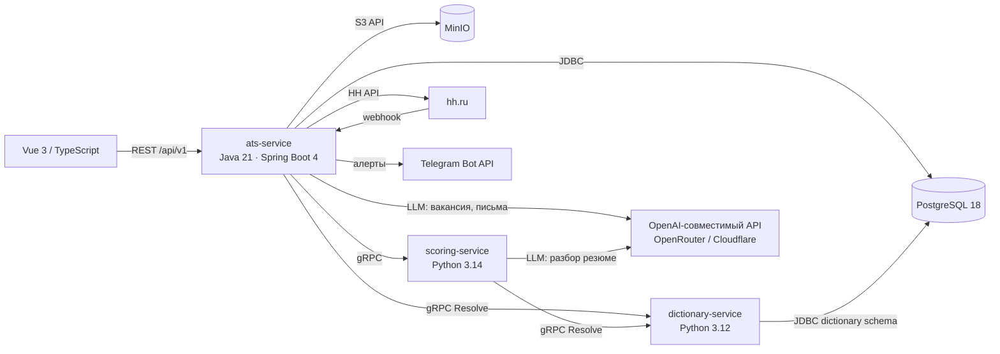

# Tracing ATS — объяснимый подбор «резюме ↔ вакансия»

## Аннотация

**Tracing ATS** сопоставляет резюме с вакансиями и объясняет результат по каждому требованию: что подтверждено дословной цитатой, что закрыто частично, где пробел и что стоит уточнить у кандидата. Система работает в двух направлениях — от резюме к вакансиям и от вакансии к пачке резюме. LLM извлекает факты и цитаты, балл считает детерминированный код, финальное решение остаётся за человеком.

---

## Архитектура



### Границы ответственности

- **`ats-service`** — REST, файлы, PostgreSQL, MinIO, hh, GitHub, маскировка PII, шаблон вакансии, оркестрация, аудит и отчёты. Арифметику скоринга не дублирует.
- **`scoring-service`** — stateless: получает обезличенный текст и структурированные требования, вызывает LLM для разбора резюме и считает `S`, `τ`, `t`, `c`, `Score`. Не имеет доступа к БД, файлам, GitHub, hh и PII.
- **`dictionary-service`** — владеет схемой `dictionary`: нормализует навыки и квалификации, хранит алиасы и связи. LLM не вызывает, числа похожести не считает.
- **`text-extraction`** — библиотека извлечения текста из PDF, DOCX, TXT и MD.
- **Человек решает:** автоматических отказов и приглашений нет; письмо кандидату — черновик для проверки HR.

### Внешние сервисы

| Сервис | Назначение | Когда нужен |
|---|---|---|
| hh.ru | Публикация вакансий, получение откликов и резюме | При работе с hh.ru |
| OpenRouter или другой OpenAI-совместимый API | Извлечение требований вакансии, разбор резюме, черновики писем | Основной сценарий |
| Cloudflare Workers AI | Резервный поставщик моделей | Опционально |
| Telegram Bot API | Уведомления о новых откликах | Опционально |

---

## Запуск

### Требования

В данном разделе перечислены требования для запуска приложения
в dev-режиме.

| Компонент | Минимум |
|---|---|
| Docker Engine / Compose | 24+ / v2 |
| RAM / свободный диск | 8 ГБ / 10 ГБ |
| Свободные порты | `3000`, `5432`, `8080`, `8082`, `8084`, `9000`, `9001`, `9090`, `8090` |
| Локальная разработка | Java 21, Gradle 9.8.2, Node 24, Python 3.14 + `uv` |

### Запуск

```bash
# Скачивает и квантует NER-модель для маскировки ПДн
chmod +x scripts/download-ner.sh
./scripts/download-ner.sh

cp .env.example .env
# заполнить ключи в .env (см. ниже)

docker compose up -d --build
```

В .env необходимо прописать как минимум следующие переменные,
содержащие секреты (пример):
```bash
# Настройки OpenAI-совместимого API для ats-service
OPENROUTER_API_KEY=xxx
VACANCY_LLM_BASE_URL=https://openrouter.ai/api/v1
VACANCY_LLM_MODEL=dots-studio/dots-3-note-preview:free

ATS_PII_NER_PROVIDER=onnx

# Использовать OpenAI-совместимый API, а не mock
SCORING_SERVICE_LLM_PROVIDER=openai
SCORING_SERVICE_LLM_BASE_URL=https://openrouter.ai/api/v1
SCORING_SERVICE_LLM_MODEL=dots-studio/dots-3-note-preview:free
SCORING_SERVICE_LLM_API_KEY=yyy
```


### Адреса

| Что | Адрес |
|---|---|
| UI | <http://localhost:3000> |
| REST API / Swagger | <http://localhost:8080/api/v1> / <http://localhost:8080/swagger-ui/index.html> |
| `ats-service` gRPC | `localhost:9090` |
| `scoring-service` gRPC | `localhost:8082` |
| `dictionary-service` gRPC | `localhost:8084` |
| PostgreSQL / MinIO | `localhost:5432` / <http://localhost:9000> |
| Заглушка hh.ru | <http://localhost:8090> |

### Моковый hh в dev-режиме

```bash
docker compose --profile mock-hh up -d --build
```

Заглушка hh.ru доступна на <http://localhost:8090>. Чтобы `ats-service` обращался к ней, задайте в `.env`:

```dotenv
ATS_HH_ENABLED=true
ATS_HH_API_BASE_URL=http://mock-hh:8090
ATS_HH_TOKEN=mock-token
ATS_HH_EMPLOYER_ID=999
ATS_HH_WEBHOOK_TOKEN=mock-hh-token
ATS_HH_WEBHOOK_PUBLIC_URL=http://ats-service:8080/api/v1/integrations/hh/webhook?token=mock-hh-token
```

### Остановка

```bash
docker compose down
# удалить также данные PostgreSQL и MinIO:
docker compose down -v
```

---

## Roadmap

### Безопасность и доверие

- Добавить вход по корпоративной учётной записи и роли: HR, нанимающий менеджер, администратор.
- Вести журнал действий с привязкой к конкретному пользователю.
- Скрывать персональные данные по умолчанию и показывать их только по явному запросу с указанием причины.
- Гарантировать, что персональные данные не попадают к внешним поставщикам моделей.
- Добавить резервное копирование и восстановление данных, контроль доступности сервиса.

### Оценка и объяснения

- Добавить пересчёт итоговой оценки после получения внешних подтверждений.
- Учитывать давность опыта и общий стаж кандидата.
- Показывать диапазон оценки и признак «предварительная / итоговая» в интерфейсе.
- Добавить обучение на решениях HR: накапливать, кто прошёл дальше, и настраивать оценку под специализации и уровни.
- Гарантировать, что одинаковые данные дают одинаковую оценку.

### Подбор и коммуникация

- Добавить импорт вакансий и резюме с hh.ru, синхронизацию откликов и статусов.
- Добавить календарь интервью, заметки, оффер и обратную связь в одном окне.
- Добавить понятный PDF-отчёт для кандидата и нанимающего менеджера.
- Добавить экран рейтинга, запуск подбора из интерфейса, загрузку нескольких резюме сразу и добавление требований к квалификации.
- Добавить подтверждения из портфолио, публикаций, сертификатов и открытых профилей — они повышают покрытие, но не штрафуют за отсутствие.

### Данные и языки

- Добавить распознавание текста в сканах и поддержку старых документов Word.
- Расширить словарь за пределы IT и добавить поддержку резюме и вакансий на других языках.
- Добавить умный подбор синонимов и близких навыков в словаре.
- Добавить возможность установки на собственных серверах и работы с локальными моделями без внешних сервисов.
- Добавить хранение версий справочников и настроек, чтобы любой прошлый результат можно было воспроизвести.
