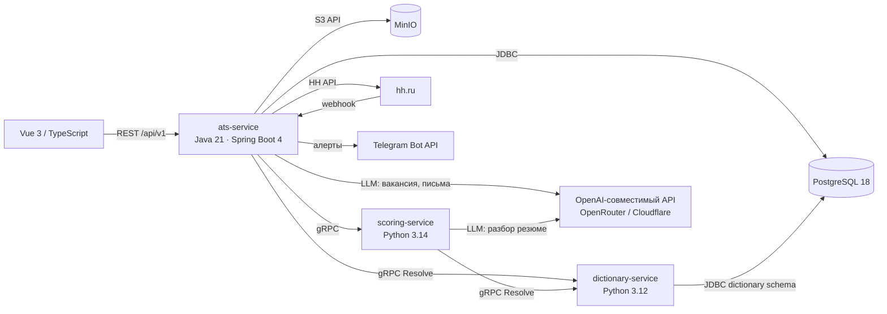

# Tracing ATS — объяснимый подбор «резюме ↔ вакансия»

## Аннотация

**Tracing ATS** сопоставляет резюме с вакансиями и объясняет результат по каждому требованию: что подтверждено дословной цитатой, что закрыто частично, где пробел и что стоит уточнить у кандидата. Система работает в двух направлениях — от резюме к вакансиям и от вакансии к пачке резюме. LLM извлекает факты и цитаты, балл считает детерминированный код, финальное решение остаётся за человеком.

---

## Архитектура



### Ключевые компоненты

| Компонент | Технологии | Ответственность |
|---|---|---|
| `frontend` | Vue 3, TypeScript, Vite | Экраны вакансий, резюме, словаря и отчёта; вызывает REST и показывает PII только после `reveal`. |
| `ats-service` | Java 21, Spring Boot 4 | REST, файлы, PostgreSQL, MinIO, маскировка PII, LLM для вакансии и писем, оркестрация, рейтинг, отчёт, решения HR. |
| `scoring-service` | Python 3.14, gRPC, Pydantic | Разбор обезличенного резюме через LLM, детерминированные `S`, `τ`, `t`, `c`, `Score`, статусы требований. Stateless. |
| `dictionary-service` | Python 3.12, gRPC, PostgreSQL | Нормализация навыков и квалификаций, алиасы, связи, версия словаря. LLM не вызывает. |
| `text-extraction` | Java-библиотека | PDF, DOCX, TXT и MD → нормализованный текст. OCR нет. |
| `PostgreSQL` | PostgreSQL 18 | Схемы `public` и `dictionary`; версии шаблонов, запуски, результаты, PII vault и аудит. |
| `MinIO` | S3 API | Оригиналы загруженных резюме. |
| LLM API | OpenAI-совместимый API | Извлечение требований и фактов, цитаты, черновики писем. Итоговый балл не выставляет. |

### Границы ответственности

- **`ats-service`** — REST, файлы, PostgreSQL, MinIO, hh, GitHub, маскировка PII, шаблон вакансии, оркестрация, аудит и отчёты. Арифметику скоринга не дублирует.
- **`scoring-service`** — stateless: получает обезличенный текст и структурированные требования, вызывает LLM для разбора резюме и считает `S`, `τ`, `t`, `c`, `Score`. Не имеет доступа к БД, файлам, GitHub, hh и PII.
- **`dictionary-service`** — владеет схемой `dictionary`: нормализует навыки и квалификации, хранит алиасы и связи. LLM не вызывает, числа похожести не считает.
- **`text-extraction`** — библиотека извлечения текста из PDF, DOCX, TXT и MD.
- **Человек решает:** автоматических отказов и приглашений нет; письмо кандидату — черновик для проверки HR.

### Внешние сервисы

| Сервис | Назначение | Когда нужен |
|---|---|---|
| hh.ru | Публикация вакансий, получение откликов и резюме | При работе с hh.ru |
| OpenRouter или другой OpenAI-совместимый API | Извлечение требований вакансии, разбор резюме, черновики писем | Основной сценарий |
| Cloudflare Workers AI | Резервный поставщик моделей | Опционально |
| Telegram Bot API | Уведомления о новых откликах | Опционально |

---

## Поток данных от входа до результата

Общий конвейер одинаков для обоих направлений:

1. **Вход.** HR загружает резюме или создаёт вакансию текстом либо файлом.
2. **Подготовка.** `text-extraction` извлекает текст, `ats-service` маскирует PII и удаляет prompt injection. Оригинал уходит в MinIO, PII — в зашифрованный `pii_vault`, обезличенный текст — в `parsed_resume`.
3. **Извлечение.** LLM возвращает только структурированные факты и дословные цитаты. Для вакансии это шаблон требований, для резюме — навыки, квалификации, образование и опыт. Непроверенная цитата отбрасывается.
4. **Сопоставление.** `scoring-service` разрешает навыки через `dictionary-service` и детерминированно считает `S`, `τ`, `t`, `c`, `Score` и статус каждого требования. LLM баллы не выставляет.
5. **Сохранение.** Результат пишется в `score_run` и `requirement_result`. Запуски, версии шаблонов, PII и аудит не перезаписываются.
6. **Результат.** Пользователь получает рейтинг и отчёт «требование → доказательство → пробел». Решение принимает HR; письмо кандидату остаётся черновиком.

### Резюме → вакансии

```text
POST /api/v1/resumes (без vacancyId)
  → text-extraction → маскировка PII → sanitizer
  → MinIO + pii_vault + parsed_resume
  → ExtractResume (LLM один раз)
  → resume_extraction
  → EvaluateResumeMatches (вакансии чанками)
  → score_run(direction=RESUME_TO_VACANCIES) + requirement_result
  → GET /resumes/{resumeId}/ranking
  → GET /resumes/{resumeId}/vacancies/{vacancyId}/report
```

- Загрузка отвечает `202`; прогресс доступен через `GET /screening-batches/{batchId}`.
- `POST /resumes/{resumeId}/match` пересчитывает по сохранённому `ParsedResume` без повторного вызова LLM.
- Парный отчёт показывает подтверждённые требования, цитаты, пробелы, сильные стороны, риски и вопросы.

### Вакансия → кандидаты

```text
POST /api/v1/vacancies (текст или файл)
  → LLM: шаблон требований с цитатами
  → HR: PUT /vacancies/{id}/template (новая версия)
  → POST /api/v1/resumes (files + vacancyId)
  → ExtractResume + EvaluateResumeMatch (PRELIMINARY)
  → POST /api/v1/vacancies/{id}/screen
  → ScreeningPolicy: threshold / top-N / borderline
  → GitHub только для SHORTLISTED и при consent
  → FINAL score_run
  → GET /vacancies/{vacancyId}/ranking
  → GET /applications/{applicationId}/report
```

- `PRELIMINARY` считается при загрузке резюме, `FINAL` создаётся отдельным запуском после скрининга и сейчас копирует готовые факты `PRELIMINARY`: `Refine` пока нет.
- GitHub-факты попадают в отчёт, но пока не меняют `Score`; отсутствие GitHub ничего не вычитает.
- HR сохраняет решение и комментарий; приглашение или отказ создаются только как черновик письма.

### Что входит в результат

- Статус требования: `COVERED`, `PARTIAL`, `GAP`, `NOT_STATED` или `ABSENT`.
- Для каждого требования: релевантность `R_i`, покрытие `c_i`, подтверждённый стаж, цитата или пробел.
- Детерминированные `strengths`, `risks`, `questions` и `recruiterNote` по уже посчитанным фактам.
- Решение HR, комментарий и черновик письма кандидату без автоматической отправки.
- При необходимости — раскрытие PII по отдельному запросу с причиной и записью в аудит.

---

## Типовые use cases

### 1. Сравнить кандидатов под вакансию

**Вход**

Вакансия «Backend-разработчик»:

```text
MUST: Java, Spring Boot, PostgreSQL; опыт 3 года; высшее образование
NICE: Kafka
```

Кандидат A:

```text
5 лет коммерческой разработки: Java 17, Spring Boot, PostgreSQL.
Снизил p95 ответа сервиса с 800 до 250 мс.
Kafka в резюме не упоминается.
Высшее образование: прикладная математика.
```

Кандидат B:

```text
1 год коммерческой разработки на Java.
В списке навыков: Java, Kafka.
Spring Boot не упоминается.
Курсы по backend-разработке.
```

**Ожидаемый результат**

| Кандидат | Ключевые статусы | Итог |
|---|---|---|
| A | Java, Spring Boot, PostgreSQL, опыт и образование — `COVERED`; Kafka — `NOT_STATED` | Высокий балл, попадает в `SHORTLISTED` при стандартных настройках. В отчёте есть цитаты по подтверждённым требованиям и пробел по Kafka. |
| B | Java — `PARTIAL` из-за стажа меньше 3 лет; Spring Boot — `NOT_STATED`; Kafka — `PARTIAL` как упоминание без подтверждения; образование — `PARTIAL` или `ABSENT` | Ниже A; в шорт-лист не попадает. В отчёте видны пробелы и вопросы для интервью. |

Отчёт по A содержит сильные стороны, риск «нет подтверждения Kafka» и вопрос «Есть ли опыт с Kafka?». Черновик приглашения опирается только на подтверждённые требования. Автоматического приглашения или отказа нет.

### 2. Подобрать вакансии под резюме

**Вход**

Резюме:

```text
5 лет: Java 17, Spring Boot, PostgreSQL, Kafka, Docker.
Высшее образование.
```

Вакансии:

```text
V1. Backend-разработчик: Java, Spring Boot, PostgreSQL, Kafka, Docker; опыт 3 года.
V2. Frontend-разработчик: Vue 3, TypeScript; опыт 2 года.
V3. Data Engineer: Python, SQL, Airflow; опыт 3 года.
```

**Ожидаемый результат**

| Вакансия | Ожидаемые статусы | Место |
|---|---|---|
| V1 | Java, Spring Boot, PostgreSQL, Kafka, Docker, опыт и образование — `COVERED` | Первое: максимальное покрытие и лучший балл. |
| V3 | SQL и PostgreSQL — `COVERED` или `PARTIAL`; Python и Airflow — `NOT_STATED` | Второе: есть частичное пересечение, но ключевые требования не подтверждены. |
| V2 | Vue 3 и TypeScript — `NOT_STATED` | Последнее: профиль не совпадает. |

Пользователь открывает рейтинг, затем отчёт по паре «резюме × вакансия»: для V1 видит цитаты и подтверждённые требования, для V3 — пробелы по Python и Airflow, для V2 — отсутствие сведений о frontend-стеке. PII в отчёте скрыта до `reveal` с указанием причины.

> Числовой балл в примерах не фиксируется: он зависит от настроек порогов и ответа LLM. При одинаковых извлечённых фактах и настройках расчёт детерминирован; меняются только входные данные.

Подробнее: [`docs/service-overview.md`](docs/service-overview.md), [`docs/resume-pipeline.md`](docs/resume-pipeline.md), [`docs/rfc/rfc-scoring-model.md`](docs/rfc/rfc-scoring-model.md).

---

## Запуск

### Требования

В данном разделе перечислены требования для запуска приложения
в dev-режиме.

| Компонент | Минимум |
|---|---|
| Docker Engine / Compose | 24+ / v2 |
| RAM / свободный диск | 8 ГБ / 10 ГБ |
| Свободные порты | `3000`, `5432`, `8080`, `8082`, `8084`, `9000`, `9001`, `9090`, `8090` |
| Локальная разработка | Java 21, Gradle 9.8.2, Node 24, Python 3.14 + `uv` |

### Запуск

```bash
# Скачивает и квантует NER-модель для маскировки ПДн
chmod +x scripts/download-ner.sh
./scripts/download-ner.sh

cp .env.example .env
# заполнить ключи в .env (см. ниже)

docker compose up -d --build
```

В .env необходимо прописать как минимум следующие переменные,
содержащие секреты (пример):
```bash
# Настройки OpenAI-совместимого API для ats-service
OPENROUTER_API_KEY=xxx
VACANCY_LLM_BASE_URL=https://openrouter.ai/api/v1
VACANCY_LLM_MODEL=dots-studio/dots-3-note-preview:free

ATS_PII_NER_PROVIDER=onnx

# Использовать OpenAI-совместимый API, а не mock
SCORING_SERVICE_LLM_PROVIDER=openai
SCORING_SERVICE_LLM_BASE_URL=https://openrouter.ai/api/v1
SCORING_SERVICE_LLM_MODEL=dots-studio/dots-3-note-preview:free
SCORING_SERVICE_LLM_API_KEY=yyy
```


### Адреса

| Что | Адрес |
|---|---|
| UI | <http://localhost:3000> |
| REST API / Swagger | <http://localhost:8080/api/v1> / <http://localhost:8080/swagger-ui/index.html> |
| `ats-service` gRPC | `localhost:9090` |
| `scoring-service` gRPC | `localhost:8082` |
| `dictionary-service` gRPC | `localhost:8084` |
| PostgreSQL / MinIO | `localhost:5432` / <http://localhost:9000> |
| Заглушка hh.ru | <http://localhost:8090> |

### Моковый hh в dev-режиме

```bash
docker compose --profile mock-hh up -d --build
```

Заглушка hh.ru доступна на <http://localhost:8090>. Чтобы `ats-service` обращался к ней, задайте в `.env`:

```dotenv
ATS_HH_ENABLED=true
ATS_HH_API_BASE_URL=http://mock-hh:8090
ATS_HH_TOKEN=mock-token
ATS_HH_EMPLOYER_ID=999
ATS_HH_WEBHOOK_TOKEN=mock-hh-token
ATS_HH_WEBHOOK_PUBLIC_URL=http://ats-service:8080/api/v1/integrations/hh/webhook?token=mock-hh-token
```

### Остановка

```bash
docker compose down
# удалить также данные PostgreSQL и MinIO:
docker compose down -v
```

---

## Roadmap

### Безопасность и доверие

- Добавить вход по корпоративной учётной записи и роли: HR, нанимающий менеджер, администратор.
- Вести журнал действий с привязкой к конкретному пользователю.
- Скрывать персональные данные по умолчанию и показывать их только по явному запросу с указанием причины.
- Гарантировать, что персональные данные не попадают к внешним поставщикам моделей.
- Добавить резервное копирование и восстановление данных, контроль доступности сервиса.

### Оценка и объяснения

- Добавить пересчёт итоговой оценки после получения внешних подтверждений.
- Учитывать давность опыта и общий стаж кандидата.
- Показывать диапазон оценки и признак «предварительная / итоговая» в интерфейсе.
- Добавить обучение на решениях HR: накапливать, кто прошёл дальше, и настраивать оценку под специализации и уровни.
- Гарантировать, что одинаковые данные дают одинаковую оценку.

### Подбор и коммуникация

- Добавить импорт вакансий и резюме с hh.ru, синхронизацию откликов и статусов.
- Добавить календарь интервью, заметки, оффер и обратную связь в одном окне.
- Добавить понятный PDF-отчёт для кандидата и нанимающего менеджера.
- Добавить экран рейтинга, запуск подбора из интерфейса, загрузку нескольких резюме сразу и добавление требований к квалификации.
- Добавить подтверждения из портфолио, публикаций, сертификатов и открытых профилей — они повышают покрытие, но не штрафуют за отсутствие.

### Данные и языки

- Добавить распознавание текста в сканах и поддержку старых документов Word.
- Расширить словарь за пределы IT и добавить поддержку резюме и вакансий на других языках.
- Добавить умный подбор синонимов и близких навыков в словаре.
- Добавить возможность установки на собственных серверах и работы с локальными моделями без внешних сервисов.
- Добавить хранение версий справочников и настроек, чтобы любой прошлый результат можно было воспроизвести.
