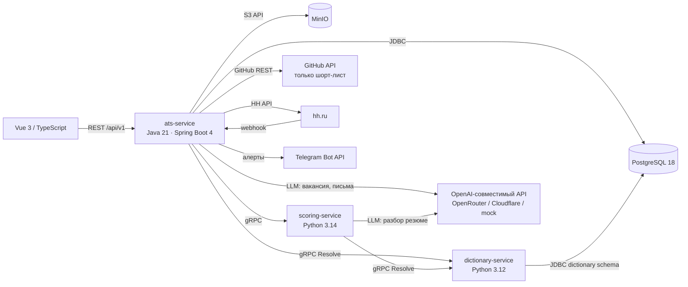

# Tracing ATS — объяснимый подбор «резюме ↔ вакансия»

## Аннотация

**Tracing ATS** — объяснимый подбор «резюме ↔ вакансия»: LLM извлекает факты и дословные цитаты, детерминированный код считает балл, человек принимает решение.

- **Кому:** рекрутёр/HR и нанимающий менеджер.
- **Что на выходе:** рейтинг, таблица «требование → подтверждение → статус → комментарий», сильные стороны, пробелы, риски и вопросы кандидату.
- **Два режима:** резюме → вакансии (основной по ТЗ) и вакансия → кандидаты (ATS).
- **Ключевой принцип:** LLM не выставляет баллов; цитата проверяется как подстрока обезличенного текста; решение принимает человек.
- **Стек:** Java 21 / Spring Boot 4, Python 3.14 (scoring), Python 3.12 (dictionary), Vue 3 + TypeScript, PostgreSQL 18, MinIO, gRPC, Docker Compose.
- **Требования:** [`TASK.md`](TASK.md).

---

## 1. Архитектура

### 1.1. Схема



### 1.2. Сервисы

| Компонент | Технологии | Ответственность |
|---|---|---|
| `frontend` | Vue 3, TypeScript, Vite, Tailwind | Вакансии, резюме, словарь, отчёты, письма |
| `ats-service` | Java 21, Spring Boot 4, JPA, Spring gRPC | REST, I/O, PII, оркестрация, hh, GitHub, отчёты, аудит |
| `scoring-service` | Python 3.14, uv, gRPC, Pydantic | Разбор обезличенного резюме, математика и объяснения; stateless |
| `dictionary-service` | Python 3.12, gRPC, pymorphy3, PostgreSQL | Нормализация навыков, алиасы, очередь NEW, квалификации, связи |
| `text-extraction` | Java-библиотека | PDF, DOCX, TXT, MD → нормализованный текст |
| `migrations` | Liquibase | Схема `public` и `dictionary`, seed |
| `PostgreSQL` / `MinIO` | PostgreSQL 18 / S3-совместимое | Доменные данные, оригиналы резюме, артефакты |
| `infra/mock-llm`, `mock-scoring-service`, `mock-hh` | Python / Rust | Демо и CI без внешних ключей и hh |

### 1.3. Границы

- **Java** читает файлы, ходит в PostgreSQL, MinIO, hh, GitHub и LLM для вакансии и писем, маскирует PII и оркестрирует сценарии.
- **`scoring-service`** получает только обезличенный текст и структурированные требования; не читает БД, файлы, GitHub и не получает PII.
- **`dictionary-service`** не вызывает LLM и не считает `S^{ij}`; отдаёт канонические ключи, алиасы и классы связей.
- **`ats-service`** не дублирует арифметику скоринга.
- **Человек решает:** автоматических отказов и приглашений нет; письма кандидату — только черновики.

### 1.4. Потоки данных

**Резюме → вакансии:** загрузка → извлечение текста → маскировка PII → `ExtractResume` (LLM) → `resume_extraction` → `EvaluateResumeMatches` (без LLM) → `score_run` → рейтинг и отчёт.

**Вакансия → кандидаты:** создание вакансии → LLM-шаблон → правка HR → загрузка резюме → `ExtractResume` + `EvaluateResumeMatch` → `score_run(PRELIMINARY)` → скрининг → GitHub для шорт-листа → `score_run(FINAL)` → рейтинг, отчёт, письмо.

Сейчас `FINAL` переиспользует факты `PRELIMINARY`, потому что в контракте нет `Refine`. GitHub-факты видны в отчёте, но пока не меняют `Score`.

### 1.5. Скоринг v0

| Элемент | Реализация |
|---|---|
| `S` для навыков | Точный `skill_id`/ключ — `1.0`; связи словаря: `SAME_GROUP`/`RELATED` `0.7`, `PARENT` `0.6`, `CHILD` `0.5`; иначе `0` |
| `S` для квалификаций | Бинарно по каноническому ключу |
| `S` для образования | `0.7 · направление + 0.3 · уровень` |
| `S` для опыта / текста | Сходство категории / доля значимых токенов в лучшей строке |
| `t` | Regex: результат `0.8`, обязанность `0.5`, остальное `0.3` |
| `τ` | `0.5 · (1 + tanh(years/required − 1)) · 2^(−recency/2)`; `recency` пока не извлекается |
| `c` | Навык `S·t·τ`, опыт `S·τ`, образование/текст `S`, квалификация `1.0` |
| `Score` | Взвешенное покрытие; `λ=0`, `F=0`, `𝓜=1`; в Python `0..1`, в API/БД `0..100` |

Формулы и открытые вопросы — [`docs/rfc/rfc-scoring-model.md`](docs/rfc/rfc-scoring-model.md). Критичность входит в `Wv`, отдельного cap нет.

### 1.6. Приватность

- PII маскируется до LLM: regex + опциональная локальная ONNX NER.
- PII хранится в AES-256-GCM `pii_vault`; `parsed_resume` и `masked_text` PII не содержат.
- `reveal` требует причину и пишет аудит; в отчёте `blind=true`.
- Prompt injection удаляется детерминированно; флаги не содержат исходного текста.
- По умолчанию `ATS_PII_NER_PROVIDER=fake`: имена не маскируются, только regex-PII. Для реальных данных нужна ONNX-модель.

---

## 2. Быстрый запуск

### 2.1. Требования

| Компонент | Минимум |
|---|---|
| Docker Engine / Compose | 24+ / v2 |
| RAM / диск | 8 ГБ / 10 ГБ |
| Локальная разработка | Java 21, Gradle 9.8.2, Node 24, Python 3.14 + `uv`, Python 3.12 |

### 2.2. Запуск

```bash
cp .env.example .env
# Для демо без ключей:
export ATS_PROFILES=mock-llm
export SCORING_SERVICE_LLM_PROVIDER=mock

docker compose up -d --build
docker compose ps
```

Схему накатывает контейнер `migrations`; `ats-service` не создаёт таблицы сам.

### 2.3. Адреса

| Что | Адрес |
|---|---|
| UI | <http://localhost:3000> |
| REST API / Swagger | <http://localhost:8080/api/v1> / <http://localhost:8080/swagger-ui/index.html> |
| `ats-service` gRPC | `localhost:9090` |
| `scoring-service` gRPC | `localhost:8082` |
| `dictionary-service` gRPC | `localhost:8084` |
| PostgreSQL / MinIO | `localhost:5432` / <http://localhost:9000> |
| `mock-llm` / `mock-scoring` / `mock-hh` | `8089` / `8083` / `8090` |

### 2.4. Остановка

```bash
docker compose down
# Удалить также данные PostgreSQL и MinIO:
docker compose down -v
```

### 2.5. Демо и mock

```bash
docker compose up -d --build
./scripts/demo-skill-dictionary.sh
```

- `ATS_PROFILES=mock-llm` — `ats-service` ходит в `infra/mock-llm`.
- `SCORING_SERVICE_LLM_PROVIDER=mock` — скоринг без сети (по умолчанию).
- `docker compose --profile mock-scoring up` — заглушка скоринга.
- `docker compose --profile mock-hh up` — заглушка hh.ru.

### 2.6. hh и Telegram

```bash
export ATS_HH_ENABLED=true
export ATS_HH_API_BASE_URL=http://mock-hh:8090
export ATS_HH_TOKEN=mock-token
export ATS_HH_EMPLOYER_ID=999
export ATS_HH_WEBHOOK_TOKEN=mock-hh-token
export ATS_HH_WEBHOOK_PUBLIC_URL='http://ats-service:8080/api/v1/integrations/hh/webhook?token=mock-hh-token'
docker compose --profile mock-hh up -d --build
./scripts/demo-hh-flow.sh
```

Подробности — [`infra/mock-hh/README.md`](infra/mock-hh/README.md) и [`docs/adr/0007-hh-webhook-integration.md`](docs/adr/0007-hh-webhook-integration.md). Telegram включается `ATS_TELEGRAM_*`; без токена алерты не отправляются.

---

## 3. Что уже работает

| Блок | Состояние |
|---|---|
| PDF, DOCX, TXT, MD | Готово: определение типа по сигнатуре, лимиты, ошибки |
| PII и vault | Готово: regex + ONNX NER, AES-256-GCM, reveal с аудитом |
| Вакансия и шаблон | Готово: `MUST`/`NICE`/`OPTIONAL`, цитаты, правка HR |
| Словарь и квалификации | Готово: алиасы, очередь NEW, связи, админка |
| Разбор резюме | Готово: навыки, квалификации, образование, опыт, цитаты |
| Скоринг и вилка | Готово: детерминированная модель v0 |
| Оба режима, рейтинг, отчёт | Готово |
| Объяснения | Готово: `feedback-templates.v2` |
| GitHub | Частично: факты в отчёте, не в `Score` |
| hh и Telegram | Готово: вебхук, `Score_pre`, алерт |
| Письма кандидату | Готово: черновики, без автоотправки |

---

## 4. Ограничения и roadmap

- Нет авторизации и ролей; `/users/*` есть только в контракте.
- GitHub не влияет на `Score`; `FINAL` копирует `PRELIMINARY`; нет `Refine`.
- Нет внешних `q`/`λ`, формулы `F`, общего `τ_total`, cap и `ml-trainer`.
- NER по умолчанию `fake`; ONNX-модель не входит в репозиторий.
- Нет PDF-отчёта, OCR и профилей весов.
- `ATS_SCREENING_*` не привязываются; `DICTIONARY_SERVICE_TOKEN` не проверяется.
- `score_run` не хранит `resolver_version`/`dictionary_mode`.

Дальше: реальная NER, CI для словаря, GitHub/`Refine`, PDF, авторизация, калибровка.

---

## 5. API, данные и тесты

- REST — [`contracts/openapi.yaml`](contracts/openapi.yaml); gRPC — [`scoring.proto`](contracts/proto/scoring_service/v1/scoring.proto), [`dictionary.proto`](contracts/proto/dictionary_service/v1/dictionary.proto), [`vacancy-internal.proto`](contracts/vacancy-internal.proto).
- Схема данных — [`docs/data-model.md`](docs/data-model.md); запуски и шаблоны неизменяемы.
- Тесты: `cd ats-service && ./gradlew test`; `cd scoring-service && uv run pytest -q`; `cd frontend && npm test`.
- CI: Java, Python, mock-scoring, frontend, migrations; отдельного job для `dictionary-service` нет.

---

## 6. Документация

- [`TASK.md`](TASK.md) — продуктовые требования.
- [`AGENTS.md`](AGENTS.md) — правила работы AI-агента.
- [`docs/README.md`](docs/README.md) — индекс документов.
- [`docs/service-overview.md`](docs/service-overview.md) — архитектура и сценарии.
- [`docs/resume-pipeline.md`](docs/resume-pipeline.md) — пайплайн резюме.
- [`docs/known-issues.md`](docs/known-issues.md) — известные расхождения.
- [`docs/deploy-vps.md`](docs/deploy-vps.md) — деплой.
- [`docs/adr/`](docs/adr/) — архитектурные решения.
- [`docs/reports/`](docs/reports/) — исторические отчёты.
