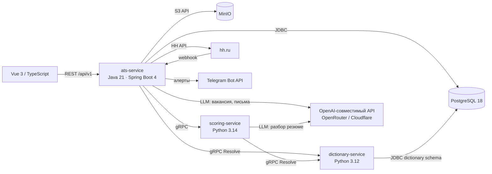

# Tracing ATS — объяснимый подбор «резюме ↔ вакансия»

## Аннотация

**Tracing ATS** сопоставляет резюме с вакансиями и объясняет результат по каждому требованию: что подтверждено дословной цитатой, что закрыто частично, где пробел и что стоит уточнить у кандидата. Система работает в двух направлениях — от резюме к вакансиям и от вакансии к пачке резюме. LLM извлекает факты и цитаты, балл считает детерминированный код, финальное решение остаётся за человеком.

---

## Архитектура



### Границы ответственности

- **`ats-service`** — REST, файлы, PostgreSQL, MinIO, hh, GitHub, маскировка PII, шаблон вакансии, оркестрация, аудит и отчёты. Арифметику скоринга не дублирует.
- **`scoring-service`** — stateless: получает обезличенный текст и структурированные требования, вызывает LLM для разбора резюме и считает `S`, `τ`, `t`, `c`, `Score`. Не имеет доступа к БД, файлам, GitHub, hh и PII.
- **`dictionary-service`** — владеет схемой `dictionary`: нормализует навыки и квалификации, хранит алиасы и связи. LLM не вызывает, числа похожести не считает.
- **`text-extraction`** — библиотека извлечения текста из PDF, DOCX, TXT и MD.
- **Человек решает:** автоматических отказов и приглашений нет; письмо кандидату — черновик для проверки HR.

### Потоки данных

**Резюме → вакансии:** загрузка файла → извлечение текста → маскировка PII → `ExtractResume` через LLM → `resume_extraction` → `EvaluateResumeMatches` без LLM → `score_run` → рейтинг и отчёт.

**Вакансия → кандидаты:** создание вакансии → LLM-шаблон требований → правка HR → загрузка резюме → `ExtractResume` + `EvaluateResumeMatch` → `score_run(PRELIMINARY)` → скрининг → `score_run(FINAL)` → рейтинг, отчёт, черновик письма.

`PRELIMINARY` и `FINAL` — разные фазы и разные записи `score_run`; они не смешиваются. `FINAL` переиспользует готовые факты `PRELIMINARY`, пока в контракте нет `Refine`.

### Скоринг

| Элемент | Правило |
|---|---|
| `S` для навыков | Точный ключ — `1.0`; `SAME_GROUP`/`RELATED` — `0.7`, `PARENT` — `0.6`, `CHILD` — `0.5`; иначе `0` |
| `S` для квалификаций | Бинарно по каноническому ключу |
| `S` для образования | `0.7 · направление + 0.3 · уровень` |
| `S` для опыта и текста | Сходство категории / доля значимых токенов в лучшей строке |
| `t` | Regex: результат `0.8`, обязанность `0.5`, остальное `0.3` |
| `τ` | `0.5 · (1 + tanh(years/required − 1)) · 2^(−recency/2)` |
| `c` | Навык `S·t·τ`, опыт `S·τ`, образование/текст `S`, квалификация `1.0` |
| `Score` | Взвешенное покрытие; в Python `0..1`, в API и БД `0..100` |

Цитата-доказательство принимается только как подстрока обезличенного текста после нормализации пробелов. Критичность входит в `Wv`; отдельного cap нет.

### Приватность

- PII маскируется до вызова LLM; в `parsed_resume` и `masked_text` PII не попадает.
- PII хранится в AES-256-GCM `pii_vault`; раскрытие требует причины и пишет аудит.
- В отчёте по умолчанию `blind=true`: PII не попадает в DOM до `reveal`.
- `ATS_PII_NER_PROVIDER=fake` маскирует только regex-PII. Для реальных данных нужен `onnx` и модель в `models/ner`.

---

## Запуск

### Требования

| Компонент | Минимум |
|---|---|
| Docker Engine / Compose | 24+ / v2 |
| RAM / свободный диск | 8 ГБ / 10 ГБ |
| Свободные порты | `3000`, `5432`, `8080`, `8082`, `8084`, `9000`, `9001`, `9090` |
| Локальная разработка | Java 21, Gradle 9.8.2, Node 24, Python 3.14 + `uv`, Python 3.12 |

### Запуск

```bash
cp .env.example .env
# заполните ключи в .env (см. таблицу ниже)

docker compose up -d --build
docker compose ps
```

Схему накатывает контейнер `migrations`; `ats-service` таблицы не создаёт. Бакет MinIO создаёт `minio-init`.

### Адреса

| Что | Адрес |
|---|---|
| UI | <http://localhost:3000> |
| REST API / Swagger | <http://localhost:8080/api/v1> / <http://localhost:8080/swagger-ui/index.html> |
| `ats-service` gRPC | `localhost:9090` |
| `scoring-service` gRPC | `localhost:8082` |
| `dictionary-service` gRPC | `localhost:8084` |
| PostgreSQL / MinIO | `localhost:5432` / <http://localhost:9000> |

### Ключевые переменные окружения

| Переменная | Назначение |
|---|---|
| `OPENROUTER_API_KEY` | Общий ключ OpenRouter; используется, если отдельный ключ сервиса не задан |
| `VACANCY_LLM_BASE_URL`, `VACANCY_LLM_MODEL`, `VACANCY_LLM_API_KEY` | LLM `ats-service`: требования вакансии, словарь, письма |
| `SCORING_SERVICE_LLM_PROVIDER`, `SCORING_SERVICE_LLM_BASE_URL`, `SCORING_SERVICE_LLM_MODEL`, `SCORING_SERVICE_LLM_API_KEY` | LLM `scoring-service`: разбор резюме; для реальной модели задайте `openai` и endpoint |
| `CLOUDFLARE_AI_ENABLED`, `CLOUDFLARE_AI_BASE_URL`, `CLOUDFLARE_AI_API_TOKEN`, `CLOUDFLARE_AI_MODEL` | Запасной OpenAI-совместимый провайдер |
| `ATS_PII_ENCRYPTION_KEY` | Base64 32-байтного AES-256-GCM ключа; для production сгенерируйте свой |
| `ATS_PII_NER_PROVIDER`, `ATS_PII_NER_MODEL_PATH` | Маскировка имён: `fake` или `onnx` с путём к модели |
| `ATS_HH_ENABLED`, `ATS_HH_TOKEN`, `ATS_HH_EMPLOYER_ID`, `ATS_HH_WEBHOOK_TOKEN`, `ATS_HH_WEBHOOK_PUBLIC_URL` | Интеграция с hh.ru |
| `ATS_TELEGRAM_ENABLED`, `ATS_TELEGRAM_BOT_TOKEN`, `ATS_TELEGRAM_CHAT_ID` | Алерты в Telegram без PII |
| `ATS_GITHUB_ENABLED`, `ATS_GITHUB_TOKEN` | Обогащение профиля GitHub для отобранных кандидатов |
| `POSTGRES_DB`, `POSTGRES_USER`, `POSTGRES_PASSWORD` | Доступ к PostgreSQL |
| `ATS_S3_ACCESS_KEY`, `ATS_S3_SECRET_KEY`, `ATS_S3_BUCKET` | Доступ к MinIO/S3 и бакет оригиналов |

Порты, таймауты, лимиты и остальные настройки — в [`.env.example`](.env.example).

### Остановка

```bash
docker compose down
# удалить также данные PostgreSQL и MinIO:
docker compose down -v
```

---

## Roadmap

### Надёжность и безопасность

- Добавить авторизацию и роли: OIDC/LDAP, RBAC, различение пользователей в аудите.
- Защитить админские gRPC-методы словаря токеном и проверять его на каждом вызове.
- Включить ONNX NER по умолчанию, добавить модель и токенизатор в поставку, проверять отсутствие PII в исходящих запросах в CI.
- Добавить переключатель blind-mode и явную подпись фазы `PRELIMINARY`/`FINAL` в UI.
- Добавить резервное копирование PostgreSQL и MinIO, health/readiness-пробы и метрики очередей.

### Скоринг и объяснимость

- Добавить `Refine` в gRPC-контракт и пересчёт `FINAL` с внешними подтверждениями.
- Передавать в скоринг внешние `q_i^l`, `λ_l` и общий `τ_total`; извлекать `recency`.
- Реализовать формулу домена `F` и множитель `𝓜`, откалибровать `Score_low`/`Score_high`.
- Добавить `ml-trainer`: размеченные исходы, обучение весов, профили под специализации и уровни, активацию артефактов с версией.
- Расширить golden-тесты на детерминизм, цитаты, отсутствие штрафа за внешние источники и разделение фаз.

### Подбор и коммуникация

- Добавить импорт вакансий и резюме с hh.ru, синхронизацию откликов и статусов.
- Добавить календарь интервью, заметки по кандидату, оффер и обратную связь в одном контуре.
- Добавить PDF-отчёт для кандидата и нанимающего менеджера.
- Добавить экран рейтинга, запуск скрининга из UI, batch-загрузку резюме и добавление квалификационных требований.
- Добавить независимые подтверждения: портфолио, публикации, сертификаты, открытые профили — только повышение покрытия, без штрафа за отсутствие.

### Данные и языки

- Добавить OCR для PDF без текстового слоя и поддержку `.doc`.
- Расширить словарь за пределы IT, добавить мультиязычные резюме и вакансии.
- Добавить `Embedding`/`fuzzy`-резолв в словаре, зафиксировать зависимости через `uv.lock`, добавить отдельный CI job.
- Хранить в `score_run` версии резолвера и режим словаря для воспроизводимости.
- Добавить on-prem-развёртывание и локальные модели как вариант без внешних LLM.
