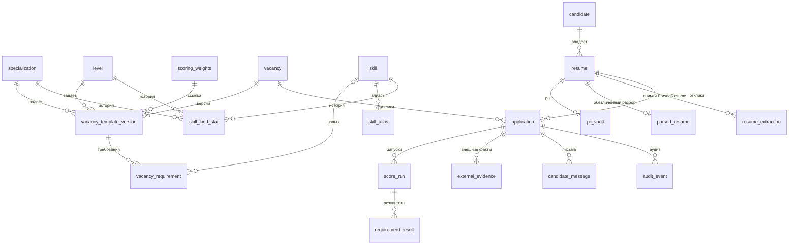

# Модель данных

Схема создаётся Liquibase-миграциями из [`migrations/changes`](../migrations/changes) через контейнер `migrations`. Приложение работает с `ddl-auto=validate` и не создаёт таблицы. Корневой changelog — [`migrations/db.changelog-master.yaml`](../migrations/db.changelog-master.yaml).

В PostgreSQL две схемы:

- **`public`** — вакансии, резюме, PII, отклики, запуски скоринга, аудит, письма, staging словаря;
- **`dictionary`** — словарь навыков и квалификаций, принадлежит `dictionary-service`.

---

## 1. Общая схема

---

## 2. Вакансии и шаблоны

| Таблица | Назначение | Ключевые поля |
|---|---|---|
| `specialization` | Специализации | `code`, `name`, `is_it`, `is_active` |
| `level` | Уровни | `code`, `name`, `sort_order`, `github_weight`, `is_active`; скрытый `none` для не-IT |
| `scoring_weights` | Версии весов | `version`, `status`, `w_m`, `w_n`, `w_f`; историческая совместимость |
| `skill` | Публичный словарь Java | `name`, `normalized_name` |
| `skill_alias` | Алиасы публичного словаря | `alias_normalized`, `skill_id`, `source` |
| `skill_kind_stat` | История `kind` HR | `specialization_id`, `level_id`, `skill_id`, счётчики |
| `vacancy` | Вакансия | `title`, `status`, `source_type`, `source_text`, `current_version` |
| `vacancy_template_version` | Неизменяемая версия шаблона | `version_no`, `specialization_id`, `level_id`, `github_weight`, `scoring_weights_id`, `prompt_version`, `llm_model`, `is_confirmed`, `dropped_requirements` |
| `vacancy_requirement` | Требование версии | `position`, `skill_id`, `skill_text`, `raw_text`, `kind`, `kind_source`, `llm_kind`, `critical`, `years_required`, `half_life_years`, `clarity_warning`, `qualification`, `education_level` |

### Особенности

- `vacancy_template_version` и `vacancy_requirement` защищены триггером `forbid_update`; правка создаёт новую версию.
- `kind` — `MUST`, `NICE`, `OPTIONAL`; числового `weight` в таблице требований больше нет.
- `critical` всегда `false`: API и UI не выставляют критичность. Критичность в скоринге выводится из `kind` (при наличии — из `critical`, если бы он был задан).
- `qualification = true` означает открытую квалификацию; её label хранится в `skill_text`.
- `education_level` — отдельное требование к образованию; специальность хранится в `skill_text`.
- `scoring_weights` остаётся для совместимости версии шаблона, но `scoring-service` не читает `w_m/w_n/w_f`. `Wv` считается из `criticality`.
- `level.github_weight` копируется в версию шаблона, но в текущем скоринге не используется.

---

## 3. Резюме и PII

| Таблица | Назначение | Ключевые поля |
|---|---|---|
| `candidate` | Кандидат | `id`, timestamps; PII здесь нет |
| `resume` | Резюме и оригинал | `candidate_id`, `original_object_key`, `original_sha256`, `original_size_bytes`, `file_type`, `status`, `warnings`, `title` |
| `pii_vault` | Зашифрованные PII | `resume_id`, `key_version`, `iv`, `ciphertext` |
| `parsed_resume` | Обезличенный текст и образование | `masked_text`, `injection_flags`, `education_level`, `degree`, `specialty`, `education_years`, `pii_model`, `ner_used` |
| `resume_extraction` | Снимок `ParsedResume` из scoring | `resume_id`, `extracted_features`, `extraction_version` |

### Статусы резюме

`UPLOADED`, `TEXT_EXTRACTED`, `MASKED`, `TEXT_EMPTY`, `MASKING_FAILED`, `FAILED`, `EXTRACTED`, `MATCHING`, `MATCHED`, `MATCH_FAILED`.

### PII

- `pii_vault` неизменяем: триггер запрещает `UPDATE`.
- `parsed_resume` неизменяем.
- В `masked_text` и `parsed_resume` не должно быть PII. Образование (вуз, специальность, годы) по решению команды не маскируется; при этом `PiiPayload.university` для новых резюме всегда `null`.
- Ключ AES-256-GCM хранится вне БД и обязателен при старте.

---

## 4. Отклики, скрининг и скоринг

| Таблица | Назначение | Ключевые поля |
|---|---|---|
| `application` | Отклик «резюме × вакансия» | `vacancy_id`, `resume_id`, `candidate_id`, `consent_github`, `status`, `screening_decision`, `preliminary_score_run_id`, `final_score_run_id` |
| `screening_batch` | Асинхронный пакет | `vacancy_id`, `resume_id`, `direction`, `status`, `total`, `processed`, `failed`, `error_message` |
| `score_run` | Неизменяемый запуск скоринга | `application_id`, `batch_id`, `phase`, `direction`, `resume_id`, `vacancy_id`, `vacancy_title`, `scoring_version`, `prompt_version`, `model_version`, `weights_version`, `score`, `score_low`, `score_high`, `cap_applied`, `flags`, `parsed` |
| `requirement_result` | Результат по требованию | `score_run_id`, `requirement_id`, `requirement_text`, `kind`, `weight`, `critical`, `c_r`, `status`, `m`, `t`, `rho`, `relevance`, `tenure`, `evidence_source`, `evidence_quote`, `gap`, `external` |
| `external_evidence` | Нормализованные внешние факты | `application_id`, `score_run_id`, `source`, `skill`, `facts`, `flags` |
| `audit_event` | Аудит действий | `application_id`, `actor`, `action`, `reason`, `metadata` |
| `report_decision` | Решение HR по паре | `resume_id`, `vacancy_id`, `decision`, `comment`, `updated_at` |
| `candidate_message` | Черновики писем | `application_id`, `score_run_id`, `phase`, `kind`, `subject`, `body`, `prompt_version`, `model_version` |

### Направления

- `VACANCY_TO_CANDIDATES` — `application_id` обязателен;
- `RESUME_TO_VACANCIES` — обязательны `resume_id` и `vacancy_id`, `application_id` может быть `NULL`.

### Фазы

- `PRELIMINARY` — по тексту резюме;
- `FINAL` — отдельный запуск. Сейчас копирует готовые факты `PRELIMINARY`, потому что `Refine` в контракте нет.

### Статусы требований

`COVERED`, `PARTIAL`, `GAP`, `NOT_STATED`, `ABSENT`.

### Ограничения

- `score_run` и `requirement_result` неизменяемы.
- `requirement_result.c_r`, `m`, `t`, `rho` имеют ограничения `0..1`; `m/t/rho` текущий Java-writer не заполняет.
- `cap_applied` всегда `false`: cap в модели не применяется.
- `external_evidence.source` пока только `GITHUB`.
- `candidate_message.kind` — `INTERVIEW_INVITATION` или `REJECTION`; `phase` — `PRELIMINARY` или `FINAL`; тело 80–3000 символов.
- `report_decision` изменяема; остальные ключевые таблицы — нет.

---

## 5. Словарь

Схема `dictionary` создаётся миграциями `020` и `023`, seed — `021` (навыки) и Python-сервис (квалификации и связи при пустых таблицах).

| Таблица | Назначение |
|---|---|
| `dictionary.skill` | Канонический навык, `status`, `skill_type` |
| `dictionary.skill_alias` | Алиас, canonical-флаг, язык, источник |
| `dictionary.skill_alias_key` | Уникальный нормализованный ключ и его вид (`RAW`, `FOLDED`, `LEMMA`, `LEMMA_FOLDED`) |
| `dictionary.review_item` | Очередь NEW: образцы, вхождения, кандидаты, статус |
| `dictionary.dictionary_meta` | Версии словаря, квалификаций, связей, конфигурации |
| `dictionary.dictionary_snapshot` | Снапшот состояния по `resolver_version` |
| `dictionary.qualification` | Каноническая квалификация |
| `dictionary.qualification_alias` | Алиасы квалификаций |
| `dictionary.qualification_alias_key` | Нормализованные ключи квалификаций |
| `dictionary.qualification_review_item` | Очередь NEW для квалификаций |
| `dictionary.skill_relation` | Неориентированная связь пары навыков и `relation_kind` |

### Версии

`resolver_version` собирается из версий словаря, квалификаций, связей, конфигурации, `pymorphy` и правил гомоглифов. `Resolve`/`ResolveQualifications`/`GetRelations` принимают `as_of_resolver_version`; неизвестная версия — `NOT_FOUND`.

### Ограничения

- `Resolve` не делает нечёткий матчинг; подсказки кандидатов — только в очереди NEW.
- `DICTIONARY_SERVICE_TOKEN` загружается, но не проверяется.
- `dictionary-service` не вызывает LLM и не считает `S^{ij}`.
- Квалификации — отдельная сущность, не `skill_type=OTHER`.
- `skill_relation` хранит класс связи, а не число похожести.

---

## 6. Staging генерации словаря

| Таблица | Назначение |
|---|---|
| `skill_generation_job` | Задание генерации по специализации, статус, модель, промпт, сырой ответ |
| `skill_generation_draft` | Черновик навыка, конфликты, выбран/отклонён |
| `skill_generation_alias` | Черновик алиаса, категория, конфликты |

Черновики не попадают в словарь без подтверждения HR. `ApplySkills` применяет выбранное одной транзакцией и поднимает версию словаря.

---

## 7. Миграции

Актуальный набор — `001–025`; файлы `005–008` в репозитории отсутствуют.

- `001` — вакансии, шаблоны, требования, справочники;
- `002` — резюме, PII, отклики, скрининг, скор, аудит;
- `003` — демо-вакансия;
- `004` — интеграция скоринга;
- `009–015` — `kind`, алиасы, история, специализации, не-IT уровни;
- `016–020` — обратный подбор, `resume_extraction`, решения HR, квалификации, схема словаря;
- `021–023` — seed словаря, генерация, квалификации и связи;
- `024` — требования к образованию;
- `025` — черновики писем кандидату.

Порядок include задан в `db.changelog-master.yaml` и не совпадает с числовым порядком имён: сначала `001` и `009–015`, затем `002–004`, затем `016–025`.

---

## 8. Инварианты

- Версии шаблонов и требований неизменяемы.
- `score_run`, `requirement_result`, `pii_vault`, `parsed_resume`, `audit_event` неизменяемы на уровне БД.
- `candidate_message` создаётся только новой строкой в коде; отдельного DB-триггера на неё нет.
- `parsed_resume` и `masked_text` не содержат PII.
- Запуски хранят версии модели, промпта, формулы и шаблона.
- Повторный расчёт создаёт новый запуск, старые не пересчитываются.
- `PRELIMINARY` и `FINAL` — разные строки и разные подписи.
- `score_run` не хранит `resolver_version` и `dictionary_mode`; это известное ограничение.
