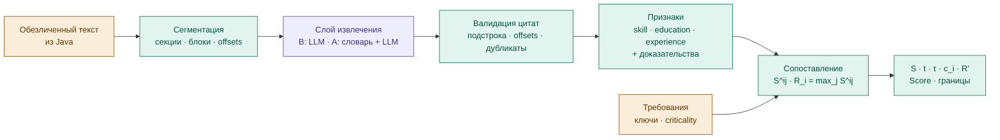

| | |
|---|---|
| **Статус** | Draft |
| **Автор** | DeepSeek | 
| **Дата** | 2026-11-10 |
| **Контур** | Python, `scoring-service/` |
| **Ветка** | `feature/scoring-service` |
| **Модуль** | `scoring-service` |
| **Учтено** | `feature/vacancy-skill-kinds` (не вмержена): `kind`, `skill_alias`, `vacancy-template.v2` |

# RFC: извлечение признаков из резюме и сверка с требованиями

> [!NOTE]
> Документ описывает **пайплайн извлечения и сопоставления**, а не математику.
> Формулы, переменные и их значения остаются в `docs/rfc/rfc-scoring-model.md`.
> Здесь фиксируются только: откуда берутся `S^{ij}`, `t_i`, `τ_i`, как проверяются
> доказательства и как один пайплайн заменяется другим.

## 1. Контекст

По `README.md` (этап 10) резюме превращается в структурированные данные, включая
неявные навыки, после чего сверяется с шаблоном вакансии. По `AGENTS.md` §5 это
зона `scoring-service`: сервис получает обезличенный текст и требования, сам
вызывает LLM и возвращает категории и цитаты; числа считает код.

На момент написания RFC этого слоя не было (историческая справка):
`scoring-service/src/api/scoring.py` был заглушкой, возвращавшей `0.5`; каталога
`scoring-service/src/api/prompts/` не было. Первый инкремент реализован в ветке
`feature/scoring-service-impl` (раздел 5.7). В ветке
`feature/vacancy-skill-kinds` (пока не вмержена) появились
`infra/mock-llm/`, промпт `vacancy-template.v2` со строгой схемой ответа и словарь
синонимов навыков (`skill_alias`, точное совпадение нормализованного ключа из
`SkillNormalizer`). Это задаёт соглашения, которые слой резюме должен повторить,
а не изобретать заново. Контракт
`contracts/proto/scoring_service/v1/scoring.proto` описывает форму ответа, но не
описывает, как получаются значения.

Нужно зафиксировать два способа извлечения и порядок перехода между ними, чтобы
реализация не превратилась в переписывание сервиса.

## 2. Цель и рамки

**Цель.** Описать:

1. пайплайн **B** — оценка требований по документу одним LLM-вызовом (стартовый, P0);
2. пайплайн **A** — детерминированное извлечение с LLM только на остатке (целевой);
3. механизм перехода B → A без изменения контракта и математики;
4. требования к локальной LLM как провайдеру;
5. расхождения документации, которые нужно закрыть ADR/правками.

### 2.1. В рамках

- вход/выход слоя извлечения в терминах gRPC-контракта;
- сегментация текста и карта offsets;
- схема ответа LLM, валидация, обработка отказов;
- правила сведения категорий в `S^{ij}` и `t_i` (значения — открытый вопрос);
- режимы работы, метрики и критерии переключения;
- кеширование результата между предварительным и итоговым вызовом.

### 2.2. Вне рамок

- извлечение текста из PDF/DOCX — `text-extraction/` (Java), см. `rfc-text-extraction.md`;
- маскировка PII — Java, отдельный модуль;
- формулы `τ`, `c_i`, `R'`, `Score`, границы и значения гиперпараметров — `rfc-scoring-model.md`;
- справочник навыков как продукт: владелец — Java (`skill` и `skill_alias` в PostgreSQL);
- обучение гиперпараметров — `ml-trainer/`;
- UI и отчётность.

## 3. Термины

| Термин | Значение |
|---|---|
| **Признак** | экземпляр `Skill`, `Education`, `PriorExperience` или `Unclassified` из текста резюме |
| **Требование** | запись `FeatureRequirement` из запроса, с ключом клиента |
| **Оценка** | `FeatureAssessment` для требования: `S^{ij}`, `t_i`, `τ_i` и доказательство |
| **Доказательство** | дословная цитата из обезличенного текста с границами `start_index`/`end_index` |
| **Ядро** | детерминированные шаги: сегментация, даты, валидация цитат, сведение, арифметика |
| **Режим** | конфигурация слоя извлечения: `llm`, `hybrid`, `shadow` |

## 4. Общая схема



Слой извлечения — единственное место, где пайплайны B и A различаются.

### 4.1. Детерминированное ядро

Общее для B и A, появляется сразу, чтобы переход не трогал эти части:

1. **Сегментация.** Секции (опыт, навыки, образование), блоки-работодатели,
   границы предложений. Каждому фрагменту — абсолютный `[start, end)` в
   обезличенном тексте, который пришёл в запросе.
2. **Карта offsets.** Любая нормализация (пробелы, переводы строк, юникод)
   сохраняет обратное отображение. Offsets всегда считаются **от переданного
   текста**, а не от исходного PDF: маскировка меняет длину строки.
3. **Даты, стаж, давность.** `2021—2023`, `март 2020 — н.в.`, `2 года`.
   Упоминание признака привязывается к ближайшему блоку опыта → `tenure`,
   `recency`. Функции чистые, «сегодня» передаётся параметром.
4. **Валидатор доказательств.** Цитата обязана быть подстрокой фрагмента после
   схлопывания пробельных последовательностей (включая `U+00A0` и `U+202F`) —
   тот же приём, что в `QuoteMatcher` для вакансии. Регистр и пунктуация
   сохраняются. Дубликаты разрешаются по `quote_hint`, иначе берётся первое
   вхождение; непрошедшая цитата отбрасывается вместе с признаком. Границы
   всегда указывают на исходный обезличенный текст, а не на нормализованную копию.
5. **Сведение.** Категория → `S^{ij}`, тип доказательства → `t_i`, границы —
   по таблицам из `rfc-scoring-model.md`.
6. **Арифметика.** `R_i`, `Rv`, `τ`, `c_i`, `R'`, `Score`, `Score_l`/`Score_h` —
   только здесь.

### 4.2. Шов

```python
class ExtractedFeature(TypedDict):
    kind: Literal["skill", "education", "experience", "unclassified"]
    name: str
    normalized_name: str
    evidence: Evidence | None       # текст + абсолютные границы
    tenure_years: int | None
    recency_years: int | None
    source: Literal["dictionary", "llm", "both"]


class ExtractionPort(Protocol):
    def assess(
        self,
        text: str,
        requirements: Sequence[Requirement],
    ) -> AssessedResult: ...
```

`AssessedResult` содержит оценки по требованиям, список недостающих требований и
`extraction_meta`. Всё, что идёт после порта, от реализации не зависит.

## 5. Пайплайн B (P0): LLM оценивает требования по документу

Название точное: это не «парсинг резюме вообще», а **попарная оценка
«требование × документ»**, упакованная в один вызов на резюме.

### 5.1. Шаги

1. Java: текст → маскировка → gRPC. В запросе: `requirements` с ключами,
   нормализованными именами и `criticality`, собранной из `kind`;
   `UnprocessedResume.text`.
2. Python, подготовка (детерминированно): нормализация с картой offsets, нарезка
   на чанки 2–4k токенов, компактный список требований `{key, name,
   normalized_name, criticality}`.
3. Вызов LLM. Вход разделён на блоки `<resume>` и `<requirements>`; текст резюме
   объявлен данными, инструкции внутри него игнорируются.
4. Ответ — строгий JSON по схеме (раздел 5.2). Невалидный ответ: один повтор с
   указанием ошибки, затем ошибка. «Починка» регулярками запрещена
   (`AGENTS.md` §7.3).
5. Валидация и сведение (разделы 5.3–5.4).
6. Арифметика ядра → ответ `ScoreResumeResponse`.
7. Java сохраняет `parsed` и `extraction_meta` (раздел 9) для повторного расчёта.

### 5.2. Схема ответа

```json
{
  "assessments": [
    {
      "requirement_key": "skill:kafka",
      "similarity": "exact",
      "evidence_kind": "with_result",
      "quote": "снизил задержку обработки на 40%",
      "quote_hint": "опыт, 2-й блок"
    }
  ]
}
```

Схема намеренно повторяет соглашения промпта вакансии (`vacancy-template.v2`):
плоский JSON, enum-поля, цитата отдельным полем, версия схемы в ответе. Разница
только в предмете: там требования вакансии, здесь оценки резюме.

Ограничения схемы:

- `similarity ∈ {exact, strong, partial, none}` — категория, не число;
- `evidence_kind ∈ {listed, duty, with_result, absent}` — категория для `t_i`;
- `quote` — дословная, не длиннее двух предложений;
- никаких `t`, `S`, процентов, `tenure` и оценок: стаж считает ядро из дат;
- лишние поля отбрасываются, неизвестные значения enum — ошибка схемы.

Отдельно для неявных навыков: допускается только вывод из описания задач
(`AGENTS.md` §7.5), без цитаты признак не создаётся.

### 5.3. Валидация

Порядок обязателен:

1. JSON разобран и прошёл Pydantic-схему;
2. `requirement_key` существует в запросе, дубликаты ключа — ошибка;
3. `quote` найдена как подстрока **внутри чанка** → пересчёт в абсолютные
   offsets; не найдена → оценка отбрасывается с причиной;
4. `similarity = none` требует пустой цитаты; иначе считается несогласованностью
   и оценка отбрасывается;
5. требование, отсутствующее в ответе, попадает в `missing_requirements`,
   а не получает `R_i = 0`.

### 5.4. Сведение

| Категория | `S^{ij}` | Примечание |
|---|---|---|
| exact | 1.0 | предложение, требует фиксации в `rfc-scoring-model.md` |
| strong | 0.85 | там же |
| partial | 0.5 | там же |
| none | 0.0 | там же |

Правило `exact-override`: если `normalized_name` признака совпадает с
`normalize_name` требования, `S = 1` независимо от категории модели. Это
дешёвая страховка от путаницы `Postgres`/`PostgreSQL` и требование открытого
вопроса RFC о гарантии `S = 1`.

Направление по весам: **веса требований в `scoring-service` не передаются.**
В запросе есть только классификация — `kind` (`MUST`/`NICE`/`OPTIONAL`) или
собранный из него `criticality` в proto, — а `Wv^i` сервис выводит сам по
правилам RFC. Ни `weight`, ни `critical` в контракт не попадают. Маппинг:
`MUST` → `REQUIRED`, `NICE` → `NICE`, `OPTIONAL` → `OPTIONAL`; значение
`CRITICAL` не используется. Окончательно это фиксируется контрактом и ADR.

Ветка `feature/vacancy-skill-kinds` ещё не вмержена, поэтому в текущем
`feature/scoring-service` действует старая модель с `weight`. Всё описанное выше —
целевое состояние после мержа, а не то, что уже в рабочем дереве.

Категория `evidence_kind` переводится в `t_i` по действующей шкале
(`listed` → 0.3, `duty` → 0.5, `with_result` → 0.8). При `absent` значение `t_i`
не определено, и требование уходит в `missing_requirements`.

### 5.5. Отказы и деградация

| Отказ | Следствие | Мера |
|---|---|---|
| требование выпало из ответа | незаслуженный пробел | `missing_requirements` → вилка, `refine = true` |
| цитата переписана | оценка отброшена | guided decoding, строгая валидация, один повтор |
| категория нестабильна | рейтинг «дрожит» | temperature 0, метрика стабильности (раздел 12) |
| длинное резюме | деградация к середине | чанки по секциям, требование оценивается по всем чанкам |
| prompt injection в резюме | посторонние поля | enum-only схема, «данные, не инструкции», отбрасывание лишнего |
| LLM недоступна | нет предварительного скора | таймаут, повтор, затем ошибка `EXTRACTION_UNAVAILABLE` (не «0 баллов») |

### 5.6. Стоимость и латентность

Оценка при 20–30 требованиях: выход 1.5–3k токенов на резюме, вход — 2–4k на
чанк. 1000 резюме ≈ 2–3M выходных токенов. Латентность одного вызова — секунды;
пакет обрабатывается параллельно с ограничением конкурентности и таймаутами.
Цифры уточняются замером (раздел 13).

### 5.7. Реализация v0

Первый инкремент (`feature/scoring-service-impl`) добавил извлечение признаков,
а не попарную оценку «требование × документ». LLM возвращает строгий JSON
`ParsedResume` (`skills`, `education`, `experience`) с цитатами; Python
проверяет цитаты как подстроки со схлопыванием пробелов, отбрасывает признаки
без валидной цитаты и собирает `FeatureAssessment` по требованиям запроса.
В текущей v0 сопоставление выполняется детерминированно по этим признакам.

`S^{ij}` в v0 считается детерминированно (`src/api/scoring/similarity.py`):
точное совпадение нормализованных имён — `1.0`, вхождение токенов или
`SequenceMatcher >= 0.8` — `0.85`, `>= 0.7` — `0.5`, иначе `0.0`. Для
образования сходство направления весит 0.7, соответствие уровня — 0.3; для
текстовых требований `S` — доля значимых токенов требования в тексте резюме.
`R_i` — максимум по проверенным признакам резюме.

`t_i` для навыков выводится из цитаты секционными правилами: результат или
метрика — 0.8, обязанность — 0.5, остальное — 0.3. `τ_i` — произведение
фактора стажа `0.5·(1+tanh(years/required − 1))` и свежести
`2^(−recency/2)`; неизвестные значения расширяют вилку. `c_i` для навыка —
`S·t·τ`, для опыта — `S·τ`, для образования и текста — `S`. `Wv^i` пока
выводится из критичности (0.25/0.5/0.75/1.0), `Score` — взвешенное покрытие,
`Score_l`/`Score_h` — детерминированная подстановка граничных `τ` (для
`NOT_STATED` верхняя граница — 1.0). Внешних источников нет, поэтому
`λ = 0`; `F = 0`, `𝓜 = 1`, пока формула домена не зафиксирована.

`NOT_STATED` означает «в резюме нет сведений», а не «навыка нет»: точка
покрытия равна 0, но верхняя граница вилки — 1.0. Значения `S`, `t`, `Wv` и
`F` остаются открытыми до правки `rfc-scoring-model.md`; они вынесены в
заменяемые политики.

Объяснения (`strengths`, `risks`, `questions`, `recruiter_note`) собираются
детерминированно по каталогу `feedback-templates.v1`; LLM для них не
вызывается. Правила — `docs/rfc/rfc-feedback-generation.md`.

Провайдер по умолчанию — `mock` (детерминированный, без сети); реальный
OpenAI-совместимый эндпоинт включается `SCORING_SERVICE_LLM_PROVIDER=openai`.
Клиент — официальный SDK `openai` с настраиваемым `base_url`, поэтому подходит
OpenRouter и локальные OpenAI-совместимые серверы. Промпт и JSON-схема —
`scoring-service/src/api/prompts/resume_extraction.py`, версия
`resume-extraction.v1`. Контракт gRPC дополнен методами `ExtractResume`,
`EvaluateResumeMatch` и `EvaluateResumeMatches`: первый возвращает `ParsedResume`
без сверки с вакансией, второй оценивает уже разобранное резюме по одной
вакансии, третий — пакетно по нескольким. `ScoreResume` остаётся одношаговым
вызовом и по-прежнему не отдаёт `parsed`.

## 6. Пайплайн A (целевой): детерминированное ядро + LLM на остаток

### 6.1. Инкременты

| Шаг | Что добавляется | Что покупает | Критерий приёмки |
|---|---|---|---|
| **A0** | exact-override по `normalized_name` (без словаря) | гарантия `S = 1` при точном совпадении | golden: 100% точных совпадений дают `S = 1` |
| **A1** | словарный матчинг по `skill_alias` (таблица уже есть в Java), плюс морфология, границы токенов, приоритет длинных совпадений | явные навыки без LLM | recall явных навыков ≥ 0.95; `Java` не матчится в `JavaScript` |
| **A2** | LLM только для непокрытых: требование + top-k фрагментов → `strong/partial/none` + цитата | стоимость ↓, узкая задача для модели | покрытие не ниже B, LLM-токенов ≤ 30% от B |
| **A3** | смежность из карты смежных навыков (P1), например Kafka ↔ RabbitMQ | частичное покрытие смежных навыков | P1-фича, включается флагом |
| **A4** | секционные правила `t_i`: список → 0.3, обязанность → 0.5, результат/метрика → 0.8 | `t_i` без модели | согласие с LLM-категорией ≥ 90% на golden |

A0–A2 укладываются в P0; A3 — это P1 по `AGENTS.md` §12 и `README.md` §13,
поэтому в P0 не входит.

### 6.2. Данные

- **алиасы уже есть**: таблица `skill_alias` (`source` = `SEED`/`HR`), каноническое
  имя хранится алиасом к самому себе, сравнение — точное совпадение
  нормализованного ключа `SkillNormalizer` (NFKC, нижний регистр, схлопывание
  пробелов, снятие краевой пунктуации, `+`/`#`/ведущая точка сохраняются). Сид
  содержит 84 навыка и 105 алиасов, включая русские (`питон`, `докер`,
  `микросервисы`).
- **морфологии нет**: «кубернетесом» и «докером» точным совпадением не находятся.
  Это первое расширение A1, если понадобится.
- **смежности и групп нет**: `related_skills` убран из шаблона вакансии, карта
  смежных навыков осталась в P1. A3 до её появления не реализуется.
- **полный справочник навыков не нужен**: сопоставление идёт против требований
  этой вакансии и их алиасов. Это снимает вопрос синхронизации каталога с Java.
- **ключ нормализации должен совпадать с Java побайтово**. `SkillNormalizer`
  реализован на Java; если Python нормализует иначе (`k8s`, `JS,`, `Node.js.`),
  совпадения разойдутся. Варианты: Java передаёт готовый ключ в запросе
  (предпочтительно) или Python повторяет алгоритм и это закрепляется тестом.

### 6.3. Риски

- неполный словарь даёт ложные пробелы — опаснее ложных покрытий;
- нормализация имён в двух местах (Java формирует `normalize_name`, Python
  сравнивает) — нужен один источник истины;
- секционные правила `t_i` ломаются на нестандартной вёрстке;
- каждый инкремент может тихо ухудшить ранжирование: без golden-набора
  включение запрещено.

## 7. Переход B → A

### 7.1. Режимы

| Режим | Поведение | Назначение |
|---|---|---|
| `llm` | пайплайн B | P0, старт |
| `shadow` | считаются оба, ответ отдаёт `hybrid` | измерение и наполнение словаря |
| `hybrid` | A1 + A2, LLM на остатке | целевой |

Режим задаётся конфигурацией и фиксируется в `extraction_meta`, чтобы сохранённые
запуски оставались воспроизводимыми. Откат — смена режима, без выката кода.

### 7.2. Наполнение словаря

Словарь не пишется «из головы», а добывается из режима `shadow`:

1. собираются агрегаты: какие `normalized_name` вернула LLM, какие цитаты прошли
   валидацию, где словарь не нашёл, а LLM нашла;
2. из расхождений формируются алиасы и правила нормализации;
3. алиас принимается, если убирает расхождение и не даёт регрессий на golden.

Логируются только агрегаты (счётчики, нормализованные имена). Тексты, цитаты и
PII в логи не попадают (`AGENTS.md` §8).

### 7.3. Критерии перехода

Предлагаемые пороги (уточняются после первого golden-прогона):

| Переход | Условие |
|---|---|
| `llm` → `shadow` | golden ≥ 10–15 синтетических пар; есть mock-LLM; метрики считаются |
| `shadow` → `hybrid` | recall требований с `S ≥ 0.5` не ниже, чем у B; доля валидных цитат не ниже; ранг на golden не хуже (Spearman/Kendall); LLM-токенов ≤ 30% от B |
| `hybrid` + A3/A4 | отдельные флаги, каждый со своим тестом и порогом |

### 7.4. Что не меняется при переходе

Даты и стаж, валидатор доказательств, таблицы сведения, арифметика, форма ответа.
Если переход требует менять формулу — это новая `scoring_version`
(`AGENTS.md` §6), а не рефакторинг.

## 8. Провайдер LLM

### 8.1. Варианты

| Вариант | Плюсы | Минусы |
|---|---|---|
| внешний API | качество, скорость старта | сеть, стоимость, лимиты, egress |
| локальная модель 10–12B | нет egress, нет лимитов, офлайн-демо | железо, качество, эксплуатация |
| гибрид | B — API, A2 — локально | два набора промптов и тестов |

Выбор фиксируется ADR. Требование `README.md` §4 «внешний API или локальная
модель» допускает все три.

### 8.2. Требования к локальной модели

- **Строгая схема.** JSON гарантируется грамматикой или guided decoding
  (llama.cpp GBNF, vLLM `guided_json`), а не разбором «как получится». Это прямое
  следствие запрета на починку ответа регулярками.
- **Промпт под малую модель.** Короткий system, плоская схема без вложенных
  `oneof`, чанки 2–4k токенов, 1–2 few-shot примера с дословной цитатой.
- **Версионирование.** Модель, квантизация, сервинг и версия промпта попадают в
  `extraction_meta` и в сохранённый запуск скоринга.
- **Детерминизм.** temperature 0, фиксированный seed, одна квантизация, batch 1.
  Это даёт воспроизводимость «в пределах конфигурации», но не гарантию при смене
  железа.
- **Замеры до выбора.** Валидность JSON, доля цитат, прошедших проверку
  подстрокой, стабильность enum на нескольких прогонах, качество на русской
  морфологии, скорость на целевом железе.

Ориентиры по памяти (проверить на целевой модели): 12B в Q4 ≈ 7–8 ГБ, Q6 ≈ 10–11
ГБ, Q8 ≈ 13 ГБ весов плюс 1–2 ГБ KV-cache на 8k контекста. 16 ГБ VRAM — Q5/Q6
на 4–8k; 24 ГБ — Q8 на 8–16k или небольшой батчинг.

### 8.3. Что локальная модель не решает

- галлюцинации цитат: валидатор их отбрасывает, превращая в пробелы;
- нестабильность категорий между прогонами;
- необходимость mock-LLM в CI (`AGENTS.md` §7.9);
- требование «один и тот же балл» из `README.md` §15 — оно выполнимо только с
  mock-LLM, поэтому метрика заменяется на стабильность категорий.

**Вывод по маршруту.** Локальная 10–12B хорошо подходит для A2 (короткий вход,
одно требование, enum + цитата) и маргинально — для B (длинный документ, 20–30
требований, дословные цитаты). Если локальная модель выбрана основным
провайдером, маршрут B → A стоит проходить быстрее, а B держать на коротких
чанках.

## 9. Влияние на контракт

Контракт обновлён в `contracts/proto/scoring_service/v1/`. Ниже — что
зафиксировано и что остаётся открытым.

### 9.1. Что уже есть в контракте

| RPC / сообщение | Назначение |
|---|---|
| `ExtractResume` | обезличенный текст → `ParsedResume`; без вакансии и скоринга; есть `reference_date`, `warnings`, `dropped` |
| `EvaluateResumeMatch` | `ParsedResume` + исходный текст + одна `Vacancy` → `EvaluateResumeMatchResponse`; LLM не вызывается |
| `EvaluateResumeMatches` | `ParsedResume` + исходный текст + `map<string, Vacancy>` → `map<string, EvaluateResumeMatchResult>`; пакетная обработка, ошибка по одной вакансии не отменяет остальные |
| `ScoreResume` | одношаговый legacy-вызов: текст + вакансия; эквивалентен `ExtractResume` + `EvaluateResumeMatch`, `parsed` не возвращает |
| `FeatureRequirement` | `criticality`, `source`, `oneof` (`skill` / `education` / `experience` / `text_requirement`) |
| `TextRequirement` | `category` (`SOFT` / `OTHER`) + `text` для требований без структуры |
| `FeatureMatch` | `status`, `relevance`, `coverage`, `resume_feature_key`, `evidence`, `comment`, `years_found` |
| `Gap` / `GapReason` | `requirement_id` + причина; статус, цитата, комментарий и стаж — в `matches[requirement_id]` |
| `GeneralResumeScore` | `relevance`, `score_low`, `score_high`, `score`, `tenure`; общий для одиночной и пакетной оценки |

### 9.2. Принятые решения

- `TextRequirement` — отдельная ветка `oneof`, чтобы не дублировать `category`
  на верхнем уровне `FeatureRequirement`.
- `source` остаётся в `FeatureRequirement`: это происхождение требования
  (`REQUIREMENT` / `DUTY`), а не тип фичи.
- `gaps` нормализованы: `Gap { requirement_id, reason }`. Детали не дублируются,
  а берутся из `matches`; это сохраняет связь «требование → доказательство →
  статус → комментарий».
- `risks`, `questions`, `recruiter_note` пока остаются строками. Если UI начнёт
  фильтровать риски по типу, их можно структурировать отдельно.
- Генерация `strengths`, `risks`, `questions` и `recruiter_note` описана
  отдельно в `docs/rfc/rfc-feedback-generation.md`: она детерминированная, не
  меняет контракт и не вызывает LLM.
- `EvaluateResumeMatches` не вызывает LLM: резюме разбирается один раз через
  `ExtractResume`, затем оценивается по нескольким вакансиям.
- `FeatureMatch` и `GeneralResumeScore` общие для одиночной и пакетной оценки,
  чтобы не расходились формы ответа.

### 9.3. Остаётся открытым

| Что | Зачем | Предложение |
|---|---|---|
| `FeatureCriticality` не связан с `kind` | веса в `scoring-service` не передаются, на входе только классификация | зафиксировать маппинг `kind` → `criticality` в контракте и не добавлять поле веса |
| нет пометки, что `normalize_name` посчитан Java | Python обязан сравнивать теми же ключами, что `SkillNormalizer` | закрепить в комментарии контракта: ключ считает Java |
| нет метаданных извлечения | воспроизводимость запуска (инв. 13) | `extraction_meta`: режим, провайдер, модель, квантизация, версия промпта и словаря |
| `FeatureEvidence` не указывает базу offsets | цитаты проверяются по обезличенному тексту | зафиксировать в комментарии контракта |
| `common.proto`: «возможно применение капа» | противоречит модели: критичность входит в вес, отдельного cap нет (`rfc-scoring-model.md`) | убрать комментарий |
| `normalize_name` / `normalized_name` | разнобой в именах | унифицировать |
| `ScoreResumeResponse.features` использует `FeatureAssessment` | legacy-путь не отдаёт `status`, `evidence` и `comment`; `FeatureMatch` отдаёт | решить, мигрировать `ScoreResume` на `FeatureMatch` или оставить его legacy |
| `BatchItemError.code` — строка | ошибки одной вакансии должны быть машинно-читаемыми | при необходимости заменить на enum или `google.rpc.Status` |
| `related_skills` в `SkillRequirement` | A3 нужна смежность, но в ветке `feature/vacancy-skill-kinds` поле убрано из шаблона | вернуть вместе с картой смежных навыков (P1) |
| `Unclassified` для признаков резюме | `TextRequirement` закрывает soft/other требования, но не признаки резюме | решить, нужен ли отдельный вариант `oneof` для неклассифицированных признаков |

## 10. Соответствие инвариантам

| Инвариант | Как выполняется |
|---|---|
| 1. LLM не выставляет баллов | модель возвращает только enum-категории и цитаты; `S`, `t`, `τ` считает ядро |
| 2. Цитата — подстрока | проверка по фрагменту со схлопыванием пробелов, как в `QuoteMatcher`; непрошедшая цитата отбрасывается вместе с признаком |
| 3. Нет GitHub — нет штрафа | пайплайн не касается внешних источников; `λ = 0` при отсутствии фактов |
| 4. Python — онлайн-ML, stateless | запрос содержит всё необходимое; нет БД, файлов, PII |
| 5. Java — I/O и маскировка | на вход приходит только обезличенный текст |
| 6. Обучение отдельно | пайплайн не участвует в `ml-trainer` |
| 7. Маскировка до LLM | offsets и цитаты считаются по тому тексту, который пришёл в Python |
| 10. Повторный расчёт без LLM | `parsed` кешируется в Java и передаётся в итоговом вызове |
| 13. Запуски неизменяемы | `extraction_meta` фиксирует режим, провайдера, модель, промпт, словарь |
| 16. Источник правды — `rfc-scoring-model.md` | формулы и значения `S`, `t`, `Wv` не дублируются в RFC извлечения |

## 11. Расхождения документации

Документация местами отстаёт от текущего состояния репозитория. Ниже — что
именно нужно привести в порядок; до этого источником истины считаются
`rfc-scoring-model.md` для формул и этот RFC для извлечения.

| Место | Расхождение | Решение |
|---|---|---|
| `README.md` §14 (`λ, wM, wN, wF`) и CHANGELOG («модель q/E/D/c_r/M/N/F») | две генерации модели: `Score = 100·(wM·M + wN·N + wF·F)` против `Score = 𝓜·R' + 𝓕·F` из RFC | привести README и CHANGELOG к RFC отдельным ADR |
| `scoring_weights` (`w_m`/`w_n`/`w_f`) и `vacancy_template_version.scoring_weights_id NOT NULL` | ветка убрала `weight` у требования, но версия шаблона по-прежнему обязана ссылаться на строку весов; в gRPC эти веса не передаются | решить: удалить таблицу и ссылку или оставить как внутреннюю для будущих `𝓜`/`𝓕`; `Wv^i` считается из `kind` |
| `README.md` §10 «Резюме в JSON» | поле `"t": 0.8` в JSON выглядит как число от LLM | считать иллюстрацией выхода кода; в LLM-схеме поля нет |
| `README.md` §6 и `AGENTS.md` §6 (`scoring-service/app/scoring/`) против `AGENTS.md` §2 (`scoring-service/src/api/scoring/`) | разный путь модуля арифметики | зафиксировать фактический путь |
| `README.md` §10, §14 и `AGENTS.md` §2 | сказано, что gRPC-контракт «не коммитится», хотя `contracts/proto/**` в репозитории | обновить формулировку |
| `AGENTS.md` §7 (`scoring-service/src/api/prompts/`), §7.9 (`infra/mock-llm/`) | промпт вакансии и `infra/mock-llm/` уже есть в ветке `feature/vacancy-skill-kinds`; промптов разбора резюме нет | добавить `scoring-service/src/api/prompts/` вместе с пайплайном B |
| `README.md` §15 | «одно резюме → один и тот же балл» с реальной LLM недостижимо | заменить на метрику стабильности категорий |
| `docs/vacancy-data-model.md` в текущей ветке (`kind` + `weight` + `critical`) | в ветке `feature/vacancy-skill-kinds` вес удалён, `kind` трёхзначный, `critical` не в API | после мержа обновить документ и зафиксировать маппинг `kind` → `criticality` |
| `README.md` §13 и `AGENTS.md` §12 | «карта смежных навыков» — P1, а полный пайплайн A её включает; память `kind` перенесена в P0 исключением RFC-002 | A3 остаётся P1, в P0 только A0–A2; исключение по памяти `kind` записать в ADR |
| `AGENTS.md` §4 инв. 2 («цитата — подстрока») против `QuoteMatcher` | команда приняла сравнение со схлопыванием пробелов (RFC-002 §17.5), это отклонение от буквальной подстроки | зафиксировать правило в ADR и в `rfc-scoring-model.md`, затем в этом RFC |
| имена RFC | `rfc-scoring-model.md`, `rfc-text-extraction.md` против `RFC-002_skill-kinds-vacancy-template.md` | выбрать одну схему нумерации и переименовать отдельным изменением |

## 12. Тестирование

| Проверка | Как |
|---|---|
| Валидность схемы | фикстуры с корректным, обрезанным и «дополненным» ответом модели |
| Цитата — подстрока | цитата, которой нет в тексте, отбрасывается; покрытие не растёт |
| Отсутствие оценки | требование вне ответа попадает в `missing_requirements` и расширяет вилку |
| Отсутствие PII в промпте | тест исходящего запроса: только обезличенный текст |
| Детерминизм | mock-LLM: один вход → один балл |
| Стабильность категорий | N = 3 прогона на golden, доля совпавших категорий ≥ 95% |
| Ранг | 10–15 синтетических резюме с известным порядком; сравнение с эталоном |
| Словарь | алиасы и границы токенов: `Java`/`JavaScript`, `Go`/`Google`, `C`/`C++` |
| Режимы | `llm`, `shadow`, `hybrid` дают совместимую форму ответа |
| Пакетная оценка | ошибка одной вакансии не отменяет остальные; ключи `results` совпадают с `vacancies` |
| Пробелы | каждый `Gap.requirement_id` есть в `matches`; `GapReason` согласован со `status` |
| Текстовые требования | `TextRequirement` не ломает оценку skill/education/experience и даёт `FeatureMatch` с цитатой или `NOT_STATED` |

Golden-наборы и фикстуры — только синтетические (`AGENTS.md` §8).

## 13. Открытые вопросы

1. **Таблица `S^{ij}`.** Значения `exact/strong/partial/none` → `0..1` не
   зафиксированы в `rfc-scoring-model.md`. Без них пайплайн не считается
   утверждённым.
2. **Правила `t_i`.** Секционные правила A4 нужно сверить с таблицей RFC и решить,
   что делать при конфликте нескольких доказательств для одного требования.
3. **`not_assessed` и границы.** Как именно неизвестная оценка расширяет
   `Score_l`/`Score_h` — вопрос к RFC скоринга, не к этому документу.
4. **Поставка словаря в Python.** Таблица `skill_alias` есть, но `scoring-service`
   не ходит в БД. Снимок в запросе или отдельный сервис справочника — варианты и
   последствия в `docs/rfc/rfc-skill-dictionary.md` §7.
5. **Морфология и смежность.** Нужен ли слой `pymorphy3` для русских падежей;
   доверять ли `similarity` из карты смежности или пересчитывать, и как это
   соотносится с `R_i = max_j S^{ij}`.
6. **Провайдер.** Внешний API, локальная 10–12B или гибрид; нужен замер на golden
   и данные о железе (VRAM).
7. **`Unclassified` и расплывчатые требования.** `TextRequirement` уже покрывает
   soft/other требования. Остаётся решить, нужен ли отдельный `Unclassified`
   для признаков резюме, которые не удалось отнести к skill/education/experience.
8. **Языки.** Русский и английский; нужно ли что-то кроме морфологии для
   смешанных резюме.
9. **Стоимость и латентность.** Замерить на демо-пачке, зафиксировать лимиты
   конкурентности и таймауты.
10. **`OPTIONAL` в `Wv^i`.** RFC-002 §17.7 фиксирует, что `OPTIONAL` получит
    собственный вес, но значение и место в формуле не заданы. До правки
    `rfc-scoring-model.md` это открытый вопрос, а не поведение по умолчанию.

## 14. Порядок работ

1. ADR/правки `rfc-scoring-model.md`: таблица `S`, правила `t`, поведение
   неизвестной оценки в границах.
2. ADR по провайдеру LLM (внешний/локальный/гибрид) с замерами.
3. Изменение контракта по разделу 9 одним изменением с реализацией.
4. Ядро: сегментация, offsets, даты, валидатор, таблицы сведения; mock-LLM;
   каталог промптов.
5. Пайплайн B + golden-набор + метрики.
6. Режим `shadow`, наполнение словаря.
7. A0 → A1 → A2 с проверкой критериев раздела 7.3.
8. A3 (P1) и A4 отдельными флагами.

## 15. Альтернативы

**Только эмбеддинги и правила, без LLM.** Отклонено: не закрывает требование
`README.md` §3 (неявные навыки из описания задач) и не даёт объяснимого
доказательства; калибровка сходства требует размеченных пар, которых нет.

**Полностью детерминированный каталог навыков.** Отклонено по той же причине плюс
несопоставимая стоимость поддержки каталога на хакатоне.

**Отдельный сервис извлечения.** Отклонено: `AGENTS.md` §5 закрепляет разбор
резюме за `scoring-service`; дополнительный сервис создал бы третью границу и
второй вызов LLM на резюме.
