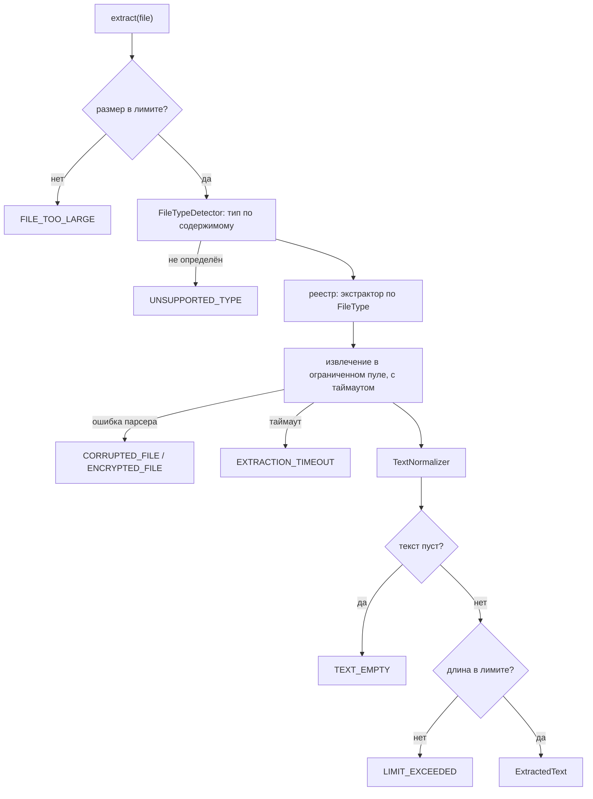

# RFC: модуль извлечения текста из файлов (`text-extraction`)

| | |
|---|---|
| **Статус** | Implemented |
| **Дата** | 2026-11-05 |
| **Контур** | Java, `text-extraction/` |
| **Ветка** | `main` |
| **Модуль** | `text-extraction` |

## 1. Контекст и цель

В проекте текст нужен из файлов двух видов: описание вакансии (сейчас) и резюме (позже). По AGENTS.md файлы читает только Java-контур, а Python-сервис получает уже готовый текст. В README для этого предусмотрен модуль `extraction` (PDFBox, POI).

**Цель RFC:** описать общий модуль, который принимает файл, определяет его формат и возвращает чистый текст. Модуль не знает ничего про вакансии, резюме, БД и хранилища, поэтому его можно использовать в обоих сценариях.

## 2. Границы

**В рамках:**
- форматы: **PDF**, **DOCX**, **TXT**, **MD**;
- определение типа файла по содержимому;
- извлечение, нормализация и проверка результата;
- лимиты, защита от вредоносных файлов, понятные ошибки.

**Вне рамок (сознательно):**
- сохранение файлов и текста в MinIO/S3;
- запись в БД;
- старый формат `.doc`, OCR для сканов, импорт с hh;
- маскировка персональных данных (отдельный модуль `masking`).

HTTP-контроллер и интеграция с `POST /vacancies` и `POST /resumes` живут в
`ats-service`; `text-extraction` остаётся библиотекой без знания о REST.

## 3. Требования

**Функциональные**
1. Вход: имя файла и его содержимое (байты). Выход: текст и метаданные.
2. Тип определяется по содержимому. Имя и `Content-Type` не считаются доверенными.
3. Один тип файла обрабатывает ровно один экстрактор. Добавление формата не требует правки существующих классов.
4. Результат нормализован: единые переводы строк, без управляющих символов и лишних пустых строк.
5. Пустой результат (например, скан без текстового слоя) считается ошибкой `TEXT_EMPTY`.

**Нефункциональные**
1. Размер файла, число страниц PDF, длина текста и время извлечения ограничены.
2. Защита от zip-бомб в DOCX.
3. Содержимое файлов и извлечённый текст не попадают в логи. Имя файла тоже, оно может содержать ФИО.
4. Временные файлы не создаются, работа идёт в памяти.
5. Модуль потокобезопасен и не хранит состояние между вызовами.

## 4. Архитектура

### 4.1. Размещение

Пакет `ats.extraction` по слоям из AGENTS.md. Контроллера пока нет, поэтому слоёв два:

```
ats.extraction
├── TextExtractionConfiguration   # @Import в сервисе-потребителе
├── domain
│   ├── TextExtractionService      # публичная точка входа
│   ├── TextExtractor              # порт: один формат или группа форматов
│   ├── FileTypeDetector           # порт: определение типа
│   ├── TextNormalizer
│   ├── UploadedFile               # вход
│   ├── ExtractedText              # выход
│   ├── RawExtraction              # сырой текст + метаданные экстрактора
│   ├── FileType                   # PDF, DOCX, TEXT, MARKDOWN
│   ├── ExtractionWarning          # предупреждения
│   └── error/                     # исключения домена + ErrorCode
└── infrastructure
    ├── ContentFileTypeDetector    # сигнатуры, ZIP-каталог
    ├── DefaultTextExtractionService
    ├── TextDecoder                # BOM, UTF-8, fallback windows-1251
    ├── PdfTextExtractor           # PDFBox
    ├── DocxExtractor              # Apache POI XWPF
    ├── PlainTextExtractor         # txt и md, только JDK
    └── ExtractionProperties       # настройки (@ConfigurationProperties)
```

Домен не зависит от PDFBox и POI: они подключаются только в `infrastructure`.

### 4.2. Публичный контракт

```java
public interface TextExtractionService {
    ExtractedText extract(UploadedFile file);   // бросает ExtractionException
}

public record UploadedFile(String fileName, byte[] content) {}

public record ExtractedText(
        String text,
        FileType type,
        Integer pageCount,                 // null, если у формата нет страниц
        List<ExtractionWarning> warnings) {}

public interface TextExtractor {
    Set<FileType> supportedTypes();
    RawExtraction extract(byte[] content);  // сырой текст, страницы и предупреждения
}

public record RawExtraction(
        String text,
        Integer pageCount,                 // null, если у формата нет страниц
        List<ExtractionWarning> warnings) {}

public interface FileTypeDetector {
    FileType detect(String fileName, byte[] content);
}
```

`fileName` нужен только как подсказка для различения `.md` и `.txt` и для проверки расхождений (раздел 5). Реализации — `@Component`, реестр экстракторов собирается из `List<TextExtractor>` при старте.

`RawExtraction` — внутренний тип, добавленный к первоначальному наброску RFC: без него нельзя вернуть `pageCount` и предупреждение о кодировке, не привязывая сервис к конкретному парсеру.

### 4.3. Поток обработки



## 5. Определение типа файла

Тип определяется по содержимому. Расширение используется только в двух случаях, описанных ниже.

| Тип | Признак |
|---|---|
| PDF | первые байты `%PDF-` |
| DOCX | сигнатура ZIP (`PK\x03\x04`), а в каталоге архива есть `[Content_Types].xml` и `word/document.xml` |
| TXT / MD | нет нулевых байтов, содержимое декодируется как текст (раздел 6.3) |
| Старый `.doc` | сигнатура OLE2 (`D0 CF 11 E0 A1 B1 1A E1`) → `UNSUPPORTED_TYPE` с подсказкой «сохраните как DOCX» |

**Проверка каталога ZIP.** Имена записей читаются из центрального каталога через `ZipFile` из Commons Compress поверх `SeekableInMemoryByteChannel` (библиотека уже идёт транзитивно с POI). Данные при этом не распаковываются, поэтому проверка безопасна для zip-бомб. Обычный `ZipInputStream` для этого не подходит: при переходе к следующей записи он распаковывает предыдущую.

**Роль расширения:**
1. Среди текстовых файлов `.md` и `.markdown` дают `MARKDOWN`, остальные `TEXT`. Обработка у них одинаковая.
2. Если расширение `.pdf` или `.docx`, а содержимое другое, файл отклоняется (`UNSUPPORTED_TYPE`): скорее всего, он переименован или повреждён. В обратную сторону проверки нет: PDF с расширением `.txt` обрабатывается как PDF.

## 6. Экстракторы

### 6.1. PDF (`PdfTextExtractor`, Apache PDFBox 3.x)
- Загрузка из байтов (`Loader.loadPDF`).
- Файл с паролем на открытие (`InvalidPasswordException`) → `ENCRYPTED_FILE`.
- Число страниц больше `max-pdf-pages` → `LIMIT_EXCEEDED`, до начала извлечения.
- Текст через `PDFTextStripper` с `setSortByPosition(true)`.
- Сканы без текстового слоя дают пустой результат, это `TEXT_EMPTY`.

### 6.2. DOCX (`DocxExtractor`, Apache POI XWPF)
- `XWPFDocument` + `XWPFWordExtractor`: абзацы и таблицы по порядку.
- Защита от zip-бомб: при старте приложения один раз задать `ZipSecureFile.setMinInflateRatio(...)` и `setMaxEntrySize(...)`. Это глобальные настройки POI.
- Колонтитулы, сноски и текстовые поля в MVP не извлекаются.

### 6.3. TXT и MD (`PlainTextExtractor`, только JDK)
Кодировка определяется по порядку:
1. BOM (UTF-8, UTF-16);
2. строгая декодировка UTF-8 (`CharsetDecoder` с `REPORT`);
3. при неудаче windows-1251 с предупреждением `ENCODING_FALLBACK_CP1251` в результате.

Markdown не преобразуется: LLM читает его как есть, парсер разметки не нужен.

## 7. Нормализация (`TextNormalizer`)

1. Удалить BOM.
2. Привести `\r\n` и `\r` к `\n`.
3. Привести к Unicode NFC.
4. Удалить управляющие символы, кроме `\n` и `\t`; неразрывные пробелы заменить обычными, символы нулевой ширины удалить.
5. Убрать пробелы в конце строк.
6. Схлопнуть три и более подряд идущих перевода строки до двух.
7. Обрезать пробелы и переводы строк по краям.

Склейка переносов слов (`раз-\nработка`) в MVP не делается.

## 8. Ошибки

Единая иерархия `ExtractionException` с полем `ErrorCode`. В `ats-service` ошибки маппятся в HTTP-ответы через `ApiExceptionHandler`.

| `ErrorCode` | Когда | HTTP |
|---|---|---|
| `FILE_TOO_LARGE` | размер больше лимита | 413 |
| `UNSUPPORTED_TYPE` | тип не определён, это `.doc` или расширение не совпало с содержимым | 415 |
| `CORRUPTED_FILE` | парсер не смог прочитать файл | 422 |
| `ENCRYPTED_FILE` | PDF с паролем | 422 |
| `TEXT_EMPTY` | после нормализации текст пуст | 422 |
| `LIMIT_EXCEEDED` | слишком много страниц или слишком длинный текст | 422 |
| `EXTRACTION_TIMEOUT` | не уложились во время | 504 |

Результат, превысивший лимит длины, отклоняется, а не обрезается: усечённое описание вакансии даст неполный шаблон навыков, и пользователь этого не заметит.

## 9. Безопасность и лимиты

- **Размер:** проверяется до любой обработки. Позже ту же границу нужно продублировать в настройках multipart контроллера.
- **Время:** извлечение выполняется в ограниченном пуле потоков (`ExecutorService` фиксированного размера) через `Future.get(timeout)`. Оговорка: PDFBox и POI не всегда прерываются по `cancel`, поэтому поток может доработать после таймаута. Границу потерь задаёт размер пула, а при его исчерпании новые запросы получают быструю ошибку.
- **Логи:** только тип, размер, длительность и код ошибки.
- **Данные:** модуль не ходит по сети и не создаёт файлов. Файлы с внешними ссылками (внешние сущности XML, URI) POI не загружает.

## 10. Конфигурация

Префикс `ats.ingestion.extraction`. Числа ниже — стартовые значения, их нужно проверить на реальных файлах.

| Свойство | Значение | Смысл |
|---|---|---|
| `max-file-size` | 10 MB | лимит размера входного файла |
| `max-pdf-pages` | 50 | лимит страниц PDF |
| `max-text-chars` | 200 000 | лимит длины результата |
| `timeout` | 10 s | лимит времени одного извлечения |
| `pool-size` | 4 | число одновременных извлечений |
| `docx.min-inflate-ratio` | задать явно | порог zip-бомбы |
| `docx.max-entry-size` | задать явно | максимальный размер записи после распаковки |

Значения валидируются при старте: приложение не запускается с нулевыми или отрицательными лимитами.

## 11. Тестирование

Фикстуры создаются в коде (DOCX через POI, PDF через PDFBox) или лежат в репозитории как маленькие синтетические файлы. Реальных документов в репозитории быть не должно.

**Детектор:**
- PDF, DOCX, TXT, MD распознаются верно;
- `.exe`, переименованный в `.pdf`, → `UNSUPPORTED_TYPE`;
- XLSX, переименованный в `.docx`, → `UNSUPPORTED_TYPE`;
- `.doc` (OLE2) → `UNSUPPORTED_TYPE`;
- PDF с расширением `.txt` обрабатывается как PDF.

**Экстракторы:**
- PDF: обычный, с кириллицей, без текстового слоя (`TEXT_EMPTY`), с паролем, повреждённый, больше лимита страниц;
- DOCX: абзацы, таблица, повреждённый ZIP, zip-бомба;
- TXT: UTF-8 с BOM и без, windows-1251 (проверка предупреждения), бинарные данные.

**Сервис:**
- нормализация (каждый пункт раздела 7);
- лимит размера, длины, таймаут (экстрактор-заглушка с `Thread.sleep`);
- логи не содержат текста файла.

## 12. План реализации

Каждый шаг — отдельный небольшой PR с тестами.

1. Типы домена: `UploadedFile`, `ExtractedText`, `FileType`, исключения, `ExtractionProperties` с валидацией.
2. `ContentFileTypeDetector` и его тесты.
3. `TextNormalizer` и тесты.
4. `PlainTextExtractor`.
5. `PdfTextExtractor`.
6. `DocxExtractor` и защита от zip-бомб.
7. `TextExtractionService`: лимиты, пул, таймаут, реестр экстракторов.

### 12.1. Статус реализации

- Модуль `text-extraction` — отдельный Gradle-проект, не является исполняемым приложением.
- Реализованы PDF, DOCX, TXT, MD, определение типа по содержимому, нормализация, лимиты, пул и таймаут.
- 45 тестов: детектор, экстракторы, нормализатор, сервис, конфигурация.
- Модуль подключён к `ats-service` через composite build и используется в `POST /vacancies` и `POST /resumes`; HTTP-ошибки маппятся в `ApiExceptionHandler`.
- Кириллический PDF проверен только в тестах DOCX/TXT; для PDF-теста с кириллицей нужен встроенный шрифт, это остаётся в разделе 14.

## 13. Принятые решения и альтернативы

| Решение | Альтернатива | Почему так |
|---|---|---|
| PDFBox + POI | Apache Tika как единый инструмент | В README уже выбраны PDFBox и POI; Tika тяжелее. Для определения DOCX tika-core не подходит без дополнительных модулей |
| Тип по содержимому | Доверять расширению и `Content-Type` | Требование AGENTS.md, оба поля подделываются |
| Вход `byte[]` | `InputStream` | Файлы небольшие и ограничены по размеру; парсерам всё равно нужен произвольный доступ. Для массовой загрузки резюме потребуется пересмотреть |
| Отклонять слишком длинный текст | Обрезать | Тихая потеря данных хуже явной ошибки |
| Только `.docx` | Добавить `.doc` через POI HWPF | Нет в README, нужен отдельный модуль, форматом почти не пользуются |
| MD как текст | Разбирать Markdown и удалять разметку | LLM читает Markdown, лишний парсер не нужен |

## 14. Риски и открытые вопросы

1. **PDF с нестандартными шрифтами** иногда дают текст с ошибочной кодировкой символов. Проверить на реальных вакансиях и резюме; возможная защита — предупреждение, если доля символов U+FFFD или управляющих выше порога.
2. **Значения лимитов** в разделе 10 взяты как стартовые.
3. **Маскировка текста вакансии.** В описании могут быть контакты рекрутёра. Нужно решить, нужна ли маскировка до вызова LLM для вакансий (README однозначно этого не требует).
4. **Протокол при падении после таймаута** (потоки, которые не прервались): достаточно ли ограничения размером пула.
5. **Кириллица в PDF**: для теста нужен встроенный TTF-шрифт; сейчас PDF-тесты используют ASCII.

## 15. Дальнейшая работа

- Сохранение оригинала и текста в MinIO через порт `FileStorage` (уже используется в `ats-service`).
- Использование модуля для резюме и `source = UPLOAD` (уже используется).
- Асинхронная обработка при массовой загрузке.
- OCR для сканов (P2 в README).
- Отдельный тест PDF с кириллицей и встроенным шрифтом.
