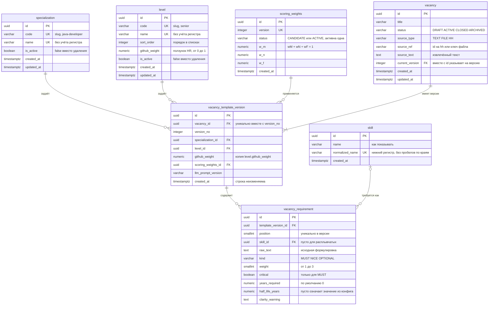

# Модель данных: вакансии, специализации, уровни, навыки

Схема соответствует миграции `migrations/changes/001-vacancy-schema.sql` (MVP).
Корневой changelog Liquibase — `migrations/db.changelog-master.xml`; его накатывает не
приложение, а отдельная джоба `migrations` из корневого `compose.yaml` (см. `migrations/Dockerfile`).

## ER-диаграмма

## Как читать

- **`scoring_weights`** — веса итогового балла `Score = 100·(wM·M + wN·N + wF·F)`. В MVP одна активная строка 0.70 / 0.15 / 0.15. Новые веса — новая версия. Таблицей владеет Java, в Python-сервис значения передаются в gRPC-запросе.
- **`level.github_weight`** — λ, вес внешних доказательств (GitHub). HR выставляет ползунком при создании уровня. Это единственная связь уровня с весами.
- **Справочники** `specialization`, `level`, `skill` открыты для добавления. Удалить строку, на которую есть ссылки, нельзя, её отключают через `is_active`.
- **Версия шаблона** фиксирует специализацию, уровень, вес GitHub и ссылку на веса балла. Когда HR меняет веса требований, создаётся новая версия, старая не меняется (защищено триггером).
- **Текущая версия** вакансии задаётся парой `vacancy.id` + `vacancy.current_version` (составной внешний ключ, проверяется в конце транзакции).

## Ограничения целостности

| Таблица | Ограничение |
|---|---|
| `scoring_weights` | `wM + wN + wF = 1`; одновременно активна только одна запись |
| `level` | `github_weight` от 0 до 1 |
| `vacancy_requirement` | `kind` только `MUST`, `NICE`, `OPTIONAL`; `weight` от 1 до 3 |
| `vacancy_requirement` | нужен либо `skill_id`, либо непустой `raw_text` |
| `vacancy_requirement` | `critical = true` только при `kind = MUST` |
| `vacancy_requirement` | навык не повторяется в одной версии, `position` уникален в версии |
| все ссылки на справочники | `ON DELETE RESTRICT`, физически удалить используемую строку нельзя |
| `vacancy` → версии → требования | `ON DELETE CASCADE` |
