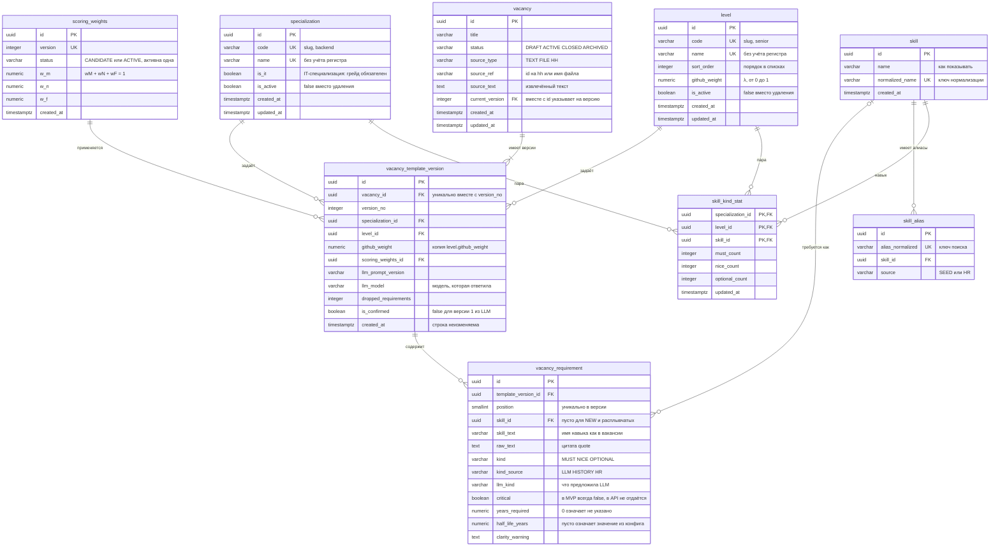

# Модель данных: вакансии, специализации, уровни, навыки

Схема соответствует Liquibase-миграциям `migrations/changes/001-vacancy-schema.sql`,
`009-requirement-skills-and-kinds.sql`, `010-skill-alias-and-seed.sql`,
`011-skill-kind-stat.sql`, `012-seed-specializations.sql`, `013-optional-level.sql`,
`014-seed-more-skills.sql` и `015-specialization-it.sql`.
Корневой changelog Liquibase — `migrations/db.changelog-master.xml`; его накатывает не
приложение, а отдельная джоба `migrations` из корневого `compose.yaml` (см. `migrations/Dockerfile`).

## ER-диаграмма

## Как читать

- **Тип требования** (`kind`) — единственная разметка навыка в MVP: `MUST`, `NICE`
  или `OPTIONAL`. Весов, процентов и `critical` в API и UI нет. Числовую важность и
  обработку `OPTIONAL` определяет `scoring-service` по своим правилам.
- **`kind_source`** показывает, откуда взят итоговый тип: `LLM` — модель, `HISTORY` —
  подсказка из `skill_kind_stat`, `HR` — человек изменил или добавил требование.
  **`llm_kind`** хранит исходное предложение модели и нужен, чтобы показать HR
  расхождение с историей.
- **`skill_text`** нужен для `NEW`-навыка до сохранения шаблона: `skill_id` появится
  только при сохранении. `raw_text` — это цитата из вакансии (`quote` в API).
- **`skill_alias`** — словарь синонимов. Каноническое имя навыка тоже лежит алиасом
  к самому себе, поэтому поиск всегда идёт в одной таблице. В MVP сравнение точное,
  без нечёткого поиска и эмбеддингов.
- **`skill_kind_stat`** — память расстановки HR по паре «специализация × уровень».
  Счётчики меняются только при сохранении шаблона (`PUT`) атомарным upsert.
  Создание черновика статистику не меняет.
- **`scoring_weights`** — веса итогового балла `Score = 100·(wM·M + wN·N + wF·F)`.
  Версия шаблона по-прежнему ссылается на активную запись, но в API и UI эти поля
  не показываются.
- **Версия шаблона** фиксирует специализацию, уровень, вес GitHub и ссылку на веса
  балла. Версия 1 приходит из LLM (`is_confirmed = false`), версии из `PUT`
  подтверждены (`is_confirmed = true`). Правка требований создаёт новую версию,
  старые строки защищены триггером от `UPDATE`.
- **Текущая версия** вакансии задаётся парой `vacancy.id` + `vacancy.current_version`
  (составной внешний ключ, проверяется в конце транзакции).

## Ограничения целостности

| Таблица | Ограничение |
|---|---|
| `scoring_weights` | `wM + wN + wF = 1`; одновременно активна только одна запись |
| `level` | `github_weight` от 0 до 1 |
| `vacancy_requirement` | `kind` только `MUST`, `NICE`, `OPTIONAL` |
| `vacancy_requirement` | `kind_source` только `LLM`, `HISTORY`, `HR`; `llm_kind` — те же три значения или `NULL` |
| `vacancy_requirement` | нужен либо `skill_id`, либо непустой `skill_text`, либо непустой `raw_text` |
| `vacancy_requirement` | навык не повторяется в одной версии, `position` уникален в версии |
| `vacancy_requirement` | `critical = true` только при `kind = MUST`; в MVP не выставляется |
| `skill_alias` | `alias_normalized` уникален; `source` только `SEED` или `HR` |
| `skill_kind_stat` | счётчики неотрицательны; ключ `(specialization_id, level_id, skill_id)` |
| все ссылки на справочники | `ON DELETE RESTRICT`, физически удалить используемую строку нельзя |
| `vacancy` → версии → требования | `ON DELETE CASCADE` |

## Уровень «Без уровня»

Признак `specialization.is_it` определяет, запрашивается ли грейд:

- для IT-специализации (`is_it = true`) уровень обязателен в `POST /api/v1/vacancies`;
  без него API отвечает `422 LEVEL_REQUIRED`, значение `none` не принимается;
- для не-IT специализации (`is_it = false`) грейда нет: переданный уровень
  игнорируется, а в `vacancy_template_version.level_id` подставляется скрытая запись
  `code = 'none'`, `name = 'Без уровня'`, `is_active = false`.

Скрытый уровень не попадает в `GET /levels`, но используется в
`vacancy_template_version.level_id` и в ключе `skill_kind_stat`, если уровень не указан.
История типов для таких вакансий изолирована от `junior/middle/senior`.

## Отличия от прежней схемы

- Колонка `vacancy_requirement.weight` и ограничение `ck_requirement_weight` удалены.
- `vacancy_requirement.raw_text` теперь используется как цитата (`quote`).
- `vacancy_template_version` получила `is_confirmed`, `llm_model`,
  `dropped_requirements`.
- `WEIGHT_OBSERVATION` из README и `docs/` этой фичей не используется; история
  типов хранится в `skill_kind_stat`.
